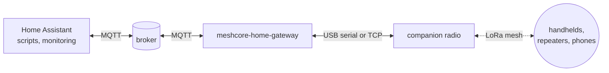

# meshcore-home-gateway

[](https://github.com/dkuenzel/meshcore-home-gateway/actions/workflows/ci.yml)
[](LICENSE)

A small, dependable gateway between home automation and a
[MeshCore](https://github.com/meshcore-dev/MeshCore) LoRa mesh: alerts go out, commands come back.
It connects a MeshCore companion radio to an MQTT broker. Automations publish a text and the
gateway sends it over the mesh; messages the radio receives come back as MQTT events, and direct
messages from allowlisted contacts can trigger commands. Home Assistant picks everything up through
MQTT discovery, without custom code.



## Features

- **Send** to configured channels and contacts: `mosquitto_pub -t meshcore/radio1/send/alerts -m "Gate open"`.
- **Delivery state** for every message: queued, sent, confirmed (with round-trip time), failed,
  expired, duplicate, rejected — with the reason.
- **Reliable direct messages:** acknowledgement tracking, retries with the radio's attempt counter,
  path reset to flood after unanswered attempts, as the official clients do.
- **Respectful of the shared channel:** an airtime budget computed from the radio's own modulation
  settings, duplicate suppression ("one alert per cause"), a bounded queue with expiry.
- **Receive** every message as JSON, with sender, channel, SNR and hop count; retries of a sender
  are deduplicated.
- **Commands** only from direct messages of allowlisted contacts (bound to their full public key),
  with replay protection; channel messages never command.
- **Home Assistant:** one device with radio link, battery and airtime sensors, event entities for
  messages, deliveries and commands, and a notify entity per target.
- **Small supply chain:** Python standard library plus `paho-mqtt` from the Linux distribution; no
  other runtime dependency.
- **One-step installation on Proxmox VE** in an unprivileged container, configured through dialogs
  that read the radio's channels and contacts.
- **Operations:** systemd notify and watchdog, sandboxed service, retained state document, journal
  logs without message texts at info level.

## Status

Version 0.x, alpha. Developed against MeshCore companion firmware 1.18.0 (protocol version 3) and
Home Assistant 2026.10. The MQTT API, the configuration format and the command line may still
change between minor versions; see [`CHANGELOG.md`](CHANGELOG.md).

## Quick start

### Proxmox VE

On the Proxmox host (Proxmox VE 9, or 8 with current updates), as root:

```sh
git clone https://github.com/dkuenzel/meshcore-home-gateway.git && cd meshcore-home-gateway
./deploy/proxmox/meshcore-home-gateway-lxc.sh
```

In the default setup the script asks only for the radio (USB serial device or TCP address) and the
broker; the advanced setup also asks for the container and topic settings. After a confirmation it
creates an unprivileged Debian 13 container, passes the radio through, installs the service, reads
the radio's channels and contacts so you can pick targets and command senders, and starts it.
`--reconfigure` and `--update` keep the configuration. Details and the manual equivalent:
[`docs/deployment.md`](docs/deployment.md).

### Any systemd-based Linux

As root, in a clone of this repository:

```sh
apt install python3 python3-paho-mqtt            # Debian 13 or newer
install -d /usr/local/lib/meshcore-home-gateway
python3 tools/build_pyz.py --interpreter '/usr/bin/python3 -I' \
  --output /usr/local/lib/meshcore-home-gateway/meshcore-home-gateway-0.1.0.pyz
ln -sfn meshcore-home-gateway-0.1.0.pyz /usr/local/lib/meshcore-home-gateway/current.pyz
ln -sfn /usr/local/lib/meshcore-home-gateway/current.pyz /usr/local/bin/meshcore-home-gateway
useradd --system --user-group --groups dialout --no-create-home --home-dir /nonexistent \
  --shell /usr/sbin/nologin meshcore-home-gateway
install -D -m 0640 -g meshcore-home-gateway deploy/config.example.toml \
  /etc/meshcore-home-gateway/config.toml
install -m 0644 deploy/systemd/meshcore-home-gateway.service /etc/systemd/system/
editor /etc/meshcore-home-gateway/config.toml && meshcore-home-gateway check-config
systemctl daemon-reload && systemctl enable --now meshcore-home-gateway
```

`meshcore-home-gateway probe --serial <device>` lists the radio's channels and contacts for the
configuration. The same steps with explanations: [`docs/deployment.md`](docs/deployment.md),
section 3.

## Using it

```sh
# send (UTF-8 text to a configured target alias)
mosquitto_pub -h broker -t meshcore/radio1/send/alerts -m "Water pump stopped"
meshcore-home-gateway send --wait 30 operator "Back online"        # waits for the delivery result

# listen
mosquitto_sub -h broker -t 'meshcore/radio1/#' -v
meshcore-home-gateway listen --topic received
```

In Home Assistant, call `notify.send_message` on the entity *Send to alerts*, and trigger
automations on the event entities *Message*, *Command* and *Delivery*. Examples:
[`docs/home-assistant.md`](docs/home-assistant.md).

## Documentation

| Document | Content |
| --- | --- |
| [`docs/design.md`](docs/design.md) | Design: goals, architecture, interfaces, security, failure modes, testing |
| [`docs/decisions/`](docs/decisions/README.md) | Architecture decision records |
| [`docs/mqtt-api.md`](docs/mqtt-api.md) | Topics and payloads |
| [`docs/home-assistant.md`](docs/home-assistant.md) | Entities, discovery, example automations |
| [`docs/configuration.md`](docs/configuration.md) | Every setting with default and meaning |
| [`docs/deployment.md`](docs/deployment.md) | Proxmox installer, manual installation, updates, operations |
| [`docs/protocol.md`](docs/protocol.md) | The companion protocol subset, with firmware sources |
| [`docs/testing.md`](docs/testing.md) | Test suites and the hardware checklist |
| [`docs/development.md`](docs/development.md) | Development workflow and releases |

## Security

The bridge can make a radio transmit and can trigger home automation, so it is strict by default:
only configured targets, an airtime budget, commands only from allowlisted full public keys with
replay protection, retained send requests ignored, nothing executed by the bridge itself. Secure
the broker (authentication, topic ACLs). Prefer USB over the unauthenticated TCP companion
interface. Details: [`docs/design.md#7-security`](docs/design.md#7-security) and
[`SECURITY.md`](SECURITY.md).

Radio regulation is your responsibility. In the EU band 869.40–869.65 MHz a device may transmit
at most 10 % of the time; the bridge's default budget uses 1 %, but the radio's own limit is a
separate setting on the radio.

## Development

```sh
make venv hooks   # tools from the hash-pinned lock file, pre-push hook
make check        # what CI runs: ruff, mypy --strict, shellcheck, zizmor, tests, build, unit check
make matrix       # the tests with every installed Python from 3.11 to 3.14, like the CI matrix
```

Test-driven, with an emulated radio and a real `mosquitto` in the tests. Contributions are
welcome: see [`CONTRIBUTING.md`](CONTRIBUTING.md), [`docs/development.md`](docs/development.md) and
the [code of conduct](CODE_OF_CONDUCT.md). Bugs and ideas go to the
[issue tracker](https://github.com/dkuenzel/meshcore-home-gateway/issues), security problems to
the private form described in [`SECURITY.md`](SECURITY.md).

## License

MIT, see [`LICENSE`](LICENSE). MeshCore is a separate project by its authors, also MIT-licensed;
this project is not affiliated with it.
