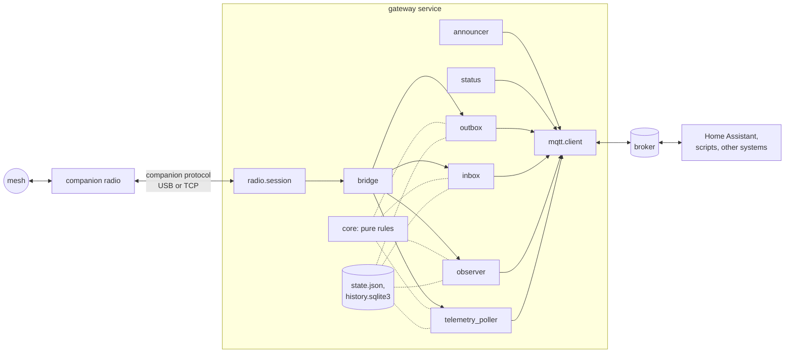

# Architecture

The short way in: what the gateway is made of, how a message travels, what runs, what is kept,
and where to look for what. The [design](design.md) has the reasons and the detail, the
[records](decisions/README.md) the decisions, the [threat model](threat-model.md) the trust.

## What it is

One Python service between a MeshCore companion radio (USB or TCP) and an MQTT broker. It sends
the household's alerts over the mesh, publishes what the radio receives and hears, judges
commands from allowlisted senders, asks the household's companions for telemetry, and announces
all of it to Home Assistant through MQTT discovery. It executes nothing itself; automations act
on its events. Its only runtime dependency is paho-mqtt.

The layers ([design §5.1](design.md#51-ports-and-adapters),
[ADR 0007](decisions/0007-hexagonal-architecture-with-an-asyncio-core.md)): `core` and `protocol`
are pure (no I/O, an injected clock); the application (`bridge`, `outbox`, `inbox`, `announcer`,
`status`, `observer`, `telemetry_poller`, `contact_manager`) asks the radio and the bus through
`ports`; the adapters (`radio`, `mqtt.client`, `state`, `history`, `systemd`) do the I/O; `wiring`
puts them together.

## How a message travels

**Out:** a client publishes text to `send/<alias>` (or `contacts/<key>/send`) → `mqtt.client`
hands it to the event loop as a request → `outbox` checks the target, cleans the text, drops a
duplicate and queues it (`queued`) → one message at a time, within the airtime budget, it goes to
the radio (`sent`) → the radio's acknowledgement makes it `confirmed`, or the retries end in
`failed`; a message that waited too long `expired`. Every step is a `delivery` event
([design §6.2](design.md#62-outbound-path)).

**In:** the radio pushes that a message waits → the session fetches it → `inbox` drops copies,
judges a command ([design §7.3](design.md#73-command-authorisation-in-detail)) and publishes
`received`, and for an accepted command `command` → `observer` writes the history and updates the
documents ([design-observer.md](design-observer.md)).

**Around them:** the radio's table reads, adverts and statistics reach the `observer`, which
publishes the documents (`contacts`, `nodes`, `stats`, `history`); `telemetry_poller` asks one
companion at a time when no message is due ([design-telemetry.md](design-telemetry.md));
`contact_manager` adds and removes contacts on request; `announcer` keeps Home Assistant's
devices current ([design-home-assistant.md](design-home-assistant.md)); `status` publishes the
`state` document with its health section.

## What runs

One asyncio event loop runs everything but paho's network thread, which hands each message to the
loop and nothing else ([design §5.2](design.md#52-concurrency)). The tasks: the radio supervisor
(connect, reconnect with back-off), the outbox worker, the radio's events, the message handler,
the request reader, the status reporter (also the watchdog and the state file), the telemetry
poller and the lag probe; each radio session adds a reader and a maintenance task. The queues: the
bus's send requests and contact requests, the outgoing queue of the outbox (alerts first), the
contact manager's work.

## The interfaces

| Interface | Where | Kept by |
| --- | --- | --- |
| MQTT topics and payloads | [mqtt-api.md](mqtt-api.md) | the [snapshot](decisions/0023-public-interfaces-kept-by-a-snapshot.md) |
| Home Assistant entities | [home-assistant.md](home-assistant.md) | the snapshot, the contract tests |
| Configuration | [configuration.md](configuration.md) | the snapshot |
| Command line | [design §6.9](design.md#69-command-line) | the snapshot |

Events (not retained): `delivery`, `received`, `command`, `contact`, `node`, `telemetry`,
`setting`, `rx`. Documents (retained): `availability`, `state`, `stats`, `contacts` and
`contacts/<key>`, `nodes`, `history`, `settings`.

## What is kept

| Where | What | Detail |
| --- | --- | --- |
| `state.json` | the command ledger, Home Assistant's components, the kept documents and advert checks, the telemetry schedule, the radio profile's memory, the budget's level, the queue at a stop | one store, written atomically ([design §5.2](design.md#52-concurrency)) |
| `telemetry-excluded.json` | the household's telemetry marks | [ADR 0029](decisions/0029-what-a-contact-is-trusted-with.md) |
| `history.sqlite3` | messages, positions, readings, nodes heard | [ADR 0016](decisions/0016-history-in-a-local-sqlite-database.md) |
| the broker | the retained documents | the gateway restores them when others write there |
| the radio | its key, contacts, channels, settings, clock | the managed profile ([ADR 0020](decisions/0020-managed-radio-profile-for-the-observer.md)) |

What each holds and for how long: [privacy.md](privacy.md); backing them up:
[deployment.md](deployment.md#4-operations).

## Where is …

| Looking for | Code | Document |
| --- | --- | --- |
| how a message is sent, retried, confirmed | `outbox.py`, `core/budget.py`, `core/text.py` | [design §6.2](design.md#62-outbound-path) |
| how a command is judged | `core/commands.py`, `inbox.py` | [design §7.3](design.md#73-command-authorisation-in-detail) |
| the companion protocol | `protocol/`, `radio/session.py` | [protocol.md](protocol.md) |
| the topics and payloads | `mqtt/topics.py`, `mqtt/payloads.py`, `views.py` | [mqtt-api.md](mqtt-api.md) |
| Home Assistant discovery | `announcer.py`, `mqtt/discovery.py`, `mqtt/contact_devices.py` | [design-home-assistant.md](design-home-assistant.md) |
| telemetry | `core/telemetry.py`, `telemetry_poller.py`, `core/lpp.py` | [design-telemetry.md](design-telemetry.md) |
| the documents and the history | `observer.py`, `core/mesh.py`, `history.py` | [design-observer.md](design-observer.md) |
| adding and removing contacts | `contact_manager.py`, `protocol/links.py` | [mqtt-api.md](mqtt-api.md#managing-contacts-add_contact-and-contactskeyremove) |
| the radio's settings | `core/profile.py`, `radio/profile.py` | [ADR 0020](decisions/0020-managed-radio-profile-for-the-observer.md) |
| who hears of what | `wiring.py` (its docstring) | [design §5.1](design.md#51-ports-and-adapters) |
| the configuration | `config.py`, `config_checks.py` | [configuration.md](configuration.md) |
| the command line | `cli/` | [design §6.9](design.md#69-command-line) |
| translations | `i18n.py`, `catalog.py`, `locale/` | [design §6.12](design.md#612-translations) |
| the installer and the unit | `deploy/` | [deployment.md](deployment.md) |
| what can fail and how it shows | `health.py`, `status.py` | [design §8](design.md#8-reliability-and-failure-modes) |
| the tests | `tests/` | [testing.md](testing.md) |
