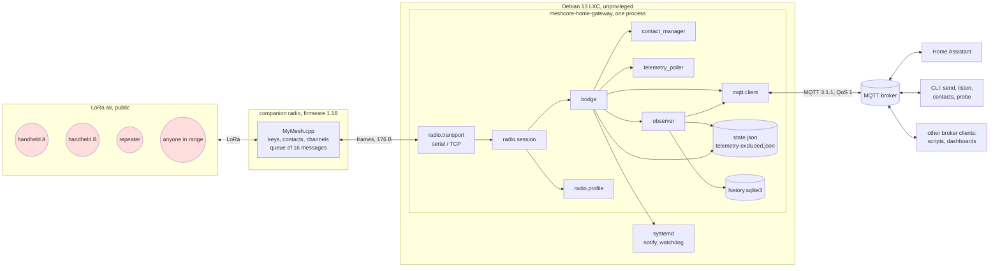

# 01 The system as the reviewer models it

This is the reviewer's own model of meshcore-home-gateway, built from the code first and the
documents second, so that the review judges the program and not its description. Where the model
and the documents differ, the difference is a finding (`06-documentation-review.md`). Section
numbers of the design document are cited as `design §n`.

## 1 One sentence

A single asyncio process holds one MeshCore companion radio over a byte link, turns everything the
radio tells it into retained JSON documents and events on an MQTT broker, turns a few MQTT topics
into actions on the radio (send a text, add or remove a contact, ask for telemetry, write a
setting), and describes all of it to Home Assistant through MQTT discovery so that Home Assistant
needs no code of its own.

## 2 The parts



| Part | Module(s) | Runs where | Holds |
| --- | --- | --- | --- |
| Transport | `radio/transport.py` | event loop (`add_reader`) | the file descriptor or TCP streams |
| Session | `radio/session.py` | two tasks per connection (reader, maintenance) | the frame decoder, one pending command, the contact records as last read, the channels, the battery and statistics, frame and command counters |
| Radio profile | `radio/profile.py`, `core/profile.py` | inside the session's start | the three-way reconcile memory per radio key |
| Bridge | `bridge.py` | eight tasks in a task group | the outgoing queue, the airtime budget, the deduplicators, the look-alike memory, the ack waiter, the announcement state |
| Contact manager | `contact_manager.py` | one worker task plus synchronous acceptance | a job queue of 8, three rate limits |
| Telemetry poller | `telemetry_poller.py`, `core/telemetry.py` | one task | the schedule, the lanes, the answer waiter, held answers |
| Observer | `observer.py`, `core/mesh.py`, `core/adverts.py`, `views.py` | synchronous, called by the bridge | the mesh view (contacts, 50 heard nodes), the published payloads per topic, pending advert checks, the recent-message deque |
| MQTT adapter | `mqtt/client.py` | paho's network thread; callbacks hop to the loop | the paho client, the request queues, a counter of queued events |
| Home Assistant adapters | `mqtt/discovery.py`, `mqtt/contact_devices.py`, `mqtt/manage_entities.py` | synchronous | announced components and devices, slugs, echoes |
| State | `state.py` | synchronous file I/O on the loop | `state.json` (nine keys owned by nine classes) and `telemetry-excluded.json` |
| History | `history.py` | synchronous SQLite on the loop | four tables, WAL |
| Command line | `cli.py` | separate processes | nothing persistent except `config render` output |
| Dashboard generator | `dashboard.py`, `dashboard.yaml` | a CLI process | reads `state.json` read-only |
| Translations | `i18n.py`, `catalog.py`, `texts.py`, `locale/*.po` | in-process | compiled catalogs |

## 3 Inputs: every place where data enters

This list is the basis of the threat model (`02-…`). Each entry names the parser or validator
that stands at the entry.

| # | Entry | Who can write there | What arrives | First code that reads it |
| --- | --- | --- | --- | --- |
| I1 | LoRa air → radio | anyone with a MeshCore radio in range (or an SDR) | adverts (signed), direct messages (encrypted to the radio), channel messages (encrypted with a shared secret, public for public channels), acknowledgements (clear), path packets, telemetry requests and answers, raw packets | the firmware; the gateway sees the result as frames |
| I2 | Radio → gateway (frames) | the radio; over TCP anyone who can reach port 5000 or spoof the radio's address | response and push frames of at most 176 bytes | `protocol/framing.FrameDecoder`, `protocol/codec.decode`, `codec.decode_message` |
| I3 | Packet log (`LOG_RX_DATA`) | every packet the radio hears, before it checks any signature | raw on-air packets | `protocol/packet.parse_packet`, `parse_advert` |
| I4 | `send/<alias>`, `contacts/<key>/send` | broker clients allowed by the ACL | up to 1 KiB of UTF-8 | `bridge._validate`, `core/text.prepare_text` |
| I5 | `add_contact`, `homeassistant/add_node` | broker clients allowed by the ACL; every Home Assistant user through the select and the text | text or JSON envelope; a key, link, card or label | `contact_manager._checked`, `protocol/links.parse_contact_text`, `core/contacts.key_from_label` |
| I6 | `contacts/<key>/remove` | the same | any payload or JSON `{"id"}`; the key from the topic | `contact_manager._checked` |
| I7 | `contacts/<key>/telemetry` | the same; every Home Assistant user through the switch | `on`, `off` or JSON | `contact_manager._telemetry_checked` |
| I8 | `homeassistant/show_hidden` | the same; every Home Assistant user through the button | any payload | `mqtt/client._ha_message` |
| I9 | `homeassistant/status` | whoever may write there (Home Assistant's user) | `online` / `offline` | `mqtt/client._handle_message` |
| I10 | The gateway's own discovery topics (`<prefix>/device/<gw>/…/config`) | Home Assistant's user (it clears them), the gateway itself | empty retained messages, or anything | `bridge._ha_device_message`, `contact_devices.discovery_message` |
| I11 | `config.toml` | root | TOML | `config.parse_config` (strict: unknown keys refused) |
| I12 | `state.json`, `telemetry-excluded.json` | the service user; root; a restored backup | JSON | `state.py` (each class validates its own key) |
| I13 | `history.sqlite3` | the service user | SQLite | `history._connect` |
| I14 | Installer answers (`--answers FILE`, dialogs) | root on the Proxmox host | `key=value` lines | the script's `load_answers`, then `config.render_config` |
| I15 | The installer script itself | whoever controls the download address (GitHub releases, `main`) | bash | the host's bash, as root |
| I16 | Language packs of the installer | the same addresses | `msg<TAB>KEY<TAB>TEXT` | `load_messages`, after a SHA-256 check against a digest in the script |
| I17 | Environment variables | the service manager, the operator's shell | `NOTIFY_SOCKET`, `WATCHDOG_USEC`, `STATE_DIRECTORY`, `JOURNAL_STREAM`, `LANGUAGE` and friends | `systemd.py`, `cli.py`, `i18n.py` |
| I18 | Command line arguments | the operator | paths, aliases, texts, keys, labels, links | `argparse`, then the handlers |
| I19 | PO catalogs | contributors (through pull requests) | gettext PO | `catalog.py` |
| I20 | The dashboard template | contributors | YAML with markers | `dashboard.render` |

## 4 Outputs: every place where data leaves

| # | Exit | Who can read there | What leaves | Sensitivity |
| --- | --- | --- | --- | --- |
| O1 | Gateway → radio (frames) | the radio; over TCP anyone on the path | commands: texts to send, contact writes, setting writes, telemetry requests, path resets | the message texts (plain on the wire to the radio), the contact table writes |
| O2 | Radio → air | everyone in range | what the radio transmits for the gateway: messages (encrypted), acknowledgements (clear), telemetry requests (encrypted), path packets, adverts (signed, with the radio's name and optionally its position) | the gateway's identity and name; its traffic pattern |
| O3 | `received`, `contacts/<key>/received`, `history` | broker clients with read access; Home Assistant and everyone who can open Home Assistant | message texts, sender keys and names, SNR, hops | household messages; who talks to whom |
| O4 | `command` | the same | accepted command, args, sender key | what the household's automations react to |
| O5 | `contacts/<key>` (retained) | the same | position, battery, readings, path, flags, times heard | **where the household's people are**, persisted on the broker |
| O6 | `nodes`, `node` | the same | keys and names of strangers heard, their signal | the neighbourhood's radios |
| O7 | `state`, `stats`, `settings` | the same | the radio's key, name, settings, counters; the gateway version | fingerprint of the installation |
| O8 | `rx` (opt-in) | the same | every raw packet heard, hex | everything on the air, including others' ciphertext and adverts with positions |
| O9 | Home Assistant discovery documents | the same | entity definitions with Jinja templates | the shape of the household's automation surface |
| O10 | Home Assistant recorder | Home Assistant users; the HA database | the attributes of the event entities (texts, keys), tracker states (positions), readings | long-term history of movements and messages |
| O11 | The journal | root in the container; the host's journal if forwarded | names (repr'd), keys (12 digits), reasons; texts only at debug | low at info level |
| O12 | `history.sqlite3` | the service user, root | messages, positions, readings, nodes heard | the same as O3, O5, O6, on disk |
| O13 | `state.json` | the same | command timestamps, the last document of each current companion (with its position), slugs, the schedule | positions on disk |
| O14 | `config answers` output, installer answers | the operator's terminal, the container's `/root` during installation | the broker password | the credential |
| O15 | The generated dashboard | whoever gets the file | the contacts' tracker IDs, which are made of their names | names of the household |

## 5 The flows that matter most

### 5.1 An outgoing text

```text
broker client → send/<alias> ──paho thread──► loop: requests queue
  → _accept: retained? size ≤ 1 KiB? UTF-8? alias known (configured) or key of a chat contact?
    prepare_text (NFC, strip controls and direction marks, collapse spaces, transliterate,
    limit 160 B or 158−name) → dedup (alias, text) within 300 s → queue of 20 (or reject)
  → delivery: queued
  → outbox worker: wait for the radio (≤ queue_ttl_s) → re-read contacts if the radio reported
    a change → resolve the prefix to exactly the configured key → estimate airtime → wait for
    the token bucket → reset the path at attempt flood_after → SEND_TXT_MSG / SEND_CHANNEL_TXT_MSG
  → delivery: sent → wait for SEND_CONFIRMED whose 4-byte code matches → delivery: confirmed
    (or retry with the same timestamp and attempt+1, up to max_attempts → failed)
  → observer: history row, history document
```

The timestamp of the message is the gateway's wall clock. The acknowledgement code the gateway
waits for is `SHA256(timestamp ‖ attempt&3 ‖ text ‖ radio's public key)[:4]`, computed by the
radio and returned in `SENT`; the recipient computes the same and sends it in the clear.

### 5.2 An incoming message and the command decision

```text
radio pushes MSG_WAITING → maintenance task → SYNC_NEXT_MESSAGE until NO_MORE_MESSAGES
  → decode (legacy or v3 layout; text UTF-8 with replacement) → MessageReceived(fetched_at,
    at_connect) → events queue → messages queue (in order)
  → _on_message: ignored channel? exact repeat (kind, origin, sender timestamp, text) within
    max(1 h, 2·max_age_s + 60 s)? → _judge:
      first word in commands.words? (direct, plain only)
      cached table: ambiguous / not allowed / replay / too old / future → final rejection
      fetched at connect → sender_unverified
      else refresh_contacts(newer_than=fetched_at) → evaluate again:
        prefix resolves to exactly one contact AND no other remembered key shares the prefix
        AND full key in commands.senders AND timestamp > last accepted AND within max_age_s
  → accepted: ledger.record (state.json, fsync) → broker connected? → publish command (QoS 0)
  → always: publish received (QoS 1), contacts/<key>/received, observer.message (history)
```

### 5.3 Contact management

```text
add_contact / homeassistant/add_node / contacts/<key>/remove
  → accept (synchronous): size, UTF-8, JSON envelope, retained, parse (key | link | card |
    label), manage on?, own key?, protected? → job queue of 8
  → worker: radio connected? tested firmware? work token (10 then 1/min)? refresh table →
    add_refusal (own key, type, already, look-alike of table ∪ protected, table full) →
    ADD_UPDATE_CONTACT (name cleaned to 31 B, flags 0, no path, no position, advert time of the
    heard advert or 0) / REMOVE_CONTACT → refresh table → added/removed or failed
```

### 5.4 Telemetry

```text
poller step: candidates = chat contacts not excluded, prefix unique in table ∪ own key, radio
  not auto-adding; schedule says whom (direct if a path is stored; flood only if heard within 30
  min, ≤ 4 floods/h); lanes (18 s/h own, 90 s/h mesh) have room; outbox quiet 10 s
  → SEND_TELEMETRY_REQ(key) → SENT(route, timeout) → wait max(5 s, 1.25·timeout)
  → TELEMETRY_RESPONSE(prefix, LPP) → taken only if prefix == asked contact's prefix (frame
    order against SENT) → lpp.decode (total) → observer.telemetry: position (if moved ≥ 20 m),
    readings → history, contacts/<key>, contact device components
```

### 5.5 Home Assistant

```text
connect / birth message / radio identity change → discovery document (not retained) for the
gateway's device (placeholders for removed components first) → manage_contacts document (select
options = labels of ≤ 20 heard nodes) → one document per contact device (≤ 50; placeholders then
empty document for removals) → state, stats, contacts, nodes documents retained → entities read
them with Jinja value_templates
Home Assistant → the gateway: notify entities publish to send/…, the select publishes a label to
homeassistant/add_node, the text publishes to add_contact, buttons to contacts/<key>/remove and
homeassistant/show_hidden, switches to contacts/<key>/telemetry; Home Assistant clears a device's
discovery topic when it removes a disabled entity or the user deletes the device
```

## 6 Trust boundaries as the reviewer draws them

The project draws one chain (design §7.1). The reviewer draws seven boundaries, because the
attacker roles at each differ:

| Boundary | Between | Crossing | Who stands outside |
| --- | --- | --- | --- |
| B1 | the air and the radio firmware | packets | anyone in radio range, including anyone who can buy a 20 € board; signatures (Ed25519) and encryption (AES-128, ECB per the packet format with a 2-byte MAC) are the firmware's |
| B2 | the radio and the gateway | frames over USB or TCP | over USB: whoever can open the device node (root, `dialout`, the container); over TCP: anyone on the radio's network, with no authentication in either direction and the private key exportable by default |
| B3 | the gateway and the broker | MQTT, plain by default | every other broker client, under the broker's ACL if one exists; the network between them if TLS is off |
| B4 | the broker and Home Assistant | MQTT | Home Assistant's broker user; whatever else shares that user |
| B5 | Home Assistant and its users | the web UI, the companion app | every Home Assistant user, administrator or not: all can press the gateway's buttons, switches, selects and texts, see every entity, and read the attributes |
| B6 | the service and the container | files, the device node, systemd | the service user vs root in the container vs the Proxmox host |
| B7 | the project and its users | releases, the installer, the documentation | GitHub, the Actions runners, the development dependencies, the maintainer's account, the AI agent that writes most commits |

The security findings are organised by these boundaries.

## 7 State on disk and in memory

| Where | Owner class | Content | Bound |
| --- | --- | --- | --- |
| `state.json` → `command_timestamps` | `CommandLedger` | newest accepted timestamp per sender key | number of configured senders |
| `state.json` → `ha_components`, `ha_removed`, `…_manage_contacts` | `AnnouncedComponents` | components of the discovery documents, pending removals (30 days) | fixed |
| `state.json` → `ha_contact_devices` | `ContactDeviceRecords` | announced devices (slug + components), pending removals, hidden keys, **slugs of every contact that ever had a device** | slugs: unbounded |
| `state.json` → `retained_contacts` | `RetainedKeys` | keys of published contact documents | table size |
| `state.json` → `current_contacts` | `CurrentDocuments` | the last document (with position and readings) of each companion whose answers are current | table size; each document ≈ 1–2 KiB |
| `state.json` → `advert_checks` | `AdvertChecks` | per companion: time and flag of the last checked advert | table size |
| `state.json` → `radio_profile` | `ProfileRecords` | per radio key: applied values, attempts, unsupported | number of radios ever connected (unbounded in theory) |
| `state.json` → `telemetry` | `TelemetryRecords` | the schedule per contact, floods, debts, the first-start hold | table size plus parked contacts for a day |
| `telemetry-excluded.json` | `TelemetryExclusions` | up to 1024 keys | 1024 |
| `history.sqlite3` → `message` | `History` | texts in and out | 30 days or 10,000 rows |
| `history.sqlite3` → `position` | `History` | positions of contacts | 30 days or 100,000 rows (newest per contact kept) |
| `history.sqlite3` → `reading` | `History` | one row per value per answer | 30 days or 200,000 rows (newest answer per contact kept) |
| `history.sqlite3` → `node` | `History` | every node ever heard (key, name, type, signal) | **30 days by age only, no row cap** |
| memory: `Mesh.nodes` | `Mesh` | heard nodes | 50 (least recently heard evicted) |
| memory: `Mesh.contacts` | `Mesh` | the table with everything learned | the radio's table |
| memory: `_seen` | `Bridge` | keys sharing an allowed sender's prefix, with a time | prefixes × keys seen within 24 h |
| memory: `_inbound_dedup` | `Deduplicator` | (kind, origin, timestamp, text) of received messages | what arrives within the window |
| memory: paho's outgoing queue | paho | events while the broker is away | 1000 counted by the adapter, then dropped; retained documents skipped |
| memory: `_logged_adverts` | `Observer` | logged adverts with positions | 64, 40 s |

Every write of `state.json` is a full rewrite: the writer loads the file, replaces its own key,
writes a temporary file, `fsync`s it, renames, `fsync`s the directory. Nine classes do this
independently; all run on the event loop, so writes never interleave, but each one re-reads the
file from disk, and a corrupt file is moved aside by whichever class reads it first.

## 8 Timing

| Mechanism | Period or limit |
| --- | --- |
| Radio command timeout | 5 s; a timeout closes the session |
| Reconnect to the radio | 1 s doubling to 60 s, ×1.0–1.2 jitter |
| Contact table re-read after a push | 2 s after the push (bursts), or at once when a message needs it |
| Message sync safety net | every 5 min |
| Heartbeat (battery, statistics) | every 60 s |
| Status document, watchdog ping | state every 60 s; `WATCHDOG=1` every min(60, watchdog/2) = 30 s with the shipped unit (WatchdogSec=60) |
| Observer tick | every status tick (30 s): prune adverts, forget nodes, purge history hourly, restate documents, flush current documents |
| Acknowledgement wait | 1.2 × the radio's estimate, 5–60 s |
| Queue time to live | 600 s |
| Airtime budget | 36 s/h, burst 10 s, per run (full at start) |
| Telemetry lanes | 18 s/h own, 90 s/h mesh, empty at start |
| Telemetry answer wait | max(5 s, 1.25 × estimate); late answers 60 s more |
| Telemetry first-start hold | 3600 s after the first table read on a new state directory |
| Look-alike memory | 24 h since the key was last named by the radio |
| Inbound duplicate memory | max(1 h, 2·max_age_s + 60 s) |
| Discovery after birth | 0.5–2 s random |
| Pending removals in Home Assistant | 30 days |
| MQTT keepalive | 60 s; a silent broker loss is seen after 1–2 keepalives |
| Stop | telemetry task first, then the radio, then 2 s to drain fetched messages, then 2.5 s for the offline will |

## 9 What the gateway writes to the radio

The gateway is not read-only towards the radio. It writes:

| When | Command | Guard |
| --- | --- | --- |
| every connect, `set_clock` on | `SET_DEVICE_TIME` | only forward, only if the host is > 2 s ahead; no upper plausibility bound |
| every connect, profile differs | `SET_OTHER_PARAMS` (manual add, telemetry modes, advert location), `SET_AUTOADD_CONFIG`, `SET_TUNING_PARAMS` (airtime factor; receive delay written back as read), `SET_ADVERT_NAME` | tested firmware (code 14) unless `always`; three-way reconcile; convergence guard |
| every connect, protected contact missing or not favourite | `ADD_UPDATE_CONTACT` | tested firmware; no look-alike |
| on request | `ADD_UPDATE_CONTACT`, `REMOVE_CONTACT` | manage on; tested firmware; rate limit; rules on a fresh table |
| per message | `SEND_TXT_MSG`, `SEND_CHANNEL_TXT_MSG`, `RESET_PATH` | the outbound chain |
| per telemetry step | `SEND_TELEMETRY_REQ` | the schedule and the lanes |

It never sends: adverts (7), radio parameters (11), key export or import (23, 24), raw packets
(25, 65), signing (33–35), the BLE PIN (37), factory reset (51), the CLI (66). A test fails if an
encoder for one appears.

## 10 Differences between the model and the documents

Noted while building the model; each is written up in `06-documentation-review.md`:

* Design §6.1 and the troubleshooting table say a radio clock ahead of the gateway makes command
  age checks fail; the check compares the sender's timestamp with the gateway's wall clock
  (`core/commands._check_time`, called from `bridge._decide` with `self._wall()`), and the
  radio's clock does not enter it.
* ADR 0016 says sightings are kept 7 days; `history.Retention.nodes_days` is 30 and the CLI
  passes no other value; the in-memory heard nodes are forgotten after 7 days (`core/mesh.NODE_TTL_S`).
* The topic table of `docs/mqtt-api.md` gives the gateway's own discovery topic the direction
  "bridge →"; the gateway subscribes to it (issue #23, comment by the owner).
* The GitHub repository description ("A simple Meshcore producer for MQTT") predates the project.
