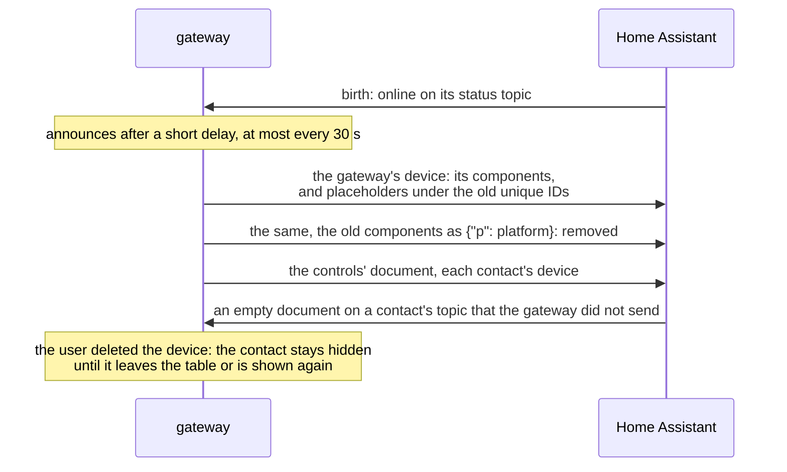

# Design: Home Assistant and the dashboard

Part of the [design](design.md), sections 6.7 and 6.13: what the gateway announces to Home
Assistant and how, and the dashboard it generates.

## 6.7 Home Assistant

The bridge publishes one device-based discovery document for itself
([ADR 0010](decisions/0010-home-assistant-through-mqtt-device-discovery.md)) and one for each
contact ([ADR 0017](decisions/0017-contacts-on-the-radio-each-with-its-own-device.md)); entities
and example automations are in [`home-assistant.md`](home-assistant.md).

| Entity | Platform | Source |
| --- | --- | --- |
| Radio link | `binary_sensor` (connectivity) | `state` → `radio`; the radio's static facts as attributes |
| Battery | `sensor` (voltage) | `state` → `battery_v` |
| Airtime last hour | `sensor` (duration) | `state` → `airtime_1h_s` |
| Airtime available | `sensor` (duration) | `state` → `airtime_available_s` |
| Queue | `sensor` | `state` → `queue` |
| Gateway degraded | `binary_sensor` (problem) | `state` → `health.degraded`; the health section as attributes |
| Last packet RSSI, SNR | `sensor` (signal strength), disabled by default | `rx` (only with `publish_rx_log`) |
| Message | `event` (`contact`, `channel`) | `received` |
| Delivery | `event` (delivery states) | `delivery` |
| Message history | `sensor` (timestamp), its own availability | `history` → the newest message's `at`; the document as attributes |
| Messages on their way | `sensor`, its own availability | `pending` → `total`; the document as attributes |
| Configuration | `sensor` (timestamp), diagnostic | `config` → `started_at`; the settings in effect as attributes, read only |
| Command | `event` (configured words) | `command` |
| Send to *alias* | `notify`, one per target | `send/<alias>` |
| Write to *alias*, Send what is written to *alias* | `text`, `button`, one pair per target not in `hidden_targets`, QoS 0 | `homeassistant/draft/target/<alias>` → `text`; → `…/request` |
| Write, Send what is written | `text`, `button` on each companion's device that is no contact target, QoS 0 | `homeassistant/draft/contact/<key>` → `text`; → `…/request` |
| Contacts, Nodes heard | `sensor` | `contacts` → `total`, `nodes` → `total` |
| Contact, New node | `event` | `contact`, `node` |
| Noise floor, Radio transmit time last hour, uptime and packet counters | `sensor`, diagnostic; the counters disabled by default | `stats` |
| Contact with remote access, Companion position in adverts | `binary_sensor` (problem) | `contacts` → `remote_cli_total`, `advert_carries_position_total` |
| Look-alike node heard | `binary_sensor` (problem) | `nodes` → `look_alike_total` |
| Show hidden contacts | `button` | → `homeassistant/show_hidden` |
| Add heard node | `select`, its own document | the heard nodes' labels → `homeassistant/add_node` |
| Add contact (key or link) | `text`, its own document | → `add_contact` |
| Remove from radio | `button` on each contact's device | → `contacts/<key>/remove` |
| Telemetry status | `sensor` (enum), diagnostic, attribute `reason` | `state` → `telemetry`, `telemetry_reason` |
| Telemetry airtime last hour, Telemetry mesh airtime last hour | `sensor` (duration), diagnostic, disabled by default | `state` → `telemetry_airtime_1h_s`, `telemetry_mesh_airtime_1h_s` |
| Telemetry | `event` (`answered`, `unanswered`) | `telemetry` |
| Telemetry | `switch`, configuration, on each companion's device | `contacts/<key>` → `telemetry_excluded`; → `contacts/<key>/telemetry` |
| Telemetry state | `sensor` (enum) on each companion's device | `contacts/<key>` → `telemetry_state` |
| Position in adverts | `binary_sensor` (problem) on each companion's device | `contacts/<key>` → `advert_carries_position` |
| Battery, MCU temperature, a sensor per reading | `sensor` (their class and unit, state class `measurement`) on a companion's device, with its first answer that carries them | `contacts/<key>` → `battery_v`, `mcu_temperature_c`, `readings`; available while `telemetry_current` |

All entities share the availability topic, so they become unavailable when the bridge is offline,
except *Message history* and *Messages on their way*: the availability of each is any message on
its own topic, `history` or `pending`, which the gateway never clears, so the messages stay
readable while the gateway is offline.
The document names the radio's model, firmware and key once the radio is known and is sent again
when they change; unknown fields are left out, because Home Assistant rejects a document with a
null device field. Components of an earlier run that the configuration no longer has are
removed: Home Assistant removes a component only when it is sent as `{"p": <platform>}` and only if
it has discovered it since its own start, so each announcement first sends a placeholder under the
old unique_id (it binds a leftover entity, or creates one for a moment), then the removal. The
state file keeps these removals pending for 30 days, because the gateway cannot tell when Home
Assistant has received them. The placeholders are enabled: when Home Assistant removes a disabled
entity, it clears the whole device's discovery topic itself. The gateway subscribes to that topic
and announces again when Home Assistant clears it.

Each contact's device (`mqtt/contact_devices.py`) sits on its own topic one level below the
gateway's device ID and follows the radio's table: it is announced after a table read, updated
when its document changes, and removed with placeholders first and then an empty document, once
more after Home Assistant's next birth message if it may not have been running. Its components
exist only with data (sending for companions, messages for companions and room servers, the
tracker once a position is known, the telemetry switch and state and *Position in adverts* for
companions, battery, MCU temperature and up to 16 readings with an answer that carries them) and
are never removed one by one; only the tracker has coordinates. The tracker of a position from
telemetry and the telemetry sensors are available only while the answers are current
([ADR 0024](decisions/0024-telemetry-values-in-home-assistant-expire.md)); the device and state
classes are interface and recorded in the snapshot. Entity IDs use a slug of the contact's name kept from its first appearance, also when
it comes back within 90 days of leaving the table (at most 1 000 slugs of contacts that left are
kept, the newest; CODE-003). The gateway subscribes to these topics: an empty document it did not send is the user
deleting the device in Home Assistant, and the contact stays hidden there until it leaves the table
or is shown again. At most `homeassistant.contact_devices` contacts get a device; one keeps its
device while it stays in the table, and free places go to protected contacts, favourites,
companions and the most recently heard, in that order.

The drafts of the chats (`drafts.py`, [mqtt-api.md](mqtt-api.md#drafts-of-home-assistants-chats-homeassistantdraftkindchat))
are Home Assistant's controls for writing, then sending: the gateway holds one draft per chat in
memory and publishes it retained; the text entity and its button publish `{"text": …}` and
`{"send": true}` on the chat's one request topic at QoS 0, so the broker keeps their order and a
press made while Home Assistant's link is down is not sent later. The MQTT adapter hands both to
the drafts part through callbacks, on the event loop in the order they came (`wiring.py`), and a
press goes to the outbox's `accept` at once, with no wait. The text's `max` is the room of a text
to the chat in bytes (`discovery.text_room`); a lower one, after the radio's name became known or
changed, cuts a longer draft, which goes out before the discovery: Home Assistant writes the state
again as it takes the discovery and raises for a state longer than `max`. A companion's pair is
announced only for a key that is no contact target, hidden or not; one announced before the key
became a target stays, always unavailable (the keep rule, and the never-published availability of
`controls = false`).

The controls that add contacts (`mqtt/manage_entities.py`) have a discovery document of their own,
`…/manage_contacts/config`, whose components join the gateway's device: the select's options exist
only in discovery and follow the heard nodes, sent at most every 30 seconds but at once when a
contact joined or left the table, and at most 10 changes at once, then one a minute, also with
announcements and from a fresh start, which begins with 2 (Home Assistant warns from the 101st
change of an entity's capabilities within an hour, counts across the gateway's restarts, and writes
its entity registry for each); the main document with its placeholders is not sent again for them.
A label puts 12 and 8 key digits before the name, so no name can push the digits aside; the gateway
resolves a label against the heard nodes and the contacts as they are when the request arrives. The
text's pattern takes keys and contact links only: the field ends at 255 characters, and a contact
card cut there would still parse, with a cut name. The select, the text and each contact's remove
button are available while the gateway is online, the radio connected and management on (on
firmware the gateway is tested with, as the worker requires), the button also only for a contact
that is not protected; templates read keys that older documents lack with `is defined`, `is true`
or `.get()`, so retained documents of an earlier version read as unavailable without a warning.
Option changes wait while the broker is away: the reconnect announces the current ones, or, with no
change left in the budget, those sent before, and the current ones within a minute. Components of
the controls' document that a later version drops are removed like those of the main document; the
state file keeps them apart.

How an announcement replaces what an earlier run announced, and how a deleted device is noticed
(all through the broker; discovery messages are not retained):

## 6.13 Dashboard

`meshcore-home-gateway dashboard` writes one Home Assistant dashboard for the gateway it runs
beside ([home-assistant.md](home-assistant.md#dashboard)), as
[ADR 0021](decisions/0021-generated-dashboards-for-desktop-and-mobile.md) decided, with only the
cards Home Assistant has. 2.0's dashboard, the first part, used only the entities the gateway had
anyway; since 2.1 the gateway announces entities for it, the message history, the messages on
their way, a draft and its *Send* for each chat and the configuration
([§6.7](#67-home-assistant)), and the dashboard needs Home Assistant 2026.10 or later
([ADR 0031](decisions/0031-household-chat-problems-and-settings-on-the-generated-dashboard.md)). No setting was added for it.

* **Views:** 2.0 had four tabs, *Overview*, *Messages*, *Contacts* and *Map*. Since 2.1 there
  are three tabs: *Overview* (a status line in a colour that names the first problem, a card for
  each problem while it exists, the latest chats, where everyone is), *Chats* (every chat with
  its newest message, and all messages as one thread) and *Contacts* (the contacts by their
  devices, the sensors' readings, each switch *Ask for position and battery*, *Add or remove*
  with each contact's *Remove*, which asks first, the nodes heard nearby). The other pages have
  no tab (`subview: true`): a page for each chat, *Map* (the contacts' trackers with 24 hours of
  traces), *Gateway* (health, the radio, its settings, the latest event of each kind),
  *Settings* (the configuration document, read only) and *Help*. A row of links under
  *Overview*'s status line opens *Map*, *Gateway*, *Settings* and *Help*, the map first: its
  other links, under *Where everyone is*, come below everything on a phone, and with them the map
  seemed gone (2.1.1). All are sections views, which reflow on a phone, so there is one variant; cards show by conditions on states and on
  templates, which the frontend evaluates since Home Assistant 2026.10.
* **Writing:** 2.0 offered the guide's script *Mesh message* (`script.mesh_message`) as a form
  in a tile, with a hint while the script was missing. Since 2.1 each chat page ends in the
  gateway's draft of that chat, the text entity *Write to …*, and its button *Send*: the gateway
  keeps the draft until it is sent ([home-assistant.md](home-assistant.md#dashboard)). The
  script stays for automations. The field and *Send* are the view's footer, which stays at the
  bottom of the screen; why the gateway refused a *Send* stands right above the thread, not in
  the footer: the frontend caps the footer at a quarter of the screen, and the refused line on
  top of the field pushed *Send* below a phone's screen. Under the thread, as in 2.1.0, the
  footer covered the line until the page was scrolled (#143); above it, its place depends on
  neither the thread's length nor the screen, and while it shows, the thread starts lower by its
  height ([platform-notes.md](platform-notes.md#home-assistant-dashboards)).
* **What changes while the dashboard stays** comes from Markdown templates over the device
  registry: the contacts of this gateway (the contact devices whose via device is the gateway's),
  the heard nodes, the last contact event. What a card needs as fixed IDs is written when the
  dashboard is made: the gateway's entity IDs from `mqtt.node_id`, and from the state file
  (`ha_contact_devices`, read only) the map's trackers (the announced contacts with a position)
  and the contacts' switches and buttons (IMP-049; a contact announced later needs the dashboard
  made again, as for the map), and since 2.1 the chat pages, one for each target and each
  contact with a device. A hint names a tracker of this gateway whose contact's key no listed
  tracker has.
* **The template** is `src/meshcore_home_gateway/dashboard.yaml`, package data like the catalogs,
  filled in as text, without a YAML parser (ADR 0005): `@gw@`, `@node@`, `@version@`,
  `@major@` and `@minor@` (its first two numbers), `@guide@` (the address of the guide of this
  version), `["@trackers@"]` (the map's trackers), `["@chats@"]` (the chat pages, JSON objects
  that Jinja reads) and `["@models@"]` (each model of a contact's device with its node type).
  2.0 also filled in how the contacts' entity IDs begin; the cards of 2.1 find the contacts by
  their devices, and the lists' items carry the IDs. Since 2.1, comment lines repeat lines for each item
  of a list, `# @each <list>` … `# @end`, for `chats`, `switches` (the contacts' switches
  *Telemetry*) and `removes` (their buttons *Remove from radio*), with the item's fields as
  `@<list>.<field>@`, each value checked against its pattern first; and keep lines,
  `# @if <flag>` … `# @end` with an optional `# @else`: `# @if trackers` while the map lists a
  tracker, a list while it is not empty, a field inside its list's `# @each` while it is not
  empty. Texts are marked `_("…")` with `msgctxt "dashboard"`. A marked whole YAML value becomes
  a quoted scalar, whose only field is `{name}`, the title of the item of a `# @each`; a marked
  text inside a card's content becomes the text, `{node}` and `{version}` filled in, any other
  field the Jinja variable of that name. The same inputs give the same bytes.
* **Translations of its texts** are used only when they hold no Jinja, HTML, Markdown link or
  address (`{{`, `{%`, `{#`, `<`, `>`, `@`, `](`, `://`, `www.`, `_("`), no control, format, line
  or paragraph separator character, and only the fields of the English text; else the English
  text. The catalog check applies the same rule (`dashboard.FORBIDDEN`, `dashboard.UNSAFE`).
* **Values from the mesh are text.** Every value a card reads from a state, an attribute or the
  registry (message texts, names, labels, versions, the contact link) goes through the card's
  macro `m`, which turns line breaks into spaces and escapes, onto a line that is one `
`,
  `<table>` or `<ha-qr-code>` element: a CommonMark HTML block, which a blank line would end. The
  alerts carry only our texts and integers. Machine values of a closed list (delivery steps,
  telemetry states, contact events) are mapped to texts, with the value itself, through `m`, for
  one added later; so are the reason codes the API documents for deliveries, contact
  requests (IMP-049) and refused commands. A reason added later, and the radio's own refusals (`error_<code>`,
  `not_found`), stay codes, in `<code>`.
* **Interface:** the command is the only growth (`cli > commands > dashboard`); the dashboard's
  content is not an interface, the entity IDs it names are.

Where the dashboard departs from ADR 0021:

1. The template lives in the package, not in `home-assistant/dashboard/`: a file outside it
   reaches neither the zipapp nor the wheel.
2. The map shows the contacts' trackers only, no heard repeater without a contact: the gateway
   keeps no stranger's position ([mqtt-api.md](mqtt-api.md#nodes-heard-nodes)), and keeping
   them was rejected in the review of 2026-11 (IMP-049).
3. Times and counts are formatted in the templates: a Markdown card cannot hand a value to the
   frontend's formatter. The tiles still format their own values. 2.0 showed relative times
   ("5 min ago") and no clock time; since 2.1 the cards show a time as a history does, "10:31",
   "yesterday 10:31" or "22 Oct 10:31", in Home Assistant's time zone.
4. The version card of 2.0 said that the versions differ, not which is newer; since 2.1 it shows
   only for another major or minor version and says which of the two to update.

Deferred: release files per node and language, `--language` and `--output`, a second variant,
more languages, a colour legend, a list of the gateways on the broker, and the right tracker IDs
when the contacts of two gateways share a name. 2.1 added what 2.0 deferred besides: a message
history, the gateway's own entities to write with, and the settings and help views.
