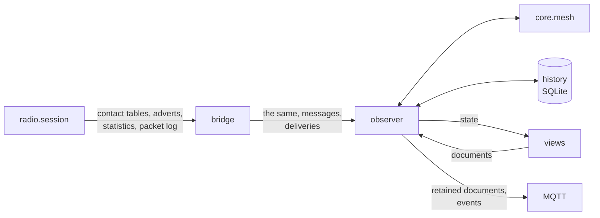

# Design: the observer, its documents and the history

Part of the [design](design.md), section 6.6: how the gateway keeps its view of the mesh,
checks adverts, writes the history and publishes the documents.

## 6.6 Observer: documents and history

The bridge hands the observer everything the radio reports (contact tables, checked adverts,
statistics, the packet log), every received message and every final delivery
([ADR 0014](decisions/0014-the-gateway-as-the-households-mesh-observer.md)). The observer keeps the
core's view of the mesh, writes the history
([ADR 0016](decisions/0016-history-in-a-local-sqlite-database.md)) and publishes the providers'
documents ([ADR 0015](decisions/0015-provider-neutral-documents-on-the-bus.md)): `stats`,
`contacts` and `contacts/<key>`, `nodes`, `history`, and the events `contact`, `node` and
`telemetry`.

* **Only changes are published**: the observer remembers the last payload per topic; after a
  reconnect to the broker it publishes them all again. The topic of a contact that left the table
  is cleared with an empty retained message; the keys of published contacts are kept in the state
  file, so contacts removed while the gateway was stopped are cleared at its first table read.
* **Signals of adverts**: the radio logs every packet before it handles it, and pushes `ADVERT` or
  `NEW_ADVERT` only for adverts whose signature it accepted. The observer takes hops, SNR and RSSI
  from the push's own log. While the radio's receive delay is 0 (its default, read at connect),
  that is the logged advert of the same key that is the frame directly before the push, for a
  `NEW_ADVERT` only with its record's time, for an `ADVERT` only when it is newer than the record
  the observer holds (the radio pushes a contact's advert only when it is newer than its record).
  Any other log is another packet (a late copy of an older advert, or a forged one), so a push
  without its own log gets no signal, as an advert that was not logged. With a receive delay
  above 0, or one not known, a logged advert of the key within 10 s before the push gives them.
  The logged content itself is never trusted on its own (protocol.md, section 4).
* **Positions** come from contact records (the radio keeps the position of a contact's newest
  advert that carried one, also after the contact stopped sharing it) and from the contacts' own
  telemetry ([design §6.11](design.md#611-telemetry)). A position from adverts exists only while the record holds one and the
  contact's last checked advert, if any, carried one (next item); a record without a position
  drops an advert position of any contact, and a telemetry position is never touched. A telemetry
  position replaces the fix when it moved 20 m or more, or when the fix came from an advert; its
  time is when it changed, so a companion at rest writes nothing per answer, neither in the
  history nor in Home Assistant's recorder. It carries an accuracy of 15 m (the cell of 0.0001°
  the encoder truncates to, and the receiver's own error). A changed advert position replaces a
  telemetry fix, also at the check that shows a companion shares it again; an unchanged one does
  not. A position from telemetry expires ([design §6.11](design.md#611-telemetry)):
  `position_current` says whether it is current, and the document keeps it. Nodes that are not
  contacts keep none.
* **Positions in adverts** ([ADR 0025](decisions/0025-positions-in-adverts-checked-from-the-packet-log.md),
  `core/adverts.py`): the observer keeps each logged advert (at most 64, at most 40 s) and, at a
  contact's `ADVERT`, its pending advert with the key's logs. The next table read whose record
  shows the logged timestamp as `last_advert` decides: while the receive delay is 0, the log that
  is the frame directly before the push; otherwise every log of the key with that timestamp must
  agree. A flagged log must hold the record's position; a new position in the record since the
  read before, with a newer `last_advert`, is evidence on its own. The radio pushes a contact's
  advert only when it is newer than its record, so a read whose record is older than the push's
  own log, or no newer than at the read before, was sent before the radio took it: it waits for
  the next read (at most 30 s), also while a log of the record's time is in the window. A read
  with no log of the record's time waits too while a newer log of the key is in the window. A
  heard companion's `NEW_ADVERT` carries the record made from that advert alone and is checked at
  once; its heard node keeps only the time and flag, and the table read that adds it takes them.
  When nothing is learned the last check stays and one debug line says "not checked". While a
  companion's newest advert is not checked, `advert_carries_position` is the last check's flag, or
  `true` when the record holds a position: it errs to warn. The index lists the companions not
  excluded from telemetry whose value is `true`; the event `position_in_advert` comes when such a
  companion's check turns to carrying, at an add with a check that carries, and at an inclusion
  while it carries. The last check of each companion is kept in the state file (`advert_checks`,
  no position); a logged position is held at most about three minutes (its log up to 40 s before
  the push, which is held up to 70 s, until the next minute tick) and never stored or published.
* **Messages** in and out go to the `history` document (the latest 50, newest first, the whole
  document within 15 KiB, #111) and to the history's table `message`. Since 2.1 each entry also
  names the target it came through or went to (the inbox's, as `received` names it; none for
  `contacts/<key>/send`, whose key is `contact_key`), and a sent one the id of its delivery
  events, when the gateway accepted it, `suspect` and the reason it failed or expired. The
  acceptance time is the wall clock (the queue counts with the monotonic one): the delivery
  carries it in its events, not on the `delivery` topic, and a message kept across a stop keeps it
  in the state file. The table gets the columns `target`, `delivery_id` (it has an `id`),
  `queued_at`, `suspect` and `reason` after a look at its columns, in version 2 as the table
  `reading` was: 2.0 names its columns in every statement, so a downgrade leaves them empty and
  keeps the history.
* **Readings** of every answer the poller takes go to the contact's document (`battery_v`,
  `mcu_temperature_c`, `readings`, `readings_at`, the gateway's time of the answer) and to the
  history's table `reading`, one row per value, in one transaction. The table was added to the
  history's version 2 with `CREATE … IF NOT EXISTS` instead of a version 3: an older gateway opens
  a file of a newer version without any history, and it ignores an added table, so a downgrade
  keeps its messages and positions. Readings are kept for `readings_days`; beyond 200 000 rows the
  oldest go, but never the rows of a contact's newest answer, which is restored at start, unless
  telemetry is on and its saved schedule knows a later answer the history missed (it was off or
  broken, or an older version ran): old values must not read as current. After the clock went
  back while the gateway was stopped the schedule cannot tell (every answer counts as more than a
  day old), and the history's newest comes back, not as current. A contact's document and the
  history show the same answer.
* **Exclusion** ([design §6.11](design.md#611-telemetry)): an excluded companion's readings, its time of the newest position and a
  position from telemetry are forgotten, and the position its record carries takes the place, as
  at a first table read, while its last checked advert, if any, carried one; its rows in the
  history stay until their age removes them and are not restored while it is excluded. `forget`
  deletes its readings and positions from telemetry in one transaction; its advert positions and
  when it was last heard stay.
* **Heard nodes**: the 50 most recently heard of the last 7 days. When 50 are kept, a node
  heard once makes room first; one heard again (a newer advert than its first, or a former
  contact) only when no other is left, so adverts with invented keys, which cost nothing, do not
  push out the nodes the household knows. The `nodes` document goes out at once when a contact
  joins or leaves the table; while only heard nodes change, at most every 30 seconds (with the
  minute tick after that), so a flood of adverts does not republish it (up to 15 KiB) per advert.
  The history keeps the rows of the contacts and of the heard nodes the gateway keeps: the hourly
  purge removes the others, and every row after 7 days. Heard nodes are other people's radios:
  `[contacts] heard_nodes = "keys"` publishes and stores their keys and types only, `"off"`
  nothing; the memory still holds them, for the look-alike check, whose keys stay published
  ([privacy.md](privacy.md)).
* **Last heard** follows adverts and messages at once; a contact heard only by its telemetry
  answers moves it at most once an hour, keeping the signal of its last advert or message (an
  answer reports none).
* **Failures stay local**: an exception in the observer is logged and does not stop messages,
  deliveries or commands; a history that cannot be written switches itself off for the run. Such
  a bug is counted and its traceback logged at most once a minute per place, with how many came
  since (`health.FAILURES`, a filter on the loggers of the parts); the `health` section of the
  `state` document and the problem sensor *Gateway degraded* tell what is wrong (ARC-012).
* **The purge** runs hourly in a thread on a connection of its own, in one transaction: its cost
  grows with the tables and the disk, and the event loop serves the radio meanwhile. The writes
  that come in the meantime wait in memory and follow it in their order
  ([ADR 0016](decisions/0016-history-in-a-local-sqlite-database.md)).
