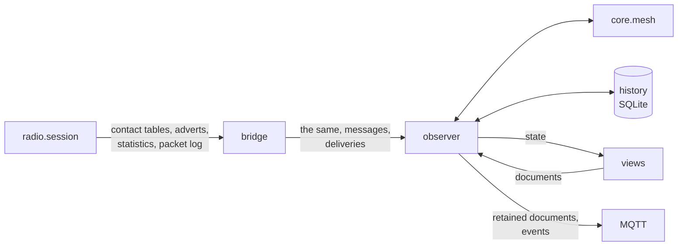
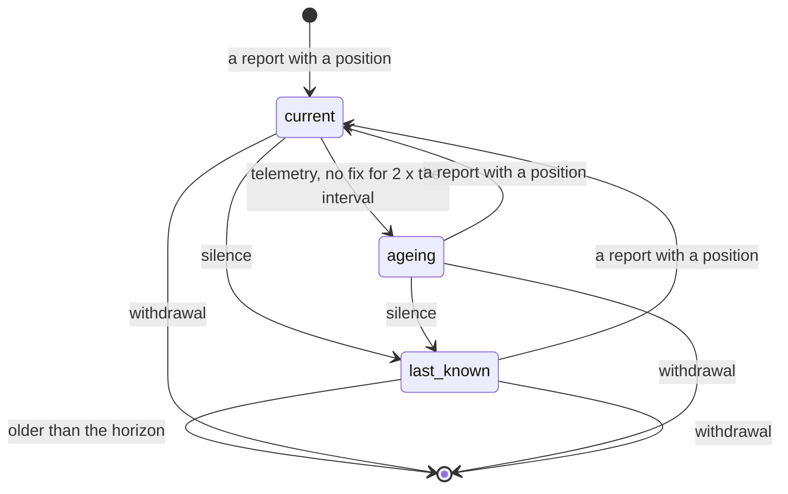

# Design: the observer, its documents and the history

Part of the [design](design.md), section 6.6: how the gateway keeps its view of the mesh,
checks adverts, writes the history and publishes the documents.

## 6.6 Observer: documents and history

The bridge hands the observer everything the radio reports (contact tables, checked adverts,
statistics, the packet log), every received message and every final delivery
([ADR 0014](decisions/0014-the-gateway-as-the-households-mesh-observer.md)). The observer keeps the
core's view of the mesh, writes the history
([ADR 0016](decisions/0016-history-in-a-local-sqlite-database.md)) and publishes the providers'
documents ([ADR 0015](decisions/0015-provider-neutral-documents-on-the-bus.md)): `stats`,
`contacts` and `contacts/<key>`, `nodes`, `history`, `pending`, `config`, `refused_commands`,
and the events `contact`, `node` and `telemetry`.

* **Refused commands**: `refused_commands` holds the latest five refusals, the newest first,
  without their words. The command ledger keeps them in the state file; the bridge hands them to
  the observer at the start, with `clean_received` their senders' names cleaned as the last run's
  documents are, the inbox after each refusal, and the broker's connects publish them again.
* **Only changes are published**: the observer remembers the last payload per topic; after a
  reconnect to the broker it publishes them all again. The topic of a contact that left the table
  is cleared with an empty retained message; the keys of published contacts are kept in the state
  file, so contacts removed while the gateway was stopped are cleared at its first table read.
* **Signals of adverts**: the radio logs every packet before it handles it, and pushes `ADVERT` or
  `NEW_ADVERT` only for adverts whose signature it accepted. The observer takes hops, SNR and RSSI
  from the push's own log. While the radio's receive delay is 0 (its default, read at connect),
  that is the logged advert of the same key that is the frame directly before the push, for a
  `NEW_ADVERT` only with its record's time, for an `ADVERT` only when it is newer than the record
  the observer holds (the radio pushes a contact's advert only when it is newer than its record).
  Any other log is another packet (a late copy of an older advert, or a forged one), so a push
  without its own log gets no signal, as an advert that was not logged. With a receive delay
  above 0, or one not known, a logged advert of the key within 10 s before the push gives them.
  The logged content itself is never trusted on its own (protocol.md, section 4).
* **Positions** come from contact records (the radio keeps the position of a contact's newest
  advert that carried one, also after the contact stopped sharing it) and from the contacts' own
  telemetry ([design §6.11](design.md#611-telemetry)). A position from adverts exists only while the record holds one and the
  contact's last checked advert, if any, carried one (next item); a record without a position
  drops an advert position of any contact, and a telemetry position is never touched. A telemetry
  position replaces the fix on a confirmed move (since 2.3, *The companion state*, below; 20 m
  before), or when the fix came from an advert; its
  time is when it changed, so a companion at rest writes nothing per answer, neither in the
  history nor in Home Assistant's recorder. It carries an accuracy of 15 m (the cell of 0.0001°
  the encoder truncates to, and the receiver's own error). A changed advert position replaces a
  telemetry fix, also at the check that shows a companion shares it again; an unchanged one does
  not. A position from telemetry expires ([design §6.11](design.md#611-telemetry)):
  `position_current` says whether it is current, and since 2.3 `position_state` how it ages; the
  document keeps it. Nodes that are not contacts keep none.
* **Positions in adverts** ([ADR 0025](decisions/0025-positions-in-adverts-checked-from-the-packet-log.md),
  `core/adverts.py`): the observer keeps each logged advert (at most 64, at most 40 s) and, at a
  contact's `ADVERT`, its pending advert with the key's logs. The next table read whose record
  shows the logged timestamp as `last_advert` decides: while the receive delay is 0, the log that
  is the frame directly before the push; otherwise every log of the key with that timestamp must
  agree. A flagged log must hold the record's position; a new position in the record since the
  read before, with a newer `last_advert`, is evidence on its own. The radio pushes a contact's
  advert only when it is newer than its record, so a read whose record is older than the push's
  own log, or no newer than at the read before, was sent before the radio took it: it waits for
  the next read (at most 30 s), also while a log of the record's time is in the window. A read
  with no log of the record's time waits too while a newer log of the key is in the window. A
  heard companion's `NEW_ADVERT` carries the record made from that advert alone and is checked at
  once; its heard node keeps only the time and flag, and the table read that adds it takes them.
  When nothing is learned the last check stays and one debug line says "not checked". While a
  companion's newest advert is not checked, `advert_carries_position` is the last check's flag, or
  `true` when the record holds a position: it errs to warn. The index lists the companions not
  excluded from telemetry whose value is `true`; the event `position_in_advert` comes when such a
  companion's check turns to carrying, at an add with a check that carries, and at an inclusion
  while it carries. The last check of each companion is kept in the state file (`advert_checks`,
  no position); a logged position is held at most about three minutes (its log up to 40 s before
  the push, which is held up to 70 s, until the next minute tick) and never stored or published.
* **Messages** in and out go to the `history` document (the latest 50, newest first, the whole
  document within 15 KiB, #111) and to the history's table `message`. Since 2.1 each entry also
  names the target it came through or went to (the inbox's, as `received` names it; none for
  `contacts/<key>/send`, whose key is `contact_key`), and a sent one the id of its delivery
  events, when the gateway accepted it, `suspect` and the reason it failed or expired. The
  acceptance time is the wall clock (the queue counts with the monotonic one): the delivery
  carries it in its events, not on the `delivery` topic, and a message kept across a stop keeps it
  in the state file. The table gets the columns `target`, `delivery_id` (it has an `id`),
  `queued_at`, `suspect` and `reason` after a look at its columns, in version 2 as the table
  `reading` was: 2.0 names its columns in every statement, so a downgrade leaves them empty and
  keeps the history. Since 2.2 a sent entry also says whether the gateway added
  `confirm_nonce`'s suffix to its text (`nonce`, #142): the outbox keeps it with each message
  (`Outgoing.nonce`, in the state file across a stop) and gives it to the delivery's events, not
  on the `delivery` topic, as the acceptance time; the table gets the column `nonce` the same
  way, empty in the rows of earlier versions.
* **Channels not published** (#136): with `publish_channels = "targets"` only the messages of the
  targets' channels are published and stored, but an earlier version kept every channel's, and
  so does `"all"`. At the start, before the first `history` document, the observer deletes from
  the table `message` the received messages of every channel but the targets' that are not
  ignored, also those without a channel's index, in one statement after a purge that runs; the
  gateway's own messages stay, also to an ignored channel. The deletion is for good, and the
  log says how many rows went. With `"all"` nothing is deleted: the documents leave the ignored
  channels out (#103) and their age removes them.
* **The settings in effect** go to the `config` document: `config_view` takes them from the
  configuration by an allowlist, and the bridge hands them over at the start and again at each
  radio connect, as a channel text's room depends on the radio's name. The targets are a list in
  ADR 0015's form, cut from the end so that the whole document stays within 15 KiB (the
  configuration allows any number of targets). `started_at` is when the observer was made, at the
  service's start, which is when the configuration was read. Since 2.3 the document also carries
  the `review` section ([ADR 0036](decisions/0036-the-settings-registry-recommendations-and-the-update-review.md)): the recommendations of this version that the file
  does not follow, and those the administrator kept, for the keys the document shows, as codes
  and values; the others are counted. It is computed at the same moments, because a
  recommendation can depend on the radio (the derived burst). The document's 15 KiB bound counts
  it; the targets give way first.
* **Messages on their way** go to the `pending` document (oldest first, the whole document within
  8 KiB): the outbox keeps the messages it accepted until their final event, the one it delivers
  included, which the queue's count in `state` leaves out (#112). An entry follows its delivery
  events: `queued`, then `sent` with each attempt; a message paused for an alert has no event and
  stays `sent`, and one kept across a stop is `queued` again with its attempts. The outbox hands
  the list to the observer once the steps of a moment are done (`call_soon`): after the `history`
  of a message that became final, so that a reader of both topics never misses it, and once for a
  burst of requests rather than for each. The observer publishes it again at every connect, and
  the outbox after the start, when the messages a stop kept are queued again (oldest first by
  their acceptance time).
* **Readings** of every answer the poller takes go to the contact's document (`battery_v`,
  `mcu_temperature_c`, `readings`, `readings_at`, the gateway's time of the answer) and to the
  history's table `reading`, one row per value, in one transaction. The table was added to the
  history's version 2 with `CREATE … IF NOT EXISTS` instead of a version 3: an older gateway opens
  a file of a newer version without any history, and it ignores an added table, so a downgrade
  keeps its messages and positions. Readings are kept for `readings_days`; beyond 200 000 rows the
  oldest go, but never the rows of a contact's newest answer, which is restored at start, unless
  telemetry is on and its saved schedule knows a later answer the history missed (it was off or
  broken, or an older version ran): old values must not read as current. After the clock went
  back while the gateway was stopped the schedule cannot tell (every answer counts as more than a
  day old), and the history's newest comes back, not as current. A contact's document and the
  history show the same answer.
* **Exclusion** ([design §6.11](design.md#611-telemetry)): an excluded companion's readings, its time of the newest position and a
  position from telemetry are forgotten, and the position its record carries takes the place, as
  at a first table read, while its last checked advert, if any, carried one; its rows in the
  history stay until their age removes them and are not restored while it is excluded. `forget`
  deletes its readings and positions from telemetry in one transaction; its advert positions and
  when it was last heard stay.
* **Heard nodes**: the 50 most recently heard of the last 7 days. When 50 are kept, a node
  heard once makes room first; one heard again (a newer advert than its first, or a former
  contact) only when no other is left, so adverts with invented keys, which cost nothing, do not
  push out the nodes the household knows. The `nodes` document goes out at once when a contact
  joins or leaves the table; while only heard nodes change, at most every 30 seconds (with the
  minute tick after that), so a flood of adverts does not republish it (up to 15 KiB) per advert.
  The history keeps the rows of the contacts and of the heard nodes the gateway keeps: the hourly
  purge removes the others, and every row after 7 days. Heard nodes are other people's radios:
  by default (`[contacts] heard_nodes = "full"`, since 2.2) the gateway publishes and stores
  their names, when and how they were heard and their signal; `"keys"` publishes their keys and
  types only and stores besides them when and how they were heard and the time their last advert
  carried, `"off"` nothing; the memory still holds them, for the look-alike check, whose keys stay
  published ([privacy.md](privacy.md)).
* **Last heard** follows adverts and messages at once, and since 2.3 path updates; a contact
  heard only by its telemetry answers moves it at most once an hour while it is heard, and once
  more, to its last report, when it turns quiet. It keeps the signal of its last advert or message
  (an answer or a path reports none).
* **Failures stay local**: an exception in the observer is logged and does not stop messages,
  deliveries or commands; a history that cannot be written switches itself off for the run. Such
  a bug is counted and its traceback logged at most once a minute per place, with how many came
  since (`health.FAILURES`, a filter on the loggers of the parts); the `health` section of the
  `state` document and the problem sensor *Gateway degraded* tell what is wrong (ARC-012).
* **The purge** runs hourly in a thread on a connection of its own, in one transaction: its cost
  grows with the tables and the disk, and the event loop serves the radio meanwhile. The writes
  that come in the meantime wait in memory and follow it in their order
  ([ADR 0016](decisions/0016-history-in-a-local-sqlite-database.md)).

### The companion state

[ADR 0035](decisions/0035-the-companion-state-model.md), since 2.3: one pure, total module, `core/companion.py`, keeps a record per
contact of the radio's table and decides three things apart from each other: whether the contact
is heard (`presence`, and `recent` for the last 24 hours), where it is (`position_state`), and
whether it moves (`motion`). The
scheduler keeps `telemetry_state` (ADR 0024), and the contact manager keeps membership: a removed
contact has no document.

**Reports.** Every sign of life enters through one call, `reported(key, at, source)`, with the
gateway's precise time:

| Source | What | Time |
| --- | --- | --- |
| `advert` | the radio's `ADVERT` push for a contact | the push |
| `advert` | a newer `last_advert` in the first table read of a run: the radio heard it while the gateway was stopped | the advert's own time, when it lies within the stop and not in the future; else the read |
| `message` | a direct message from the contact | its `received_at` |
| `telemetry` | an accepted answer, with or without a fix | the answer |
| `path` | `PATH_UPDATED`, except the path of the gateway's own flood | the push |
| `pushed` | a pushed report, once a subscription exists (not in 2.3) | the push |

`heard_at` follows these sources too: at once for adverts, messages and paths (`heard_via`
`path` is new), at most hourly for telemetry answers while the companion is heard, and once more
when it turns quiet, to the time of its last report. Its signal fields stay those of the last
advert or message.

**Presence.**

| `presence` | Asked by the poller now | Not asked |
| --- | --- | --- |
| `heard` | silent less than `max(1 h, 3 × its interval)`, and fewer than two unanswered requests in a row since its last report | silent less than 24 h |
| `quiet` | not heard, silent less than 24 h | silent less than 7 days |
| `long_quiet` | silent 24 h or longer | silent 7 days or longer |
| `never` | no report since it became a contact | the same |

Silence is counted by the observer's tick, and only while the radio is live: a gateway that is
stopped, or whose radio is away, hears nothing, so it holds nobody's silence against them. Each
tick adds the time that elapsed since the last one (the status loop calls it every 60 s, every
30 s under systemd's watchdog). The count is saved in the state file as an age. While telemetry
is off or paused, every contact counts as not asked. The thresholds are fixed. `recent` is true
while a contact is silent less than 24 h, asked or not: an asked companion is `quiet` after an
hour or more and still `recent` until the day is over. The advert warning reads it
([design-home-assistant.md](design-home-assistant.md#613-dashboard), *A companion's state*).

**A start without saved ages** (the first start of 2.3 after 2.2, a lost state file, a contact
added while the gateway was stopped): the contact's last report is the newest of the `heard` time
and `heard_via` restored from the history, the last answer of the saved schedule, and the
record's `last_advert` when it is not in the future. Its silence runs from that report to the
gateway's stop, the newest `saved_at` of the state file, and the stop is not silence; without a
saved stop it runs to the start, which errs to quiet. Only a contact with none of these is
`never`.

**Positions.** Every published position has a report time, `position_reported_at`: for
telemetry it is `position_received_at` (the newest answer that carried a position), for adverts
`advert_heard_at` (the newest heard advert, which carried it); where that key is `null`, the fix's
own time.

* **Silence**: telemetry not current by ADR 0024 (two unanswered requests, the time bound,
  telemetry paused, the radio away); a companion's advert position 1 h after its report.
* **Withdrawal** ends a position at once, without a last known one: a checked advert without a
  position; current answers without a fix for over an hour (`no_position`); an exclusion; a
  removal; telemetry switched off in the configuration. `position_state` becomes `null`, so the
  tracker turns unavailable and *Last known position* carries nothing.
* **The coordinates keep their documented rule**: the document keeps the newest known position
  as before (a checked advert without one, an exclusion and a removal take it away already).
  `position_state` tells whether the gateway still stands behind it; every entity and card
  follows `position_state`.
* **The horizon** is `[telemetry] last_known_days` (7; 0 to 30; 0 ends a position at the first
  silence), never longer than `[history] positions_days` while the history is on. It bounds how
  long Home Assistant shows a last known position, with or without the history; without the
  history the gateway also loses the position at a restart.
* `fixed`: the advert position of a repeater, room server or sensor, a site that does not expire.
* Currency follows the schedule's saved ages, so a restart neither expires nor revives a
  position; a radio that is away ages it (ADR 0024). The horizon follows the wall clock, as the
  history's purge does.

**Motion** (telemetry fixes only). One rule replaces the observer's 20 m and the scheduler's 50 m
([design-telemetry.md](design-telemetry.md#611-telemetry), *Movement*):

* at rest, the published position is the fix where the companion came to rest; each answer with
  a fix refreshes its report time, never its coordinates;
* a fix farther than `[telemetry] rest_radius_m` (50 m; 25 to 500) from it is an excursion; the
  scheduler asks again after the moving interval;
* a second answer within the radius drops the excursion: it is neither published nor written to
  the history;
* a second answer beyond the radius confirms the move: both fixes are published, then every fix
  of the trip;
* two answers within the radius of each other end the trip; the interval then doubles back up to
  the resting one;
* `motion` is `resting` (a probe included) or `moving` (the settling included), with
  `motion_since`; `null` for a contact without a telemetry position.

**One tick, one place for each rule.** The observer's tick asks the module for every contact and
publishes the documents that changed; telemetry outcomes still come with the poller's step. Each
rule lives in one table of the module; the views only map it to keys.

**The clear of an old advert position.** When a companion's newest checked advert carries no
position and the radio's record still holds one, the observer marks the contact for a clear by
the contact manager's worker (at the log line "its advert carries no position (the radio's record
keeps an older one)", and in a sweep when the session becomes live). The marks are a set beside
the queue of household requests, never in it, and the worker takes one only while no request
waits, so a sweep never makes a request fail `busy`. Under the managed profile,
with the radio connected, at most once per contact per 10 minutes and while more than half of the
radio-work budget's burst is left, the worker has the session:

1. read the one record (`GET_CONTACT_BY_KEY`, 30), in one hold of the command lock; stop if it is
   gone, holds no position, or holds a newer advert;
2. write it back with its own bytes and the position 0, 0, without `lastmod`
   (`ADD_UPDATE_CONTACT`, 9); withdraw the write, unsent, if a push for the key came after the
   read, and try once more after 10 s;
3. if a push for the key came between the read's answer and the write's `OK` (frame numbers),
   undo its effect: `CONTACT_DELETED` → `REMOVE_CONTACT`; `PATH_UPDATED` → `RESET_PATH`;
   `ADVERT` → that advert counts as not checked, which errs to warn until the next one.

The table read the write triggers shows the record without a position; the `contact` event
`position_cleared` and an info line follow. The `settings` document lists the contacts still
waiting (`contacts_old_advert_position`); under `manage = "observe"` that is every such contact.

**Positions in adverts, with firmware that clears them.** A record whose position turned to none
since the read before is evidence of a flagged advert only when no log of that advert is adjacent
to its push; with an adjacent log, the log decides. A record whose position changed to another
one stays evidence, as before. The gateway's own clear changes no `last_advert` and is never taken
for an advert.
