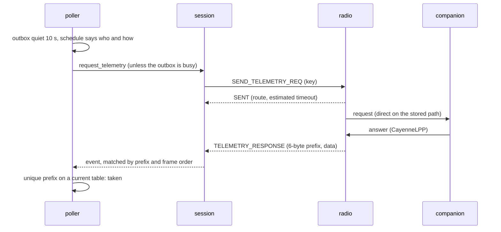
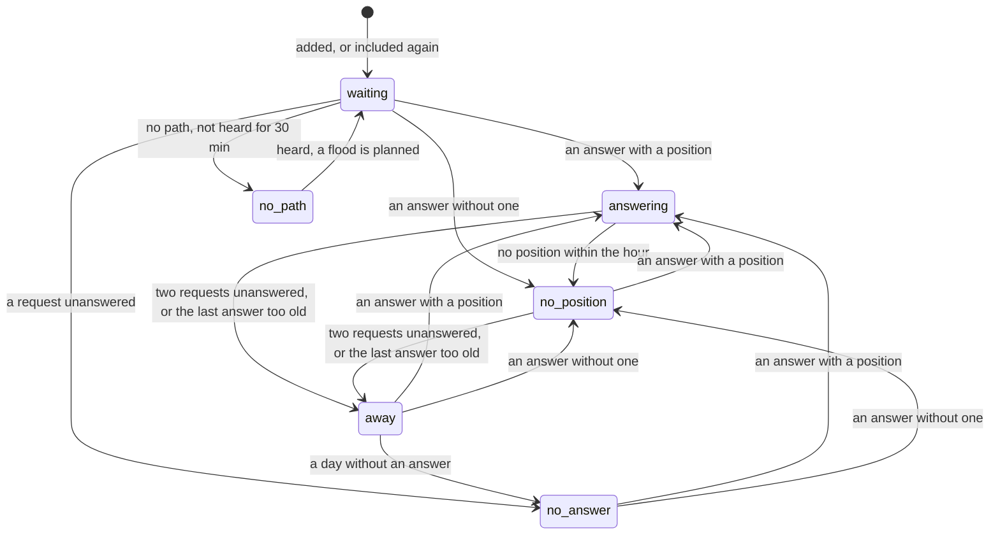
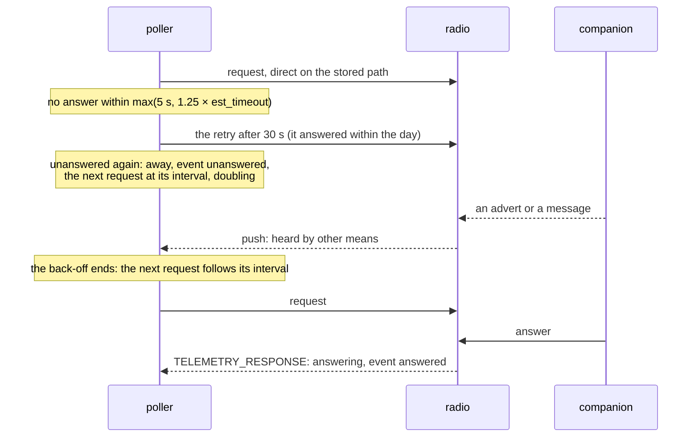
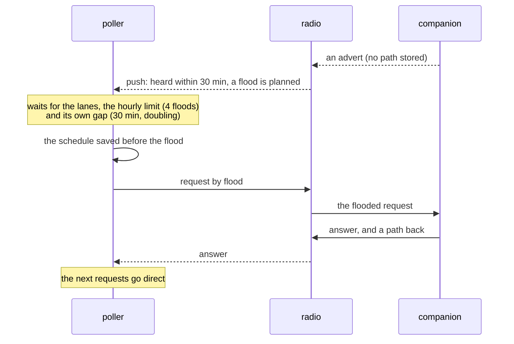

# Design: telemetry

Part of the [design](design.md), section 6.11: whom the gateway asks for telemetry, how and
when, what the answers become, and what is kept across a restart.

## 6.11 Telemetry

[ADR 0018](decisions/0018-telemetry-pulled-from-the-households-companions.md): the gateway asks the
household's companions for battery, readings and position with `SEND_TELEMETRY_REQ`; a companion
answers only contacts it allows (denial is silence). On by default (`[telemetry] enabled`); the
household excludes every companion that is not its own, or, with `[telemetry] ask = "household"`,
includes those that are (SEC-016): then a contact is asked only once included, or as a contact
target or command sender, and the first start holds nothing. Values expire when a companion stops
answering ([ADR 0024](decisions/0024-telemetry-values-in-home-assistant-expire.md)).

* **Who.** Every chat contact of the radio's table that the household did not exclude and whose
  first 6 key bytes no other contact and not the radio's own key share: the 0x8B names the
  answering contact by those bytes only (an excluded look-alike still blocks its twin). Nothing is
  asked while the radio adds contacts of any type on its own (a look-alike could enter the table
  and answer in its place); the managed profile switches that off.
* **Exclusion.** `contacts/<key>/telemetry` (`off`, `on`), the switch *Telemetry* and `contacts
  telemetry` reach the contact manager, which takes the request at once, without the radio, its
  worker or `[contacts] manage`, and without an await, so storage, documents and event cannot
  interleave with the poller. `off` is taken for any well-formed key, also one not on the radio
  yet: exclusion only narrows what the gateway does. The keys (at most 1024) are kept in
  `telemetry-excluded.json` in the state directory, written atomically and only when the set
  changed; `off` takes effect also when the file cannot be written (`not_saved`, written again at
  every status tick), `on` only once stored. A file that cannot be parsed is left as it is and
  pauses telemetry (`exclusions_unreadable`) until it is fixed or deleted and the service
  restarted: the gateway asks nobody rather than everybody. An exclusion withdraws a request that
  waits for the radio's lock, drops an answer that arrives anyway (checked after the table wait,
  and by the observer), counts a silence as nothing learned, and forgets the contact's answers in
  the schedule; when it was asked and flooded stays, so the flood limits hold. An inclusion makes
  it `waiting` and due at once. One owner holds the set: the observer; the contact manager and the
  poller read it.
* **The first-start hour.** When telemetry starts on a state directory whose state file has no
  telemetry record (it never ran there), the poller sends nothing for an hour from its first step
  with a read table: `paused` with `first_start`, one warning with the number of companions it
  will ask. What is left of the hour is saved with the schedule, so a restart neither skips nor
  extends it (an unknown elapsed time keeps all of it). An update to a default-on version has no
  moment of opt-in; the hour gives the household one.
* **One at a time.** The firmware keeps one pending request; the poller is its only user (the
  gateway sends no other remote request). It waits `max(5 s, 1.25 × est_timeout)` from `SENT`. An
  answer is taken for the contact asked, or as the late answer of the last request until the next
  one, at most 60 s after its wait; an answer read before a request's `SENT` belongs to the one
  before (frame numbers). It is taken only on a table that shows every change the radio reported
  (held up to 15 s for the re-read), with the prefix still unique; a late answer older than one
  taken is dropped (frame numbers within a session, not the wall clock, which may be set back).
  The binary answer 0x8C carries no sender and is never read.
* **Messages first.** No request while the outbox has a message, is delivering one (which includes
  waiting for its acknowledgement), or had one or received one in the last 10 s (not a message of a
  channel the configuration ignores, which nothing answers); a message queued while a request waits
  for the radio withdraws it unwritten. A message queued after the request went out is sent at once;
  it may share the channel with the request's answer for about a second (direct), or with a flood
  for up to its timeout.
* **Routes.** Direct only: a contact with a stored path is asked on it. One without a path is asked
  by flood only when it was heard by other means within 30 minutes when the flood is planned (an
  advert, also one from before it was added or, as the history keeps it, from before a restart; a
  message as it arrived; a path it sent; never its own telemetry answers, never a message fetched at
  connect, never the path of the gateway's own flood, never an advert of a repeater, room or sensor
  the radio did not add). Heard after its last request (sent or tried), it is due at once, and its
  flood is planned also while the hourly limit holds. A flood once planned stays planned while it
  waits for the lanes, a retry or the hourly limit, however the contact is heard meanwhile, as long
  as the gateway keeps deciding (plans are dropped after 5 minutes without a decision, the radio
  away) and the contact stays a candidate without a path and its own gap stays over (one that leaves
  loses its plan, and so does one whose gap grows to a day when its last answer turns a day old; a
  restart drops every plan). At most 4 floods an hour for the gateway and one per contact per 30
  minutes, the gap doubling with each flood until a direct answer (up to a day); a contact that has
  not answered within a day gets one flood a day. A flooded request teaches both sides a path, so
  the next requests go direct. **The gateway never resets or writes a path for telemetry:** a stored
  path that no longer works stays until the companion sends a path or a message's flood fallback
  resets it ([design §6.2](design.md#62-outbound-path)); a contact whose path was reset is then asked again only once it is heard. A
  companion away when an alert to it fell back to a flood is therefore found again when it
  advertises or sends a message, not by itself. A request written whose `SENT` never came (the link
  broke, or the gateway stopped) counts as sent as planned, so a reconnect or a restart does not
  repeat a flood, and its answer is still taken as late for two minutes. A request refused or
  withdrawn counts as tried: a sign of life from before it does not bring it forward again.
* **Lanes.** Two token buckets, separate from the message budget: 18 s an hour of the gateway's own
  transmit time and 90 s an hour of estimated airtime in the mesh (every hop of request and answer;
  a flood as repeated by 20 repeaters, an assumption). Both start empty at every start (a restart
  adds no burst; a debt is saved and carried over, less what the stop paid back) and when the
  radio's settings change (the debt carried over again), and hold the costliest planned request, a
  flood (0.821 s and 20.4 s at EU/UK Narrow). A request is charged in full when the radio reports
  it sent, answered or not; a flood the radio sent for a request planned direct, and a flooded
  answer the packet log shows, are charged as what they were, as a debt the refill pays back first.
  A direct request costing more than a lane holds is not sent (at EU/UK Narrow more than 18 hops
  for a 19-byte answer with one-byte path hashes; fewer with longer hashes or answers).
  A due flood waits at most 10 minutes behind direct requests, then goes first. Over any interval
  *T* telemetry's own transmit time is at most `0.821 + 18 × T / 3600` s plus one charge beyond the
  level, and its estimated mesh airtime `20.4 + 90 × T / 3600` s plus one; the radio's measured
  transmit time is a backstop for its own share only (polls pause from 180 s in an hour), nothing
  measures the others'.
* **Intervals** from a share of channel time per companion, request to request: 1 % while it moves,
  0.1 % at rest, at least 90 s and 15 minutes (a neighbour at EU/UK Narrow: 90 s and 15 min; over
  two repeaters 4.7 and 47 min); once an hour without a position in its answers. Moving means 50 m
  or more from the last fix; two answers under 50 m mean resting again (at rest the reference
  stays, so slow drift adds up and jitter never counts). A new contact counts as resting.
* **Back-off.** An unanswered request is retried after 30 s once (a contact that answered within a
  day, asked directly), then asked at its interval doubling with every failure: at least every
  `max(30 min, its interval)` while it answered within the day, so it is found again that long
  after it comes back without sending anything (30 min for a neighbour at rest, an hour without a
  position); up to 6 h after a day without an answer and for one that never answered. Hearing it by
  other means ends the back-off: the next request follows its interval after the last one, never
  sooner (a contact without a path: at once, see Routes). Over TCP a timeout during a table
  listing, one that ran or was still running in the wait (when the radio's push queue drops
  frames), counts only the second time in a row.
* **Refusals.** `ERR 1` switches telemetry off until the radio reconnects (firmware without the
  command, or a later one that dropped it); `ERR 2` skips the contact until the next table read;
  `ERR 3` (no free packet buffer) pauses requests for 60 s. A disconnect during the wait counts
  nothing.
* **Readings** ([mqtt-api.md](mqtt-api.md#reading-keys)). The 13 single-value CayenneLPP types
  that 1.18 companions send are published under `ch<channel>_<type>[_<n>][_<unit>]`, `<type>` the
  library's name, `<n>` from 2 for a further reading of one channel and type; GPS is the position,
  other types are decoded and not published. `battery_v` is the answer's first entry if it is the
  channel 1 voltage, `mcu_temperature_c` its last if it is a channel 1 temperature and nothing after
  it was left undecoded (the firmware's order); both leave `readings`. Luminosity has no unit: the
  T1000-E, its only 1.18 sender, sends 0–100 % in it, other boards lux. Values are the integers sent
  divided, never rounded again.
* **Positions** go to the contact's document and its tracker ([design §6.6](design.md#66-observer-documents-and-history)).
* **States and expiry.** The scheduler computes each companion's state from its schedule:
  `answering` or `no_position` while its answers are current (at most one request in a row
  unanswered, the last answer at most `max(1 h, 3 × its interval)` old; located while the newest
  answer, or one within the last hour, carried a position), else `away` within a day of an answer,
  `no_path` for a candidate without a path that was not heard within 30 minutes and has no flood
  planned, `no_answer` after a failure, `waiting` otherwise; the poller adds `excluded` and
  `look_alike` (from the table as last read and the radio's own key, in every step, also while
  paused), the observer `off`. The documents pull the state from the poller; the poller
  re-evaluates every chat contact at every step and the asked one after each outcome, and
  republishes a contact whose state changed. The tracker of a telemetry position and the telemetry
  sensors in Home Assistant follow `position_current` and `telemetry_current`
  ([ADR 0024](decisions/0024-telemetry-values-in-home-assistant-expire.md)).
* **Events** on `telemetry`, only for requests that were sent: `unanswered` when a companion that
  answered within the day leaves its second request in a row unanswered (once per absence: the
  count resets only with an answer), `answered` for an answer after two or more failures in a row,
  or the first since the contact was added or included again. An expiry by the time bound alone
  (paused, the radio away, no path, the gateway stopped) raises none.
* **Status.** `state.telemetry` is `on`, `off`, `unsupported` or `paused`; while paused
  `state.telemetry_reason` says why: `first_start`, `no_radio` (no radio session),
  `exclusions_unreadable`, `auto_add` or `radio_airtime`.
* **Persistence.** The schedule (per contact the due time, failures, the times of its last answer,
  request and flood, how long its answers count and when one last carried a position, whether it
  was last moving, the size of its answers, since when it left the candidates; the gateway's
  floods of the last hour, the lanes' debt and what is left of the first-start hour) is kept under
  `telemetry` in the state file, relative to the time it was saved (a contact of the last run
  keeps its schedule until a table read lacks it, however long the radio was away),
  without positions. It is saved every 5 minutes after a change, at once after a flood (before its
  wait, so a crash cannot repeat it) and at the stop. A contact that left the candidates keeps its
  schedule for a day; one the radio's table adds again forgets its answers, as at an inclusion.
  When the clock went back while the gateway was stopped, the time stopped is unknown: it counts
  as nothing, except that every last answer counts as more than a day old
  (fewer requests until the next answer, never more) and no located time is kept. Restored before
  any task runs, the schedule gives each contact its state back at once, and the observer the time
  of its newest answer with a position, so a restart flips no state and raises no event. The
  observer keeps the last document of each companion whose answers are current in the state file
  too (at once when one turns current or no longer, or loses a position from adverts, so that a
  crash brings back none a check dropped; else with its minute tick and at the stop).
  Before the first table read it has no contacts. It keeps these documents in their latest state,
  also once they expired, stores each change at once, and publishes them again when their state
  changes, and each again at every connect of the broker (it may have missed one: a run that
  stopped before it was back). So after a restart without the radio they still expire at their
  bound, also when a run stopped before the broker connected. The first table read replaces
  them. The exclusions are kept in their own file (above).

### Diagrams

How a companion's state changes, as the scheduler computes it at each step (*States and expiry*
above); `excluded` and `look_alike` (the poller) and `off` (the observer) take precedence over
every state:

An unanswered request, the back-off, and the companion found again (*Back-off*, *Events*):

A companion without a path (*Routes*, *Lanes*, *Persistence*):

