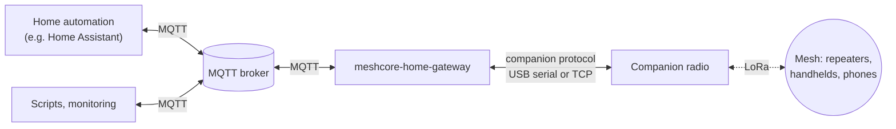
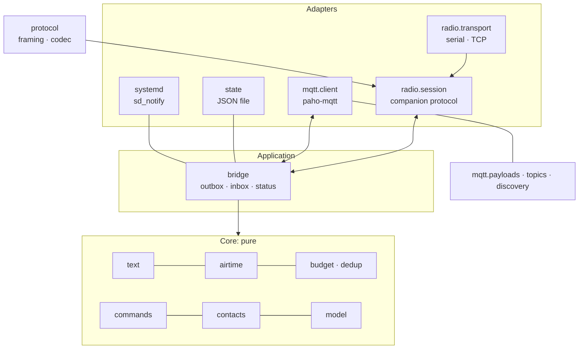
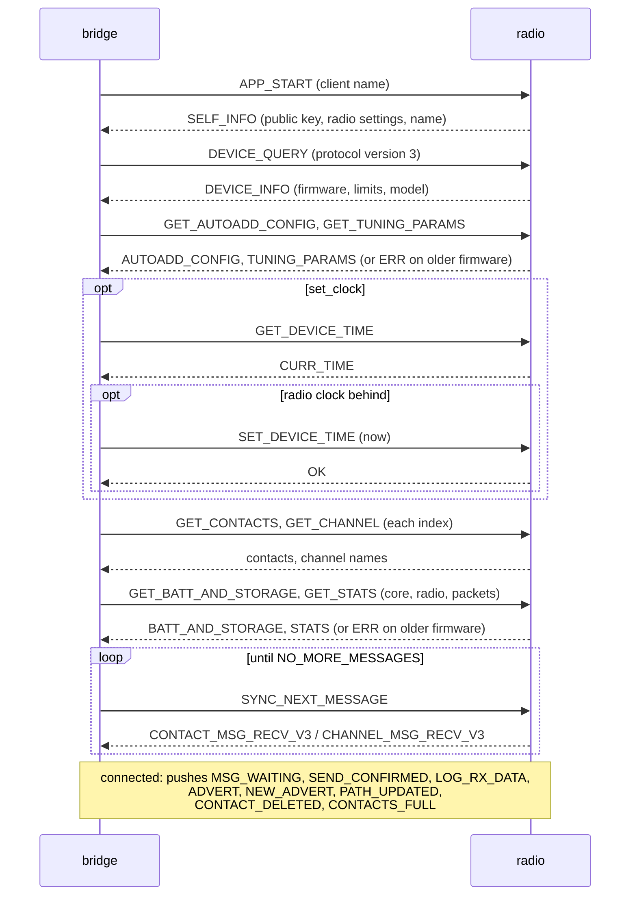
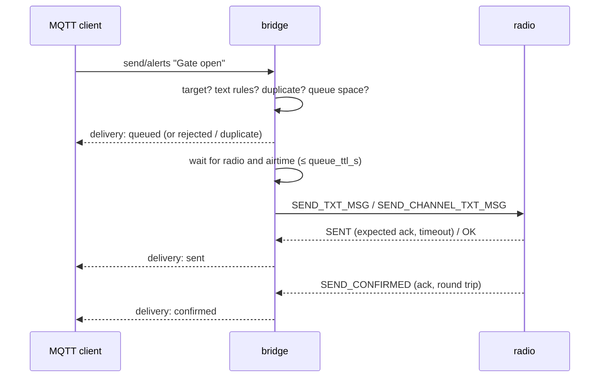
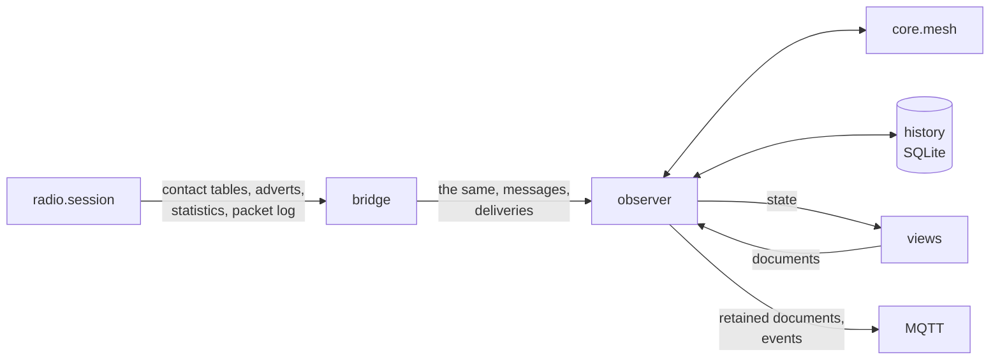
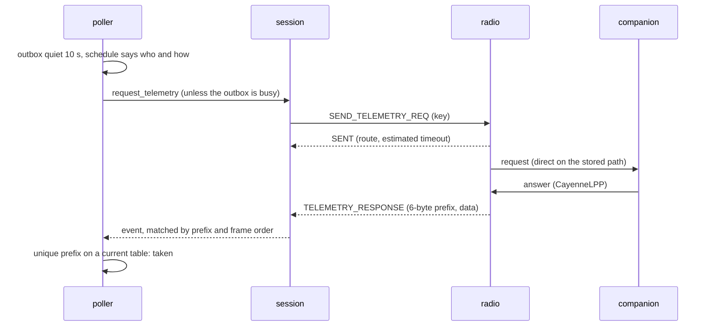

# meshcore-home-gateway: design

| | |
| --- | --- |
| Status | Accepted for 0.1; the observer (§13) accepted 2026-10-23 |
| Date | 2026-10-18, extended 2026-10-23 |
| Decisions | [`docs/decisions/`](decisions/README.md) |

## 1 Summary

meshcore-home-gateway connects one MeshCore companion radio to an MQTT broker. Automations publish a
text to a topic and the bridge sends it over the mesh; messages the radio receives appear as MQTT
events; direct messages from allowlisted contacts that start with a configured word become command
events. The bridge budgets airtime, suppresses duplicates, reports the delivery state of every
message, and announces itself to Home Assistant through MQTT discovery. It is small, has one runtime
dependency from the Linux distribution, and installs on Proxmox VE into its own unprivileged
container.

## 2 Context and scope

[MeshCore](https://github.com/meshcore-dev/MeshCore) is a LoRa mesh firmware. A *companion radio*
is a node that a client (phone app, script) controls through a binary protocol over BLE, USB serial
or TCP. Repeaters relay packets; contacts exchange end-to-end encrypted direct messages; channels
are group messages encrypted with a shared secret.

A home automation system can use the mesh as an independent reporting path: alerts reach handhelds
when the internet or the mobile network is down, and people can send simple commands back. The
bridge is the piece in between.

In scope: text messages to and from configured contacts and channels, delivery state, commands,
status, Home Assistant discovery, deployment on Proxmox VE and on any systemd-based Linux. Since
[ADR 0014](decisions/0014-the-gateway-as-the-households-mesh-observer.md) the gateway is also the
household's **mesh observer**: it harvests what the radio reports (positions, heard nodes, the
radio's own statistics), manages the radio's contacts, pulls telemetry and positions from the
household's own companions, keeps a local history, and offers all of it as provider-neutral
documents for Home Assistant and later front ends (§13).

## 3 Goals and non-goals

**Goals**

| ID | Goal |
| --- | --- |
| G1 | Send text to a configured target (channel or contact) by publishing to an MQTT topic. |
| G2 | Publish every received message; publish authorised commands as separate events. |
| G3 | Report the delivery state of each outgoing message (queued, sent, confirmed, failed …). |
| G4 | Protect the shared channel: airtime budget, duplicate suppression, bounded retries. |
| G5 | Home Assistant integration without custom code, through MQTT discovery. |
| G6 | Minimal supply chain: Python standard library plus the distribution's `paho-mqtt`. |
| G7 | Installation on Proxmox VE in one step, configured through dialogs. |
| G8 | Observable: availability, radio link, battery, airtime use, logs, watchdog. |
| G9 | Observer: contacts with their own Home Assistant devices, heard nodes, positions and telemetry of the household's companions, the radio's measured duty cycle; nothing about the household leaks to the mesh ([ADR 0014](decisions/0014-the-gateway-as-the-households-mesh-observer.md)). |
| G10 | One set of provider-neutral documents for every front end, with a local history ([ADR 0015](decisions/0015-provider-neutral-documents-on-the-bus.md), [ADR 0016](decisions/0016-history-in-a-local-sqlite-database.md)). |
| G11 | In the household's language: English, German, Dutch, Polish, French ([ADR 0019](decisions/0019-internationalisation-with-gettext.md)). |

**Non-goals**

* Repeater and room-server administration, requests to nodes that are not the household's
  contacts, firmware updates, changing the radio's frequency or modulation
  ([ADR 0014](decisions/0014-the-gateway-as-the-households-mesh-observer.md)).
* BLE as a transport (possible later as another adapter).
* Several radios in one process: run one instance per radio (topics are per node).
* Persisting the outgoing queue across restarts: a restart drops queued messages without a final
  delivery event (see §8).
* Guaranteed delivery. Radio is best effort; the bridge reports what happened.

## 4 Requirements and constraints

### 4.1 Functional requirements

| ID | Requirement |
| --- | --- |
| F1 | A UTF-8 text published to `<base>/<node>/send/<alias>` is sent to the target `<alias>`. Unknown aliases are rejected with a delivery event. |
| F2 | Texts are cleaned (control characters, spaces), optionally transliterated to ASCII, and limited to the byte limit of the target type; too long texts are truncated (marked `...`) or rejected. |
| F3 | Direct messages are retried until acknowledged, up to `max_attempts`; after `flood_after` unacknowledged attempts the stored path is reset so the next attempt floods. |
| F4 | Messages wait in a bounded queue for the radio and for airtime; after `queue_ttl_s` they expire. |
| F5 | The same text to the same target within `dedup_window_s` is sent once. |
| F6 | Every received message is published on `received`, with sender, channel, signal and the command verdict. |
| F7 | A received message is a command only under the rules of §7.3; accepted commands are published on `command` with the word as `event_type`. |
| F8 | Availability (`online`/`offline`, retained, with last will) and a retained state document are published. |
| F9 | Home Assistant discovery publishes one device with connectivity, battery, airtime, queue, message, delivery and command entities and one notify entity per target; the device shows the radio's model, firmware and key. |
| F10 | The CLI checks a configuration, probes a radio (contacts, channels), sends and listens via MQTT, and renders a configuration from installer answers. |

### 4.2 Quality requirements

| ID | Requirement | Measure |
| --- | --- | --- |
| Q1 | Security | Commands only from allowlisted full public keys, never from channels; replay and clock checks; no execution in the bridge (§7). |
| Q2 | Reliability | Reconnects to radio and broker without restart; systemd restarts the process on crash or hang (watchdog). |
| Q3 | Resource use | Idle CPU near zero, resident memory below 50 MB, container disk below 1 GB. |
| Q4 | Maintainability | Branch coverage ≥ 90 %, `mypy --strict`, `ruff`; one module, one responsibility. |
| Q5 | Supply chain | Runtime: standard library and Debian's `python3-paho-mqtt`; tools hash-pinned with a 14-day cooldown; actions pinned to commit SHAs; release files reproducible and attested. |
| Q6 | Privacy | Message texts are logged only at debug level. |

### 4.3 Constraints

* **Protocol limits** (MeshCore v1.18.0, details and sources in [`protocol.md`](protocol.md)): frames
  carry at most 176 bytes; a text is at most 160 bytes (10 cipher blocks); the radio queues at most
  16 frames for a disconnected client and tracks at most 8 expected acknowledgements.
* **Regulation.** In the EU sub-band 869.40–869.65 MHz, short-range devices may transmit with up to
  500 mW e.r.p. at a duty cycle of at most 10 % (ERC Recommendation 70-03, Annex 1). Other bands and
  regions have other limits; the airtime budget is configurable and defaults far below.
* **Platform.** Linux with Python ≥ 3.11 and `paho-mqtt` ≥ 2.0. The reference target is Debian 13
  (Python 3.13, `python3-paho-mqtt` 2.1.0).

## 5 Architecture

### 5.1 Ports and adapters

The core holds the rules and calculations and does no I/O. The application layer orchestrates. The
adapters talk to the radio, the broker, the file system and systemd
([ADR 0007](decisions/0007-hexagonal-architecture-with-an-asyncio-core.md)).

| Package / module | Responsibility |
| --- | --- |
| `core.text` | Clean, transliterate and limit outgoing text. |
| `core.airtime` | LoRa time on air; on-air size of MeshCore text and telemetry packets, the airtime a telemetry request causes. |
| `core.budget` | Airtime token bucket (with a debt for airtime already spent); event rate limit; duplicate suppression. |
| `core.lpp` | CayenneLPP decoder for telemetry answers; the position in them and the names of their readings. |
| `core.telemetry` | The telemetry schedule: whom to ask next, by which route and when, within two airtime lanes; each companion's state (§6.11). |
| `core.contacts` | Resolve 6-byte key prefixes to full keys; detect ambiguity. |
| `core.commands` | Decide whether a message is an authorised command. |
| `core.mesh` | The observer's view of the mesh: contacts with when they were heard and where they are, nodes heard but not added; the radio's measured airtime over an hour. |
| `core.model` | Data classes shared by all layers. |
| `protocol.framing` | Frame encoder and incremental decoder. |
| `protocol.codec` | Command encoders and response decoders. |
| `protocol.packet` | On-air packets from the radio's packet log, and the adverts in them. |
| `views` | Providers: the documents of the MQTT API, built from the core's state (pure). |
| `radio.transport` | Serial port (termios) and TCP byte streams. |
| `radio.session` | Connection handshake, request/response, pushes, message sync, time sync. |
| `bridge` | Outbound queue with delivery and retries, inbound handling, status reporting, supervision. |
| `observer` | Feeds the mesh view and the history from the radio's reports, messages, telemetry answers and deliveries; publishes the documents. |
| `telemetry_poller` | Asks the companions for telemetry, one at a time, after the messages; takes an answer only for the contact asked (§6.11). |
| `history` | The local history in SQLite. |
| `mqtt.topics`, `mqtt.payloads` | Topic layout and JSON payloads of the public API. |
| `mqtt.discovery` | Home Assistant device discovery document. |
| `mqtt.client` | paho-mqtt adapter: connection, last will, subscriptions, hand-over to the event loop. |
| `config` | TOML loading with strict validation; rendering from installer answers. |
| `state` | Atomic JSON state file; ledger of accepted command timestamps. |
| `systemd` | Readiness, watchdog and status notifications. |
| `cli` | Command-line entry points. |

### 5.2 Concurrency

One asyncio event loop runs everything except paho's network thread. The paho callbacks pass data
to the loop with `loop.call_soon_threadsafe`; nothing else crosses threads, so the application code
needs no locks. The serial port is read with `loop.add_reader` on a non-blocking descriptor.

Long-running tasks on the loop, supervised by a task group:

* **radio supervisor**: connect, run the session, reconnect with exponential back-off (1 s doubling
  to 60 s, with jitter) when the transport fails;
* **outbox worker**: one outgoing message at a time, in order;
* **radio events**: acknowledgements and the receive log at once; received messages go to
* **message handler**, which processes them in order (a command that could be accepted may wait
  for a fresh read of the radio's contact table, §7.3, without delaying acknowledgements);
* **request reader**: turns MQTT send requests into queue entries or rejections;
* **status reporter**: publishes the state document on change and every 60 s, pings the systemd
  watchdog and writes an exclusion from telemetry that could not be stored yet (§6.11);
* **telemetry poller** (only with `[telemetry] enabled`, the default): one request to a companion
  at a time (§6.11). Its saved schedule is restored before any task starts.

On stop the telemetry poller is cancelled first, so no request goes out after it, and saves its
schedule; an answer that arrives later is dropped. Then the radio supervisor ends and closes the
session. The radio events and the message
handler then finish the messages the radio has already handed over, for at most 2 s (a command
waiting for its table read is rejected, `sender_unverified`); then the other tasks are cancelled.
Messages still waiting in the radio are fetched at the next start.

Each radio session runs two tasks of its own: a **reader** that routes frames, and a
**maintenance** task that re-reads the contact table after adverts and contact pushes, drains the
message queue on `MSG_WAITING` and every 5 minutes, and polls the battery every 60 s as a
heartbeat.

Waits with a time limit use `asyncio.timeout`, not `asyncio.wait_for`: on Python 3.11, `wait_for`
can lose a cancellation that arrives just as the awaited event completes, and the task group then
never finishes on shutdown (found by the test matrix).

## 6 Detailed design

### 6.1 Radio session

The session speaks the protocol subset of [`protocol.md`](protocol.md). The companion protocol is
strictly request/response for commands, with unsolicited *push* frames in between. The session
therefore sends one command at a time (an `asyncio.Lock`), routes push frames to handlers, and
hands the waiting command only frames with the response codes it expects; anything else (stale
frames after a reconnect, noise) is logged and dropped. Every command has a 5 s timeout; a timeout
or transport error closes the session and the supervisor reconnects.

* **Opening.** The serial port runs raw at 115200 baud, exclusively (`TIOCEXCL`), with DTR asserted
  and RTS cleared like the official Python clients: nRF52 radios only send while DTR is set, and
  RTS can reset ESP32 boards. 1200 baud is refused (it reboots nRF52 radios into the bootloader).
* **Resynchronisation.** The radio's serial frame parser has no timeout and keeps its state
  across reconnects, so over USB the session first writes 256 zero bytes and discards everything
  that arrives in the next 0.5 s. Over TCP it does not: each connection resets the WiFi parser,
  and zeros would misalign its 3-byte header reads (protocol.md, section 1).

* **Clock.** With `set_clock` (the default) the session reads the radio clock at connect and sets
  it when it is behind; the firmware only moves its clock forward. If the radio is ahead of the
  bridge by more than 60 s the bridge logs a warning; command age checks may then reject commands
  until the clock is right (visible as `too_old` or `from_the_future`). Without `set_clock` the
  clock is neither read nor checked.
* **Messages.** On `MSG_WAITING`, after connecting, and every 5 minutes as a safety net, the session
  drains the radio's queue with `SYNC_NEXT_MESSAGE` until `NO_MORE_MESSAGES`. Messages queued
  before the bridge requested protocol version 3 arrive in the legacy layout; both are decoded.
* **Contacts and channels** are read at connect time; contacts are re-read after advert, path and
  contact-table pushes, so key resolution (§7.3) sees new and changed contacts. Every key the
  radio names goes to the bridge, with whether the radio holds or held that contact: from a push
  before the next frame is handled, from a table read record by record before the read returns
  (§7.3). Channel slots without a name are not configured and never used (the radio would send
  with an all-zero key).
* **Managed profile** ([ADR 0020](decisions/0020-managed-radio-profile-for-the-observer.md)).
  After the auto-add and tuning settings are read and before the contact table is read, the
  session hands itself to the profile (`radio/profile.py`): a three-way reconcile of desired
  (configuration), last applied (state file, per radio key) and live (the radio) in
  `core/profile.py` names what to write; one setter per command, then the settings are read back.
  After the table read, protected contacts are added or made favourites. A bug there is logged and
  the connection goes on. When the profile only observes, the session warns if the radio adds
  contacts on its own (§7.2).
* **Messages fetched at connect** are marked: they may have arrived while no session listened to
  the radio's pushes (§7.3).
* **Liveness.** A battery query every 60 s doubles as a heartbeat; with it the session reads the
  radio's statistics (noise floor, its own measured time on air, packet counters, uptime), unless
  the firmware does not have them.
* **What the radio reports** goes to the bridge as events beside the messages: every contact table
  it reads, every advert the radio checked (a contact's key, or the full record of a node it did
  not add, with its position) and the heartbeat's readings. The full contact records keep the
  path, flags and the position of the contact's last advert that carried one (protocol.md,
  section 3).
* **Telemetry.** `request_telemetry` sends `SEND_TELEMETRY_REQ` and returns the route and the
  estimated timeout from `SENT`; the answer is a push, awaited by the poller outside the command
  lock (§6.11). Its condition (`unless`, a message waiting in the outbox) is checked once the
  command holds the lock, so a message that came meanwhile goes first and nothing is written.
  The session numbers every frame it reads, so an answer read before a request's `SENT` belongs
  to the request before. `PATH_UPDATED` and `TELEMETRY_RESPONSE` go to the event queue.
* **Path reset.** `RESET_PATH` makes the radio forget the stored path without a push: the session
  patches its cached record the same way and reports the reset, so the outbox budgets the floods
  that follow and the contact's document says at once that no path is known.
* **Single client.** The radio must not serve another client (phone app) at the same time: both
  would drain the same message queue.

### 6.2 Outbound path

1. **Request.** The alias comes from the topic. A retained publish made while the bridge is
   connected arrives without the retain flag (MQTT 3.1.1) and is sent once; the copy the broker
   keeps arrives flagged at every later connection (reconnect or restart) and is rejected
   (`reason: retained`), so it is not sent again. Payloads over 1 KiB or not valid UTF-8 are
   rejected.
2. **Target.** Only configured aliases exist
   ([ADR 0008](decisions/0008-outbound-safety-targets-airtime-budget-deduplication.md)). A contact
   target is bound to a full public key; at send time its 6-byte prefix must match exactly one
   contact in the radio's table as last read, read again first when the radio has reported a
   contact change since, and that contact must have the configured key, otherwise the delivery
   fails (`ambiguous_target`, `unknown_contact`). The radio encrypts for the first contact with
   the prefix, so a look-alike it has just added would get the message; a change whose push was
   lost (over TCP) remains unseen until the next read. A channel target must be a named channel
   slot on the radio (`channel_not_configured`).
3. **Text.** `core.text` applies the policy. Limits: 160 bytes for a direct message; for a channel
   message the firmware prepends `"<radio name>: "`, so the limit shrinks by that prefix. Before
   the radio has connected once, the name is unknown: a channel text is checked against the
   shortest prefix and limited again when it is sent; one that may not be truncated then fails
   (`too_long`), as after a rename of the radio.
4. **Duplicates.** Same alias and same final text within `dedup_window_s` → `duplicate`. A
   request rejected because the queue is full does not count, so its retry is accepted.
5. **Queue.** Bounded (`queue_size`); a full queue rejects. Each entry carries its arrival time and
   a time to live of `queue_ttl_s`. A message that never left within that time is `expired`:
   `no_radio` (radio disconnected), `queue_ttl` (waited behind other messages) or
   `airtime_budget`. A message that left at least once and runs out of time is `failed` with
   `no_acknowledgement`. No attempt starts after the time to live, but the acknowledgement wait of
   the last one runs to its end (step 7), so a late acknowledgement still confirms the message and
   the final event can come up to 60 s after `queue_ttl_s`.
6. **Airtime.** Before each transmission the bridge estimates the packet's time on air (§6.3) and
   waits until the budget allows it; if the wait would exceed the remaining time to live, the
   message expires. A packet longer than `burst_s` could never be sent: it fails at once
   (`exceeds_airtime_burst`), and the bridge warns at connect if the radio's settings make long
   messages that slow.
7. **Send and confirm.** Channel messages are final at `sent`. Direct messages wait for the
   acknowledgement: 1.2 times the radio's estimate from `SENT`, bounded to 5..60 s, like the
   MeshCore Python client. Without an acknowledgement the bridge retries with the **same
   timestamp** and the next attempt number (0..3; the acknowledgement code depends on both); after
   `flood_after` unanswered attempts it first resets the stored path, so the next attempt floods.
   Late acknowledgements of earlier attempts still count. After `max_attempts` the state is
   `failed`. A recipient whose acknowledgement got lost receives the retry as a second message;
   the firmware does not deduplicate it. An attempt interrupted by a radio error (disconnect,
   timeout) is repeated with the same number once the radio is back, within the time to live. If the
   radio had already sent it, the repeat is the identical packet, and nodes that saw the first copy
   drop it ([`protocol.md`](protocol.md#5-semantics)): a channel message arrives once; a direct
   message's repeat earns no acknowledgement, so the bridge waits out its timeout and the next
   attempt may show up at the recipient as a second message. The radio's own refusals (ERR,
   `disabled`) end the delivery as `failed` with the error name.

Messages leave strictly in arrival order, one at a time. A message waiting for an acknowledgement
delays the next one; this keeps the protocol simple and the channel calm (the radio tracks at most
8 acknowledgements anyway).

### 6.3 Airtime estimate and budget

Time on air follows the Semtech SX126x datasheet formula; the radio's own settings come from
`SELF_INFO` (frequency, bandwidth, spreading factor, coding rate). The packet size is modelled from
the MeshCore packet format ([`protocol.md`](protocol.md#6-on-air-sizes)): header, path length and
path, then for a direct message the destination and source hashes, a 2-byte MAC and the AES-128
ciphertext of timestamp, flags and text, padded to 16-byte blocks; for a channel message the
channel hash, the MAC and the ciphertext of timestamp, flags, name prefix and text.

Modulation details from the firmware: preamble 32 symbols up to SF 8 and 16 above, CRC on,
explicit header, low data rate optimisation from 16 ms symbol time. The estimate counts 4
transport-code bytes on every flood and, for a flooded direct message, the path packet the radio
sends back after the acknowledgement, sized for a recipient 4 path bytes away (4 hops with
one-byte hashes). Up to that distance it errs on the high side; over more hops the path packet
is larger than counted ([`protocol.md`](protocol.md#6-on-air-sizes)). The implementation
reproduces published reference values and RadioLib's own calculation (`tests/test_airtime.py`).

The budget is a token bucket over seconds of airtime
([ADR 0008](decisions/0008-outbound-safety-targets-airtime-budget-deduplication.md)): it holds at
most `burst_s` (default 10 s) and refills at `budget_s_per_hour` (default 36 s, 1 % of an hour).
Over any interval *T* the airtime the bridge counts for its own transmissions is bounded by
`burst_s + budget × T / 3600` per run of the service: the bucket is not stored, each start begins
with a full burst. The count is exact except for a flooded attempt to a recipient more than 4 path
bytes away, whose returned path packet is longer than estimated (protocol.md §6).
Each attempt of a direct message counts. The radio's other transmissions (acknowledgements it
sends, adverts, path returns) are not counted; the default leaves 9 percentage points of the 10 %
EU duty cycle for them. Telemetry has two budgets of its own, which never take from this one
(§6.11).

### 6.4 Inbound path

1. A message frame is decoded into `InboundMessage` (kind, text, sender prefix or channel index,
   sender timestamp, SNR, hop count, text type).
2. Exact repeats (same sender or channel, timestamp and text within an hour) are dropped: that is
   how a sender's retries arrive.
3. The sender prefix is resolved against the contact table as last read; for a possible command
   (a direct message whose first word is a command word) §7.3 decides whether the table has to be
   read again first.
4. `core.commands` decides: not a command, accepted, or rejected with a reason.
5. The bridge publishes the message on `received` (with the verdict), and an accepted command on
   `command`. The newest accepted timestamp per sender goes to the state file before the event is
   published, so a crash cannot turn into a replay; if the file cannot be written, the command is
   rejected (`state_unwritable`) and the service carries on. A command refused because the broker
   is unreachable (`broker_unavailable`) stores its timestamp too: its sender was verified.
6. Channels listed in `ignore_channels` are not published (busy public channels).

### 6.5 MQTT interface

The full API with payload examples is in [`mqtt-api.md`](mqtt-api.md).

| Topic below `<base>/<node>/` | Direction | Retained | Content |
| --- | --- | --- | --- |
| `availability` | out | yes | `online` / `offline`, last will `offline` |
| `state` | out | yes | JSON: radio link, battery, airtime, queue, radio and device info |
| `send/<alias>` | in | must not be | UTF-8 text to send |
| `delivery` | out | no | JSON with `event_type` = delivery state |
| `received` | out | no | JSON with `event_type` = `contact` or `channel` |
| `command` | out | no | JSON with `event_type` = command word |
| `rx` | out | no | JSON per received packet: SNR, RSSI, raw bytes (optional) |
| `stats`, `contacts`, `contacts/<key>`, `nodes`, `history` | out | yes | JSON documents of the observer (§6.6) |
| `contact`, `node` | out | no | JSON: a contact added or removed, the result of a contact request (also excluded from telemetry or included again); a node heard for the first time |
| `contacts/<key>/telemetry` | in | must not be | `on`, `off` or JSON: include a companion in telemetry, or exclude it (§6.11) |
| `telemetry` | out | no | JSON: a companion answers again, or stopped answering (§6.11) |

* QoS 1 throughout, except command events. MQTT 3.1.1 with a clean session: requests published
  while the bridge is
  offline are lost, which is the safer choice for alerts that would otherwise arrive late. Events
  the bridge publishes while the broker is down are queued in memory (up to 1000, more are
  dropped and counted in the log) and sent after the reconnect; retained documents are not
  queued, because the reconnect publishes availability and state again. Commands are refused
  while the broker is unreachable (`broker_unavailable`): delivered after the reconnect, they
  would trigger automations at an arbitrary later time. A broker that vanishes silently (power
  loss, network) is noticed only after one to two `keepalive_s`; command events go out with QoS 0,
  so one sent in that time is lost instead of being resent after the reconnect. The sender then
  gets no answer and can send the command again.
* On reconnect the bridge republishes availability, discovery and state; when Home Assistant
  announces itself on `homeassistant.status_topic` (default `homeassistant/status`), discovery and
  state (availability is retained, so Home Assistant receives it with its subscription).

### 6.6 Observer: documents and history

The bridge hands the observer everything the radio reports (contact tables, checked adverts,
statistics, the packet log), every received message and every final delivery
([ADR 0014](decisions/0014-the-gateway-as-the-households-mesh-observer.md)). The observer keeps the
core's view of the mesh, writes the history
([ADR 0016](decisions/0016-history-in-a-local-sqlite-database.md)) and publishes the providers'
documents ([ADR 0015](decisions/0015-provider-neutral-documents-on-the-bus.md)): `stats`,
`contacts` and `contacts/<key>`, `nodes`, `history`, and the events `contact`, `node` and
`telemetry`.

* **Only changes are published**: the observer remembers the last payload per topic; after a
  reconnect to the broker it publishes them all again. The topic of a contact that left the table
  is cleared with an empty retained message; the keys of published contacts are kept in the state
  file, so contacts removed while the gateway was stopped are cleared at its first table read.
* **Signals of adverts**: the radio logs every packet before it handles it, and pushes `ADVERT` or
  `NEW_ADVERT` only for adverts whose signature it accepted. The observer takes hops, SNR and RSSI
  from the push's own log: while the radio's receive delay is 0 (its default, read at connect),
  the logged advert of the same key that is the frame directly before the push; else from a logged
  advert of the key within 10 s before it. The logged content itself is never trusted on its own
  (protocol.md, section 4).
* **Positions** come from contact records (the radio keeps the position of a contact's newest
  advert that carried one, also after the contact stopped sharing it) and from the contacts' own
  telemetry (§6.11). A position from adverts exists only while the record holds one and the
  contact's last checked advert, if any, carried one (next item); a record without a position
  drops an advert position of any contact, and a telemetry position is never touched. A telemetry
  position replaces the fix when it moved 20 m or more, or when the fix came from an advert; its
  time is when it changed, so a companion at rest writes nothing per answer, neither in the
  history nor in Home Assistant's recorder. It carries an accuracy of 15 m (the cell of 0.0001°
  the encoder truncates to, and the receiver's own error). A changed advert position replaces a
  telemetry fix, an unchanged one does not. A position from telemetry expires (§6.11):
  `position_current` says whether it is current, and the document keeps it. Nodes that are not
  contacts keep none.
* **Positions in adverts** ([ADR 0025](decisions/0025-positions-in-adverts-checked-from-the-packet-log.md),
  `core/adverts.py`): the observer keeps each logged advert (at most 64, at most 40 s) and, at a
  contact's `ADVERT`, its pending advert with the key's logs. The next table read whose record
  shows the logged timestamp as `last_advert` decides: while the receive delay is 0, the log that
  is the frame directly before the push; otherwise every log of the key with that timestamp must
  agree. A flagged log must hold the record's position; a new position in the record since the
  read before, with a newer `last_advert`, is evidence on its own. A read older than the log waits
  for the next one (at most 30 s). A heard companion's `NEW_ADVERT` carries the record made from
  that advert alone and is checked at once; its heard node keeps only the time and flag, and the
  table read that adds it takes them. When nothing is learned the last check stays and one debug
  line says "not checked". While a companion's newest advert is not checked,
  `advert_carries_position` is the last check's flag, or `true` when the record holds a position:
  it errs to warn. The index lists the companions not excluded from telemetry whose value is
  `true`; the event `position_in_advert` comes when such a companion's check turns to carrying, at
  an add with a check that carries, and at an inclusion while it carries. The last check of each
  companion is kept in the state file (`advert_checks`, no position); a logged position is held at
  most about two minutes and never stored or published.
* **Readings** of every answer the poller takes go to the contact's document (`battery_v`,
  `mcu_temperature_c`, `readings`, `readings_at`, the gateway's time of the answer) and to the
  history's table `reading`, one row per value, in one transaction. The table was added to the
  history's version 2 with `CREATE … IF NOT EXISTS` instead of a version 3: an older gateway opens
  a file of a newer version without any history, and it ignores an added table, so a downgrade
  keeps its messages and positions. Readings are kept for `readings_days`; beyond 200 000 rows the
  oldest go, but never the rows of a contact's newest answer, which is restored at start, unless
  telemetry is on and its saved schedule knows a later answer the history missed (it was off or
  broken, or an older version ran): old values must not read as current. After the clock went
  back while the gateway was stopped the schedule cannot tell (every answer counts as more than a
  day old), and the history's newest comes back, not as current. A contact's document and the
  history show the same answer.
* **Exclusion** (§6.11): an excluded companion's readings, its time of the newest position and a
  position from telemetry are forgotten, and the position its record carries takes the place, as
  at a first table read, while the companion still shares it; its rows in the history stay until
  their age removes them and are not restored while it is excluded. `forget` deletes its readings
  and positions from telemetry in one transaction; its advert positions and when it was last
  heard stay.
* **Last heard** follows adverts and messages at once; a contact heard only by its telemetry
  answers moves it at most once an hour, keeping the signal of its last advert or message (an
  answer reports none).
* **Failures stay local**: an exception in the observer is logged and does not stop messages,
  deliveries or commands; a history that cannot be written switches itself off for the run.

### 6.7 Home Assistant

The bridge publishes one device-based discovery document for itself
([ADR 0010](decisions/0010-home-assistant-through-mqtt-device-discovery.md)) and one for each
contact ([ADR 0017](decisions/0017-contacts-on-the-radio-each-with-its-own-device.md)); entities
and example automations are in [`home-assistant.md`](home-assistant.md).

| Entity | Platform | Source |
| --- | --- | --- |
| Radio link | `binary_sensor` (connectivity) | `state` → `radio`; the radio's static facts as attributes |
| Battery | `sensor` (voltage) | `state` → `battery_v` |
| Airtime last hour | `sensor` (duration) | `state` → `airtime_1h_s` |
| Airtime available | `sensor` (duration) | `state` → `airtime_available_s` |
| Queue | `sensor` | `state` → `queue` |
| Last packet RSSI, SNR | `sensor` (signal strength), disabled by default | `rx` (only with `publish_rx_log`) |
| Message | `event` (`contact`, `channel`) | `received` |
| Delivery | `event` (delivery states) | `delivery` |
| Command | `event` (configured words) | `command` |
| Send to *alias* | `notify`, one per target | `send/<alias>` |
| Contacts, Nodes heard | `sensor` | `contacts` → `total`, `nodes` → `total` |
| Contact, New node | `event` | `contact`, `node` |
| Noise floor, Radio transmit time last hour, uptime and packet counters | `sensor`, diagnostic; the counters disabled by default | `stats` |
| Contact with remote access, Companion position in adverts | `binary_sensor` (problem) | `contacts` → `remote_cli_total`, `advert_carries_position_total` |
| Look-alike node heard | `binary_sensor` (problem) | `nodes` → `look_alike_total` |
| Show hidden contacts | `button` | → `homeassistant/show_hidden` |
| Add heard node | `select`, its own document | the heard nodes' labels → `homeassistant/add_node` |
| Add contact (key or link) | `text`, its own document | → `add_contact` |
| Remove from radio | `button` on each contact's device | → `contacts/<key>/remove` |
| Telemetry status | `sensor` (enum), diagnostic, attribute `reason` | `state` → `telemetry`, `telemetry_reason` |
| Telemetry airtime last hour, Telemetry mesh airtime last hour | `sensor` (duration), diagnostic, disabled by default | `state` → `telemetry_airtime_1h_s`, `telemetry_mesh_airtime_1h_s` |
| Telemetry | `event` (`answered`, `unanswered`) | `telemetry` |
| Telemetry | `switch`, configuration, on each companion's device | `contacts/<key>` → `telemetry_excluded`; → `contacts/<key>/telemetry` |
| Telemetry state | `sensor` (enum) on each companion's device | `contacts/<key>` → `telemetry_state` |
| Position in adverts | `binary_sensor` (problem) on each companion's device | `contacts/<key>` → `advert_carries_position` |
| Battery, MCU temperature, a sensor per reading | `sensor` (their class and unit, state class `measurement`) on a companion's device, with its first answer that carries them | `contacts/<key>` → `battery_v`, `mcu_temperature_c`, `readings`; available while `telemetry_current` |

All entities share the availability topic, so they become unavailable when the bridge is offline.
The document names the radio's model, firmware and key once the radio is known and is sent again
when they change; unknown fields are left out, because Home Assistant rejects a document with a
null device field. Components of an earlier run that the configuration no longer has are
removed: Home Assistant removes a component only when it is sent as `{"p": <platform>}` and only if
it has discovered it since its own start, so each announcement first sends a placeholder under the
old unique_id (it binds a leftover entity, or creates one for a moment), then the removal. The
state file keeps these removals pending for 30 days, because the gateway cannot tell when Home
Assistant has received them. The placeholders are enabled: when Home Assistant removes a disabled
entity, it clears the whole device's discovery topic itself. The gateway subscribes to that topic
and announces again when Home Assistant clears it.

Each contact's device (`mqtt/contact_devices.py`) sits on its own topic one level below the
gateway's device ID and follows the radio's table: it is announced after a table read, updated
when its document changes, and removed with placeholders first and then an empty document, once
more after Home Assistant's next birth message if it may not have been running. Its components
exist only with data (sending for companions, messages for companions and room servers, the
tracker once a position is known, the telemetry switch and state and *Position in adverts* for
companions, battery, MCU temperature and up to 16 readings with an answer that carries them) and
are never removed one by one; only the tracker has coordinates. The tracker of a position from
telemetry and the telemetry sensors are available only while the answers are current
([ADR 0024](decisions/0024-telemetry-values-in-home-assistant-expire.md)); the device and state
classes are interface and recorded in the snapshot. Entity IDs use a slug of the contact's name kept from its first appearance, also when
it comes back. The gateway subscribes to these topics: an empty document it did not send is the user
deleting the device in Home Assistant, and the contact stays hidden there until it leaves the table
or is shown again. At most `homeassistant.contact_devices` contacts get a device; one keeps its
device while it stays in the table, and free places go to protected contacts, favourites,
companions and the most recently heard, in that order.

The controls that add contacts (`mqtt/manage_entities.py`) have a discovery document of their own,
`…/manage_contacts/config`, whose components join the gateway's device: the select's options exist
only in discovery and follow the heard nodes, sent at most every 30 seconds but at once when a
contact joined or left the table, and at most 10 changes at once, then one a minute, also with
announcements and from a fresh start, which begins with 2 (Home Assistant warns from the 101st
change of an entity's capabilities within an hour, counts across the gateway's restarts, and writes
its entity registry for each); the main document with its placeholders is not sent again for them.
A label puts 12 and 8 key digits before the name, so no name can push the digits aside; the gateway
resolves a label against the heard nodes and the contacts as they are when the request arrives. The
text's pattern takes keys and contact links only: the field ends at 255 characters, and a contact
card cut there would still parse, with a cut name. The select, the text and each contact's remove
button are available while the gateway is online, the radio connected and management on (on
firmware the gateway is tested with, as the worker requires), the button also only for a contact
that is not protected; templates read keys that older documents lack with `is defined`, `is true`
or `.get()`, so retained documents of an earlier version read as unavailable without a warning.
Option changes wait while the broker is away: the reconnect announces the current ones, or, with no
change left in the budget, those sent before, and the current ones within a minute. Components of
the controls' document that a later version drops are removed like those of the main document; the
state file keeps them apart.

### 6.8 Configuration

One TOML file, `/etc/meshcore-home-gateway/config.toml`, owner `root`, group
`meshcore-home-gateway`, mode 0640 (it holds the broker password). Unknown keys are errors. Every
setting is in [`configuration.md`](configuration.md). The installer writes the file through
`meshcore-home-gateway config render`, which validates with the same code as the service and
creates a missing directory with mode 0755 whatever the umask, so that the service user reaches
the file.

### 6.9 Command line

| Command | Purpose |
| --- | --- |
| `meshcore-home-gateway run` | Run the bridge (systemd service). |
| `meshcore-home-gateway check-config` | Validate the configuration (and load the TLS files) and print a summary. |
| `meshcore-home-gateway probe --serial DEV` / `--tcp HOST[:PORT]` | Connect to a radio directly (service stopped) and print device info, contacts and channels; `--list` gives tab-separated lists for the installer, `--json` everything. IPv6 addresses go in brackets: `[ADDRESS]:PORT`. |
| `meshcore-home-gateway send [--wait S] ALIAS TEXT` | Publish a send request through the broker (only to a configured alias); with `--wait`, wait for the delivery result and exit 0 only on `sent` (channels) or `confirmed`. |
| `meshcore-home-gateway listen [--topic T] [--count N]` | Print events from the broker as JSON lines (`received`, `command`, `delivery`, `state`, `contact`, `node`, `telemetry`). |
| `meshcore-home-gateway contacts list [--json]` | The radio's contacts and the heard nodes, from the retained documents (tab-separated: kind, key, type, `protected`/`removable`/`look_alike`, heard, name). |
| `meshcore-home-gateway contacts add [--wait S] CONTACT` | Add a contact: a full key, a heard node as `KEY12…KEY8` (a name may follow, as Home Assistant's select lists it), a contact link or card; prints the full key to compare. Exit 0 on `added` (with `--wait 0`: once the broker took the request), 1 on `refused`, `failed`, no result in `--wait` (default 30 s) or the gateway offline, 2 when the text is no key, link or card, or a label names no single node. |
| `meshcore-home-gateway contacts remove [--wait S] KEY` | Remove a contact (full key or `KEY12…KEY8`); exit codes as for `add`, 0 on `removed`. |
| `meshcore-home-gateway contacts link` | Print the gateway's contact link (for a QR code). |
| `meshcore-home-gateway contacts telemetry [--wait S] [--forget] CONTACT {on,off}` | Ask a companion for telemetry again (`on`) or exclude it (`off`; a full key also before it is on the radio, `KEY12…KEY8` from the index); `--forget` with `off` also deletes its readings and positions from telemetry from the history. Exit 0 on `excluded` or `included` without a reason, 1 on `refused`, `failed`, any reason, no result in time or the gateway offline, 2 on a usage error. |
| `meshcore-home-gateway config render` | Write a validated configuration (TLS files loaded) from `key=value` answers (installer). |
| `meshcore-home-gateway config answers` | Print a configuration as answers, the inverse of `render` (installer, reconfigure). |

Exit codes: 0 success, 1 failure, 2 usage error (invalid arguments), 78 configuration error (the
systemd unit does not restart on it).

### 6.10 Logging and observability

* Logs go to standard error; under systemd (`JOURNAL_STREAM` set) without time stamps, because the
  journal adds them. Level from the configuration.
* Message texts appear only at debug level; info level logs alias, length and state.
* `sd_notify`: `READY=1` after start-up, `STATUS=` with radio state and queue length, `WATCHDOG=1` from
  the event loop at half the watchdog interval, `STOPPING=1` on shutdown.
* The `state` document and the Home Assistant diagnostic entities show the radio link, battery and
  airtime use; the `delivery` event shows every failure.
* The check for positions in adverts (§6.6) logs each check at info level ("contact
  a1b2c3d4e5f6: its advert carries its position", or "no position", with "(the radio's record
  keeps an older one)" when it does), a logged copy that differs from the advert the radio took as
  a warning, and each advert the radio took that the gateway could not check at debug level
  ("contact …: its advert at <time> was not checked (not logged)" or "(no report from the
  radio)"). A heard node's differing copies are logged at debug level only ("node …"). No
  coordinate is logged.

### 6.11 Telemetry

[ADR 0018](decisions/0018-telemetry-pulled-from-the-households-companions.md): the gateway asks the
household's companions for battery, readings and position with `SEND_TELEMETRY_REQ`; a companion
answers only contacts it allows (denial is silence). On by default (`[telemetry] enabled`); the
household excludes every companion that is not its own. Values expire when a companion stops
answering ([ADR 0024](decisions/0024-telemetry-values-in-home-assistant-expire.md)).

* **Who.** Every chat contact of the radio's table that the household did not exclude and whose
  first 6 key bytes no other contact and not the radio's own key share: the 0x8B names the
  answering contact by those bytes only (an excluded look-alike still blocks its twin). Nothing is
  asked while the radio adds contacts of any type on its own (a look-alike could enter the table
  and answer in its place); the managed profile switches that off.
* **Exclusion.** `contacts/<key>/telemetry` (`off`, `on`), the switch *Telemetry* and `contacts
  telemetry` reach the contact manager, which takes the request at once, without the radio, its
  worker or `[contacts] manage`, and without an await, so storage, documents and event cannot
  interleave with the poller. `off` is taken for any well-formed key, also one not on the radio
  yet: exclusion only narrows what the gateway does. The keys (at most 1024) are kept in
  `telemetry-excluded.json` in the state directory, written atomically and only when the set
  changed; `off` takes effect also when the file cannot be written (`not_saved`, written again at
  every status tick), `on` only once stored. A file that cannot be parsed is left as it is and
  pauses telemetry (`exclusions_unreadable`) until it is fixed or deleted and the service
  restarted: the gateway asks nobody rather than everybody. An exclusion withdraws a request that
  waits for the radio's lock, drops an answer that arrives anyway (checked after the table wait,
  and by the observer), counts a silence as nothing learned, and forgets the contact's answers in
  the schedule; when it was asked and flooded stays, so the flood limits hold. An inclusion makes
  it `waiting` and due at once. One owner holds the set: the observer; the contact manager and the
  poller read it.
* **The first-start hour.** When telemetry starts on a state directory whose state file has no
  telemetry record (it never ran there), the poller sends nothing for an hour from its first step
  with a read table: `paused` with `first_start`, one warning with the number of companions it
  will ask. What is left of the hour is saved with the schedule, so a restart neither skips nor
  extends it (an unknown elapsed time keeps all of it). An update to a default-on version has no
  moment of opt-in; the hour gives the household one.
* **One at a time.** The firmware keeps one pending request; the poller is its only user (the
  gateway sends no other remote request). It waits `max(5 s, 1.25 × est_timeout)` from `SENT`. An
  answer is taken for the contact asked, or as the late answer of the last request until the next
  one, at most 60 s after its wait; an answer read before a request's `SENT` belongs to the one
  before (frame numbers). It is taken only on a table that shows every change the radio reported
  (held up to 15 s for the re-read), with the prefix still unique; a late answer older than one
  taken is dropped (frame numbers within a session, not the wall clock, which may be set back).
  The binary answer 0x8C carries no sender and is never read.
* **Messages first.** No request while the outbox has a message, is delivering one (which includes
  waiting for its acknowledgement), or had one or received one in the last 10 s (not a message of a
  channel the configuration ignores, which nothing answers); a message queued while a request waits
  for the radio withdraws it unwritten. A message queued after the request went out is sent at once;
  it may share the channel with the request's answer for about a second (direct), or with a flood
  for up to its timeout.
* **Routes.** Direct only: a contact with a stored path is asked on it. One without a path is asked
  by flood only when it was heard by other means within 30 minutes when the flood is planned (an
  advert, also one from before it was added or, as the history keeps it, from before a restart; a
  message as it arrived; a path it sent; never its own telemetry answers, never a message fetched at
  connect, never the path of the gateway's own flood, never an advert of a repeater, room or sensor
  the radio did not add). Heard after its last request (sent or tried), it is due at once, and its
  flood is planned also while the hourly limit holds. A flood once planned stays planned while it
  waits for the lanes, a retry or the hourly limit, however the contact is heard meanwhile, as long
  as the gateway keeps deciding (plans are dropped after 5 minutes without a decision, the radio
  away) and the contact stays a candidate without a path and its own gap stays over (one that leaves
  loses its plan, and so does one whose gap grows to a day when its last answer turns a day old; a
  restart drops every plan). At most 4 floods an hour for the gateway and one per contact per 30
  minutes, the gap doubling with each flood until a direct answer (up to a day); a contact that has
  not answered within a day gets one flood a day. A flooded request teaches both sides a path, so
  the next requests go direct. **The gateway never resets or writes a path for telemetry:** a stored
  path that no longer works stays until the companion sends a path or a message's flood fallback
  resets it (§6.2); a contact whose path was reset is then asked again only once it is heard. A
  companion away when an alert to it fell back to a flood is therefore found again when it
  advertises or sends a message, not by itself. A request written whose `SENT` never came (the link
  broke, or the gateway stopped) counts as sent as planned, so a reconnect or a restart does not
  repeat a flood, and its answer is still taken as late for two minutes. A request refused or
  withdrawn counts as tried: a sign of life from before it does not bring it forward again.
* **Lanes.** Two token buckets, separate from the message budget: 18 s an hour of the gateway's own
  transmit time and 90 s an hour of estimated airtime in the mesh (every hop of request and answer;
  a flood as repeated by 20 repeaters, an assumption). Both start empty at every start (a restart
  adds no burst; a debt is saved and carried over, less what the stop paid back) and when the
  radio's settings change (the debt carried over again), and hold the costliest planned request, a
  flood (0.821 s and 20.4 s at EU/UK Narrow). A request is charged in full when the radio reports
  it sent, answered or not; a flood the radio sent for a request planned direct, and a flooded
  answer the packet log shows, are charged as what they were, as a debt the refill pays back first.
  A direct request costing more than a lane holds is not sent (at EU/UK Narrow more than 18 hops
  for a 19-byte answer with one-byte path hashes; fewer with longer hashes or answers).
  A due flood waits at most 10 minutes behind direct requests, then goes first. Over any interval
  *T* telemetry's own transmit time is at most `0.821 + 18 × T / 3600` s plus one charge beyond the
  level, and its estimated mesh airtime `20.4 + 90 × T / 3600` s plus one; the radio's measured
  transmit time is a backstop for its own share only (polls pause from 180 s in an hour), nothing
  measures the others'.
* **Intervals** from a share of channel time per companion, request to request: 1 % while it moves,
  0.1 % at rest, at least 90 s and 15 minutes (a neighbour at EU/UK Narrow: 90 s and 15 min; over
  two repeaters 4.7 and 47 min); once an hour without a position in its answers. Moving means 50 m
  or more from the last fix; two answers under 50 m mean resting again (at rest the reference
  stays, so slow drift adds up and jitter never counts). A new contact counts as resting.
* **Back-off.** An unanswered request is retried after 30 s once (a contact that answered within a
  day, asked directly), then asked at its interval doubling with every failure: at least every
  `max(30 min, its interval)` while it answered within the day, so it is found again that long
  after it comes back without sending anything (30 min for a neighbour at rest, an hour without a
  position); up to 6 h after a day without an answer and for one that never answered. Hearing it by
  other means ends the back-off: the next request follows its interval after the last one, never
  sooner (a contact without a path: at once, see Routes). Over TCP a timeout during a table
  listing, one that ran or was still running in the wait (when the radio's push queue drops
  frames), counts only the second time in a row.
* **Refusals.** `ERR 1` switches telemetry off until the radio reconnects (firmware without the
  command, or a later one that dropped it); `ERR 2` skips the contact until the next table read;
  `ERR 3` (no free packet buffer) pauses requests for 60 s. A disconnect during the wait counts
  nothing.
* **Readings** ([mqtt-api.md](mqtt-api.md#reading-keys)). The 13 single-value CayenneLPP types
  that 1.18 companions send are published under `ch<channel>_<type>[_<n>][_<unit>]`, `<type>` the
  library's name, `<n>` from 2 for a further reading of one channel and type; GPS is the position,
  other types are decoded and not published. `battery_v` is the answer's first entry if it is the
  channel 1 voltage, `mcu_temperature_c` its last if it is a channel 1 temperature and nothing after
  it was left undecoded (the firmware's order); both leave `readings`. Luminosity has no unit: the
  T1000-E, its only 1.18 sender, sends 0–100 % in it, other boards lux. Values are the integers sent
  divided, never rounded again.
* **Positions** go to the contact's document and its tracker (§6.6).
* **States and expiry.** The scheduler computes each companion's state from its schedule:
  `answering` or `no_position` while its answers are current (at most one request in a row
  unanswered, the last answer at most `max(1 h, 3 × its interval)` old; located while the newest
  answer, or one within the last hour, carried a position), else `away` within a day of an answer,
  `no_path` for a candidate without a path that was not heard within 30 minutes and has no flood
  planned, `no_answer` after a failure, `waiting` otherwise; the poller adds `excluded` and
  `look_alike` (from the table as last read and the radio's own key, in every step, also while
  paused), the observer `off`. The documents pull the state from the poller; the poller
  re-evaluates every chat contact at every step and the asked one after each outcome, and
  republishes a contact whose state changed. The tracker of a telemetry position and the telemetry
  sensors in Home Assistant follow `position_current` and `telemetry_current`
  ([ADR 0024](decisions/0024-telemetry-values-in-home-assistant-expire.md)).
* **Events** on `telemetry`, only for requests that were sent: `unanswered` when a companion that
  answered within the day leaves its second request in a row unanswered (once per absence: the
  count resets only with an answer), `answered` for an answer after two or more failures in a row,
  or the first since the contact was added or included again. An expiry by the time bound alone
  (paused, the radio away, no path, the gateway stopped) raises none.
* **Status.** `state.telemetry` is `on`, `off`, `unsupported` or `paused`; while paused
  `state.telemetry_reason` says why: `first_start`, `no_radio` (no radio session),
  `exclusions_unreadable`, `auto_add` or `radio_airtime`.
* **Persistence.** The schedule (per contact the due time, failures, the times of its last answer,
  request and flood, how long its answers count and when one last carried a position, whether it
  was last moving, the size of its answers, since when it left the candidates; the gateway's
  floods of the last hour, the lanes' debt and what is left of the first-start hour) is kept under
  `telemetry` in the state file, relative to the time it was saved (a contact of the last run
  keeps its schedule until a table read lacks it, however long the radio was away),
  without positions. It is saved every 5 minutes after a change, at once after a flood (before its
  wait, so a crash cannot repeat it) and at the stop. A contact that left the candidates keeps its
  schedule for a day; one the radio's table adds again forgets its answers, as at an inclusion.
  When the clock went back while the gateway was stopped, the time stopped is unknown: it counts
  as nothing, except that every last answer counts as more than a day old
  (fewer requests until the next answer, never more) and no located time is kept. Restored before
  any task runs, the schedule gives each contact its state back at once, and the observer the time
  of its newest answer with a position, so a restart flips no state and raises no event. The
  observer keeps the last document of each companion whose answers are current in the state file
  too (at once when one turns current or no longer, else with its minute tick and at the stop).
  Before the first table read it has no contacts. It keeps these documents in their latest state,
  also once they expired, stores each change at once, and publishes them again when their state
  changes, and each again at every connect of the broker (it may have missed one: a run that
  stopped before it was back). So after a restart without the radio they still expire at their
  bound, also when a run stopped before the broker connected. The first table read replaces
  them. The exclusions are kept in their own file (above).

## 7 Security

### 7.1 Assets and trust boundaries

* **Assets:** the right to transmit on a shared channel (airtime, reputation of the node); the
  command path into the automation system; message confidentiality; broker credentials.
* **Boundaries:** radio channel (untrusted) → radio (trusted firmware, holds the keys) → USB or TCP
  link → bridge → broker (authenticated clients) → automation system.

### 7.2 Threats and mitigations

| Threat | Mitigation |
| --- | --- |
| Spoofed command over the air | Commands only from direct messages, which the firmware authenticates with the key shared between sender and radio; channel messages never command (anyone with the channel secret can write any name). |
| Look-alike contact with the same 6-byte key prefix | Permissions and targets bind full public keys. The sender must be the only contact with its prefix in the table read after the message arrived, and no other key with that prefix may have been seen on the radio in the last 24 hours, so a look-alike that came and went counts. Commands that waited in the radio before the bridge connected are rejected (§7.3). Recommended radio settings, warned about at connect: manual adding, no contact type added automatically. |
| Replayed command packet | Sender timestamp must be newer than the last accepted one of that sender (persisted; a command refused because the broker was unreachable counts too) and within `max_age_s` of the bridge clock. Exact repeats are dropped for an hour, also those of a rejected command. |
| Command injection into the automation system | Only configured single words become event types; arguments are data. The bridge executes nothing. Automations must treat `args` as untrusted. |
| Abuse of the send topic by any broker client | Broker authentication and topic ACLs; only configured targets exist; airtime budget, queue limit, duplicate suppression; the events of refused requests are rate-limited. paho reads a message whole before the bridge can check its size, so a broker limit on the packet size keeps huge payloads out of the bridge's memory (mqtt-api.md, last section). |
| Retained send request re-sent on every reconnect | A retained request published while the bridge is connected arrives without the flag (MQTT 3.1.1) and is sent once; the copy the broker keeps arrives flagged at every later connection (reconnect or restart) and is rejected (`reason: retained`), not sent. Clear it with an empty retained message on the same topic. |
| Forged events on the bridge's topics by another broker client (a fake `command` event triggers automations as if an allowlisted sender had sent it) | Topic ACLs: only the bridge user may publish below `<base>/<node>/`, except `send/`. Required when commands are configured (mqtt-api.md, last section); the sender check protects only the radio side. |
| Unauthenticated TCP companion interface | Prefer USB. With WiFi firmware, put the radio in an isolated network that only the bridge reaches: any client controls the radio, and can for example create temporary contacts that the contact list never shows. Nor does the bridge authenticate the radio: a host that takes the radio's address (ARP or DNS spoofing, or while the radio is off) can present an allowlisted key as a contact and forge accepted commands, and it receives the outgoing messages. Over TCP the radio also drops pushes while its send queue is full; the bridge warns when commands are configured with TCP. |
| Credential disclosure | Configuration 0640 `root:meshcore-home-gateway`; the installer passes answers through a temporary file in the container and deletes it; secrets are never logged. |
| Compromised dependency | Runtime code from the distribution only; development tools hash-pinned with a cooldown; actions pinned by SHA; Dependabot with cooldown. |
| Tampered release download | Release files are built by the release workflow from the tagged commit and attested with Sigstore-signed build provenance; `SHA256SUMS` and `gh attestation verify` with the release workflow and the tag check them (ADR 0013); the tag ruleset keeps tags from being moved or deleted, and CI tags only a commit whose checks passed (ADR 0022). |
| Privilege escalation in the service | Dedicated system user, systemd sandboxing, unprivileged container. |
| Telemetry of someone outside the household: a companion that allows everyone and has the gateway as a contact answers | A companion's firmware denies telemetry by default and answers only a requester in its own table; the household excludes every other companion (the switch, the command line, MQTT; a full key also before it is added); the first time telemetry runs on an installation it waits an hour after the radio connects, so the household can do so first; exclusions survive restarts and the contact leaving the table, and an unreadable exclusions file pauses telemetry instead of asking everyone. |
| Presence decided on a position nobody confirmed | A position from telemetry and the readings expire when the companion stops answering ([ADR 0024](decisions/0024-telemetry-values-in-home-assistant-expire.md)); the state says why; `paused` with `no_radio` while the radio is away, and no events then. |
| A household companion shares its position in adverts, which everyone in range can read | The gateway checks each companion's newest advert ([ADR 0025](decisions/0025-positions-in-adverts-checked-from-the-packet-log.md)): *Position in adverts* on its device, the gateway's *Companion position in adverts* and the event `position_in_advert` warn the household. Until the newest advert is checked, the radio's record decides, erring to warn. The gateway reads only what the radio logged and accepted; it sends no command for it and never writes a companion. |
| A forged advert in the packet log (the radio logs every packet before it checks the signature) | A log counts only for an advert the radio pushed and whose timestamp the next table read shows as `last_advert`. While the receive delay is 0, the log that is the frame directly before the push decides, and a forged copy is never there; otherwise all logs of the key with that time must agree, and differing copies decide nothing. A flagged log must hold the position the record took. A forged position is never shown: positions come from the record. |

### 7.3 Command authorisation in detail

A received message is an accepted command only if: it is a plain-text direct message; its first word
(case-insensitive, ended by any whitespace) is in `commands.words`; its 6-byte sender prefix
resolves to exactly one contact; that contact's full key is in `commands.senders`; its sender
timestamp is newer than the last accepted command of that sender; and, unless `max_age_s` is 0, it
lies within `max_age_s` of the bridge clock in either direction (with 0, at most a day ahead)
([ADR 0009](decisions/0009-inbound-commands-from-allowlisted-contacts.md)).

The sender check is the hard part: the frame names the sender only by the prefix, and the contact
table can change under the bridge. The radio decrypts a direct message only with a contact it
holds, so a look-alike that sent a message was in the table when the message arrived. Afterwards
it may stay (the prefix is then ambiguous), be overwritten by a newer contact, or, in firmware
1.18, clear its own slot with two adverts, without any removal push. What the radio does report,
once and to whichever client is connected, is every advert, path update and overwrite, each with
the full key ([`protocol.md`](protocol.md#5-semantics)); every table read lists the keys too.

The bridge therefore keeps a memory: each key that shares the 6-byte prefix of an allowed sender and
that the radio named as its contact (table read, advert, path or overwrite push), with the time it
was last seen. A node the radio reported but did not add (`NEW_ADVERT`) cannot have sent a message
the radio decrypted; its key only renews one already remembered, so a look-alike that merely
advertises does not block the sender. (Firmware 1.11 and older also announce a contact they have
just added that way, but cannot drop it without a client, so the fresh table shows it.) A message's
sender must be the only contact with its prefix in the table of the session that fetched the
message, and no other remembered key may share that prefix. Remembered keys only add doubt; they
never become the sender. Only keys with a sender's prefix are kept, so the memory stays small
whatever the radio hears. The checks run in this order:

1. **Cached table.** A rejection by the table the bridge already holds stands, unless the sender
   was unknown (it may have been added since): keys that leave the table are remembered, so
   nothing the radio does turns such a rejection into an acceptance. Senders that are not allowed
   cost nothing.
2. **Fetched at connect.** A command fetched by the first sync of a session, which also takes
   what arrives during the connection setup, may have arrived while no session listened: a
   look-alike may have come and gone unseen. It is rejected (`sender_unverified`); the sender
   sends it again.
3. **Fresh table.** Otherwise the bridge reads the table again, unless a read started after the
   message was fetched: one read serves every message fetched before it, and a read in progress
   is awaited instead of repeated. A failed read rejects the command (`sender_unverified`), also
   when the radio connection ends first.
4. **Verdict** on the fresh table and the memory.

A read costs about 150 bytes per contact, about 4.6 s for 350 contacts over a USB-UART bridge at
115200 baud. The rejection reasons are published, so misconfiguration and attacks are visible.

### 7.4 Residual risks

* Whoever controls an allowlisted handheld (or its key) can send commands. Keep the word list
  small and make automations confirm critical actions.
* A look-alike needs a 48-bit prefix collision with an allowlisted key, which takes considerable
  but feasible computing effort (about 2^48 key generations). If the radio adds it, the real
  sender's commands are rejected (`sender_ambiguous`) for 24 hours after the bridge last saw it.
  A restart of the service ends that early; commands that waited in the radio meanwhile are
  rejected anyway (§7.3, step 2).
* A command rejected as `sender_unverified` or `state_unwritable` leaves the sender's last
  timestamp as it was (the sender was not verified, or the file could not be written). A replayed
  copy of its packet is dropped as a repeat for as long as it could pass the age check: an hour,
  or twice `max_age_s` and a minute if that is longer (the sender's clock may be `max_age_s`
  ahead). So only a restart of the service leaves a gap, within `max_age_s`; with
  `max_age_s = 0` a copy that arrives after the hour is accepted at any time.
* Over TCP, pushes can be lost while the radio's send queue is full; a look-alike that enters and
  leaves the table between two table reads can then go unseen. The link is not authenticated
  either: whoever answers on the radio's address is the radio to the bridge, so a host that takes
  that address can forge commands from an allowlisted key. Commands should use USB, or a network
  that only the bridge and the radio can reach.
* A second client of the radio (another interface of a multi-interface build, or anyone on the
  TCP port) can change the contact table without the bridge seeing it. The bridge must be the
  radio's only client.
* Telemetry (§6.11) asks every chat contact of the radio that is not excluded, and the gateway
  cannot read a companion's permissions: a contact that answers everyone ("Allow All") is tracked
  like a household member until it is excluded. An update nobody looks at within the first-start
  hour asks such a contact, and a heard node added from Home Assistant's select is asked within a
  minute (exclude it first on the command line). An answer is bound to a contact by its 6-byte
  prefix: a look-alike in the table could answer in its place, so no contact with a shared prefix
  is asked and nothing is asked while the radio adds contacts on its own. A position comes from
  the companion's receiver and may be old (some trackers send their last one with GPS off); the
  gateway shows when it received a position and when it last changed, never when it was fixed.
  Values count for up to an hour (three of the companion's intervals) after its last answer, and
  coming back takes up to 30 minutes. Any Home Assistant user who may switch entities can include
  an excluded companion again; the broker's ACL decides who may write `contacts/+/telemetry`.
* The check for positions in adverts cannot read every advert: a report the radio dropped over
  TCP, a log too long for a frame (non-default repeaters), an advert made while the gateway was
  stopped, a companion added from a key or a link before the gateway heard it. Until the newest
  advert is checked the radio's record decides: a companion that stopped sharing warns again after
  an unchecked advert, until its next checked advert; one that starts sharing while unchecked is
  missed only if its record holds no position (it never had one, or it was added before the
  gateway heard it), until its next advert. Two adverts between two table reads, sharing switched
  off in between, read as sharing when the first one changed the record's position; another
  client of the radio that writes a contact with a newer advert time and another position does
  the same.
  A forged copy without the flag decides only when the real advert's log was too long for a frame
  and the forgery is the adjacent or only copy, or when another client raised the receive delay
  during a session (the gateway reads it at connect): a wrong "no position" until the next advert.
* Excluding a contact does not purge Home Assistant's own history: its recorder keeps the states
  until it purges them, and the long-term statistics of `measurement` sensors until they are
  deleted by hand (home-assistant.md, *Privacy*). The gateway's history of the contact goes with
  `forget`.
* The radio firmware and its key storage are trusted.
* Messages on the radio are only as confidential as MeshCore's encryption; channel secrets of
  public or hashtag channels are known to everyone.

## 8 Reliability and failure modes

| Failure | Detection | Behaviour | Visible as |
| --- | --- | --- | --- |
| Radio unplugged or rebooted | read error, command timeout | session closed, reconnect with back-off; queue waits; an interrupted attempt is repeated | `state.radio = disconnected`; connectivity entity off |
| Malformed or unexpected answer | decoding | session closed, resynchronised on reconnect | log warning |
| Radio clock wrong | `CURR_TIME` vs bridge clock | with `set_clock`: set forward; warn if ahead | log warning; command rejections `too_old` / `from_the_future` |
| Broker unreachable | paho disconnect (a silent loss: after one to two `keepalive_s`) | paho reconnects (1..60 s); up to 1000 events queued in memory; commands refused; command events (QoS 0) are never queued | availability `offline` via last will; `received`: `broker_unavailable` after the reconnect |
| Bridge hangs | systemd watchdog | process restarted | journal entry; availability `offline` then `online` |
| Bridge crashes or restarts | systemd | restart after 5 s; queued outgoing messages are lost; on a stop, received messages the radio has handed over are still published (for up to 2 s, §5.2) | availability; no delivery state for lost messages |
| Airtime budget exhausted | token bucket | messages wait, then expire | `delivery: expired`; airtime entity |
| Recipient out of range | no acknowledgement | retries, flood, then give up | `delivery: failed` |
| Automation loop floods requests | duplicates, queue | duplicates suppressed, queue full rejects; the events of refused requests are limited to 20 per second (bursts of 100), so they cannot push other events out of a subscriber's queue on the broker | `delivery: duplicate` / `rejected`; a log warning counts the events left out |
| State file corrupt | JSON error at start | moved aside, start empty | log warning |
| State file not writable | error on save | the command is rejected, the service carries on | `received`: `state_unwritable`; log error |
| Command sent while the bridge was not connected or was connecting | fetched at connect | rejected; the sender sends it again | `received`: `sender_unverified`; log warning |
| Companion silent (away, switched off, no permission) | no telemetry answer within the wait | one retry after 30 s, then a back-off: at least every `max(30 min, its interval)` for a day on its stored path, then up to 6 h; never a flood unless heard | log info per state change |
| Telemetry answer from another contact or a look-alike | prefix, table | dropped; with a look-alike in the table nobody with that prefix is asked | log debug or warning |
| Radio adds contacts on its own, or transmitted 180 s in the last hour | settings, statistics | telemetry paused | `state.telemetry = paused`, `telemetry_reason` `auto_add` or `radio_airtime`; log warning |
| Radio without `SEND_TELEMETRY_REQ` | `ERR 1` | telemetry off until it reconnects | `state.telemetry = unsupported` |
| Bug in the telemetry poller | exception | logged; the next step goes on after 60 s; messages are not affected | log error |
| `telemetry-excluded.json` not writable on `off` | error on save | in effect in memory, a warning once; written again at every status tick until stored, then an info line | `contact`: `excluded`, `reason: not_saved`; the command line exits 1 |
| … not writable on `on` | error on save | nothing changes, the contact stays excluded | `contact`: `failed`, `state_unwritable` |
| … cannot be parsed at start | JSON error | left in place, an error once, never written; telemetry paused; `off` in memory only, `on` refused | `state.telemetry_reason = exclusions_unreadable`; `not_saved`, `failed` |
| … cannot be read at start | `OSError` | the service stops, as for the state file | systemd log |
| Invalid entries in it | validation | skipped | log warning |
| A flood of exclusion requests | rate limit | beyond 1 a second (bursts of 30) `rate_limited`; refusal events limited as for other requests | `contact`: `refused`; log |
| 1024 keys excluded | count | `off` for a further key refused; `on` removes keys | `contact`: `refused`, `too_many` |
| An exclusion while the request waits for the radio's lock | the request's last check | withdrawn before the write | log debug |
| An answer of a contact excluded meanwhile | after the table wait, and in the observer | dropped; a silence counts as nothing learned | log debug |
| History broken, off, or of a newer version | open or write error | readings neither stored nor restored; `forget` cannot delete; documents and Home Assistant go on | log warning; `excluded` with `not_forgotten` |
| More than 16 reading keys of one contact | count | the rest only in the document | log info, once per key and run |
| An unpublished CayenneLPP type | decoder | not published | log debug |
| A bug while the states are evaluated | exception | logged at most once a minute; the step goes on | log error |
| Radio away | no session | telemetry paused at once; states turn `away` after `current_s`; no event | `state.telemetry = paused`, `telemetry_reason = no_radio` |
| The clock set back while stopped | negative age | ages unknown: last answers count as more than a day old, no located time, the first-start hour kept whole | – |
| An advert the radio took but did not report (over TCP its push dropped), or one made while the gateway was stopped | `last_advert` grew without a push | not checked: a new position in the record at the next table read counts; else the last check stays, and the value errs to warn | log debug "not checked"; `advert_checked_at` older than `last_advert_at` |
| An advert without its log (too long for a frame), or a read that never shows the logged advert | no log with the record's time | as above; a read older than the log waits for the next one, at most 30 s | log debug "not checked" |
| Logged copies of one advert that differ, or a log against the record | comparison | nothing learned; the last check stays | log warning |
| A receive delay above 0, or firmware that reports no tuning | the tuning read at connect | the frame before the push does not decide; all logs of the key with the advert's time must agree | – |
| Advert checks in the state file invalid or not writable | validation, error on save | invalid entries skipped; the checks are kept in memory, and the next change writes them again | log warning |

## 9 Deployment and operations

* **Proxmox VE** ([ADR 0006](decisions/0006-deployment-in-an-unprivileged-proxmox-container.md),
  [`deployment.md`](deployment.md)): `deploy/proxmox/meshcore-home-gateway-lxc.sh` runs on the host
  (Proxmox VE 9, or 8 with a `pve-container` that supports Debian 13), straight from its address
  (`bash -c "$(wget -qO- URL)"`); the host keeps nothing. A default setup asks only for the radio,
  the broker and the targets, an advanced one for everything. After a confirmation it creates an
  unprivileged Debian 13 container with nesting, passes the USB serial device through (`dev0`,
  group `dialout` as seen in the container), installs `python3` and `python3-paho-mqtt` from
  Debian and the program inside the container (a release's zipapp checked against its
  `SHA256SUMS`, or the source of `main` built there), validates the answers with it, probes the
  radio to offer its channels and contacts as targets, writes the configuration and starts the
  service. Commands in the container run with a clean environment.
* **Any systemd Linux:** install the two packages, copy the zipapp to
  `/usr/local/lib/meshcore-home-gateway/`, the unit to `/etc/systemd/system/`, write the
  configuration.
* **Service:** `deploy/systemd/meshcore-home-gateway.service`: `Type=notify`, watchdog, restart on
  failure, system user `meshcore-home-gateway` in group `dialout`, sandboxing
  (`ProtectSystem=strict`, `NoNewPrivileges`, no capabilities, restricted address families and
  system calls, write-execute memory denied). Device access is not restricted by the unit:
  `PrivateDevices=` would hide the serial port, and unprivileged containers do not enforce
  `DeviceAllow=`; in the container only the passed-through device exists, and only `dialout` may
  open it.
* **Layout in the container:**
  `/usr/local/lib/meshcore-home-gateway/meshcore-home-gateway-<version>.pyz`, the symlink
  `current.pyz` to the active version, `/usr/local/bin/meshcore-home-gateway` pointing to it. The
  zipapp runs with `/usr/bin/python3 -I` (isolated mode: no user site, no environment variables).
* **Update:** `meshcore-home-gateway-lxc.sh --update <id>` downloads the new zipapp (from a
  release, checked against its `SHA256SUMS`) or builds it, under a temporary name next to the old
  one, checks the current configuration with it, then moves it to its versioned name, switches the
  symlink and restarts; a failed check leaves the old version active, also when
  the version string did not change. Rollback switches the symlink back to a version still
  installed; an update with an unchanged version string replaces that version's file, and the unit
  file the update installed stays in place (it is not rolled back). `--reconfigure <id>`
  runs the dialogs again with the current settings as defaults (`meshcore-home-gateway config
  answers`) and keeps the settings it does not ask for, and targets or command senders the radio no
  longer offers; `--answers <file>` installs without dialogs.
* **Backup:** the configuration file, `/var/lib/meshcore-home-gateway/state.json` and
  `telemetry-excluded.json` next to it, and the history (`history.sqlite3`).
* **Releases** ([ADR 0013](decisions/0013-signed-releases-with-github-artifact-attestations.md)):
  semantic versioning from 1.0.0 on; every finished increment is a pre-release of the minor
  version it leads to (`vX.Y.0aN`), a release candidate is what the hardware checklist runs with
  ([development.md](development.md#release)). The pull request writes the version, a check
  refuses one that is not the next, and CI on `main` tags the merge commit
  ([ADR 0022](decisions/0022-releases-tagged-by-ci-on-main.md)). A tag runs
  `.github/workflows/release.yml`. A read-only job runs `make check` and
  `make release` (reproducible zipapp, wheel and sdist, `SHA256SUMS`, notes from the changelog);
  a second job, the only one with write permissions, attests every file with Sigstore-signed build
  provenance and publishes the GitHub release. Users verify a file with `sha256sum --check` and
  `gh attestation verify`.

## 10 Testing strategy

| Level | What | How |
| --- | --- | --- |
| Unit | core, protocol codec, configuration, payloads, discovery | pytest, golden byte vectors from the firmware source, reference values for time on air |
| Component | session and bridge | an in-memory radio that emulates the firmware's responses and pushes |
| Integration | MQTT adapter and bridge end to end | a private `mosquitto` per test on a free port; the system test runs the service as a process (its coverage is measured too) |
| Contract | discovery, payloads and the documented automations in Home Assistant | the real MQTT integration of a pinned Home Assistant release, in its own environment (`make ha-test`) |
| Installer | Proxmox host script | runs with stub commands for `pct`, `pveam`, `pvesm`, `pvesh`, `pveversion`, `dpkg-query` and `whiptail`, which answer in the formats of Proxmox VE 9 and parse options like the real whiptail; a manual check drives the real whiptail |
| Static | style, types, shell, workflows, unit file | ruff, mypy --strict, shellcheck, zizmor, systemd-analyze (verify, exposure score) |
| Hardware | real radios | checklist in [`testing.md`](testing.md), with each release candidate before its release (not for the pre-releases of increments) |

`make check` runs everything except the hardware checklist, locally and in CI; `make matrix` runs
the tests with every supported Python version, like the CI matrix, and fails if one is missing.

## 11 Alternatives considered

| Decision | Record |
| --- | --- |
| Standalone bridge instead of a Home Assistant integration | [0002](decisions/0002-standalone-bridge-instead-of-home-assistant-integration.md) |
| MQTT as the bus | [0003](decisions/0003-mqtt-as-the-message-bus.md) |
| Own implementation of the protocol subset | [0004](decisions/0004-own-implementation-of-the-companion-protocol-subset.md) |
| Runtime dependencies from the distribution | [0005](decisions/0005-runtime-dependencies-from-the-distribution.md) |
| Unprivileged Proxmox container, host script with dialogs | [0006](decisions/0006-deployment-in-an-unprivileged-proxmox-container.md) |
| Ports and adapters, one event loop | [0007](decisions/0007-hexagonal-architecture-with-an-asyncio-core.md) |
| Outbound safety: targets, airtime budget, deduplication | [0008](decisions/0008-outbound-safety-targets-airtime-budget-deduplication.md) |
| Inbound commands from allowlisted contacts | [0009](decisions/0009-inbound-commands-from-allowlisted-contacts.md) |
| Home Assistant through MQTT device discovery | [0010](decisions/0010-home-assistant-through-mqtt-device-discovery.md) |
| Neutral, English-language project under MIT | [0011](decisions/0011-neutral-english-language-project-under-mit.md) |
| Project name | [0012](decisions/0012-project-name-meshcore-home-gateway.md) |
| Signed releases with artifact attestations | [0013](decisions/0013-signed-releases-with-github-artifact-attestations.md) |
| The gateway as the household's mesh observer | [0014](decisions/0014-the-gateway-as-the-households-mesh-observer.md) |
| Provider-neutral documents on the bus | [0015](decisions/0015-provider-neutral-documents-on-the-bus.md) |
| History in a local SQLite database | [0016](decisions/0016-history-in-a-local-sqlite-database.md) |
| Contacts on the radio, each with its own device | [0017](decisions/0017-contacts-on-the-radio-each-with-its-own-device.md) |
| Telemetry pulled from the household's companions | [0018](decisions/0018-telemetry-pulled-from-the-households-companions.md) |
| Telemetry values in Home Assistant expire | [0024](decisions/0024-telemetry-values-in-home-assistant-expire.md) |
| Positions in adverts checked from the packet log | [0025](decisions/0025-positions-in-adverts-checked-from-the-packet-log.md) |
| Internationalisation with gettext | [0019](decisions/0019-internationalisation-with-gettext.md) |
| Managed radio profile for the observer | [0020](decisions/0020-managed-radio-profile-for-the-observer.md) |
| Generated dashboards for desktop and mobile | [0021](decisions/0021-generated-dashboards-for-desktop-and-mobile.md) |

## 12 Open questions and future work

* BLE transport as a further adapter, for radios without USB data or WiFi.
* Priorities in the outgoing queue (an alert overtaking a status message).
* MQTT 5 features: message expiry for send requests, response topics for correlation.

## 13 Roadmap: the mesh observer

The observer ([ADR 0014](decisions/0014-the-gateway-as-the-households-mesh-observer.md)) is built
in slices, each a release-ready step with its own tests, Home Assistant first:

| Slice | Content | Records |
| --- | --- | --- |
| 1 | Read what the radio already sends: positions in contact records and adverts, nodes heard, contact flags, the radio's settings, statistics and duty-cycle factor | – |
| 2 | Documents and history: radio statistics, contact index and one document per contact, heard nodes, recent messages, contact and node events; SQLite history | 0015, 0016 |
| 3 | Home Assistant: one device per contact with its entities, created and removed with the contact; every companion a recipient; statistics and contact sensors on the gateway's device | 0017 |
| 4 | Managed radio profile: the observer reveals nothing, adds contacts only on request, keeps the regional duty cycle; installer dialog | 0020 |
| 5 | Contact management: the gateway, the MQTT requests, the command line and the Home Assistant controls (add a heard node, add by key or link, remove; the gateway's QR code) | 0017 |
| 6 | Telemetry and positions of the household's companions, with traces on the map. **6a**: the requests, the schedule and its lanes, positions in the documents and trackers, off by default; **6b**: readings, the answer's time and state, expiry, events, exclusion of a contact, on by default with a first-start hour; **6c** (this release): the check for positions in adverts, traces on Home Assistant's map | 0018, 0024, 0025 |
| 7 | Translations of the command line, the installer and the Home Assistant names | 0019 |
| 8 | Generated dashboards for desktop and mobile | 0021 |

Later: a terminal dashboard and a web dashboard on the same documents, Home Assistant as a
control surface for selected radio settings, the household's own repeaters.
