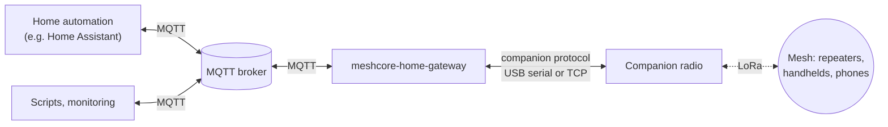
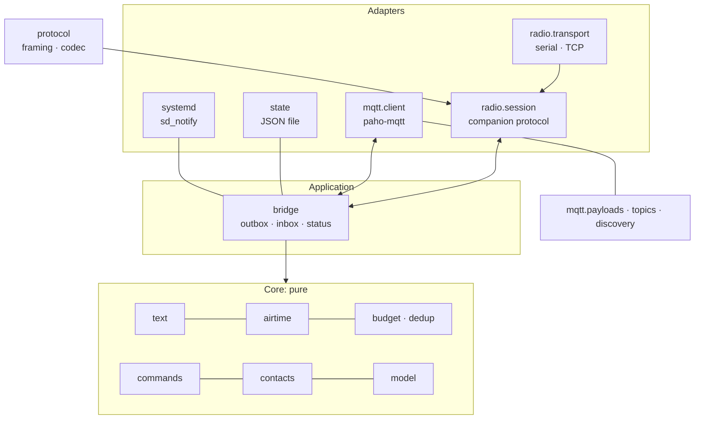
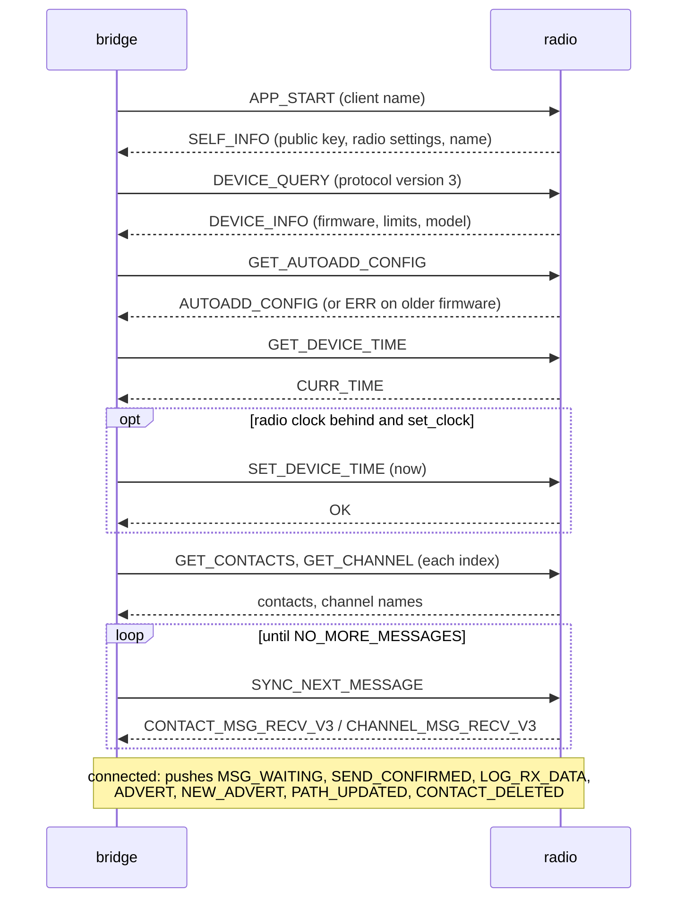
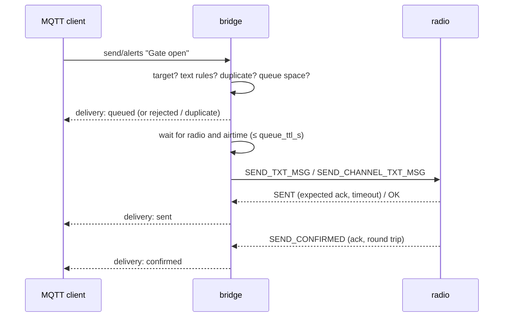

# meshcore-home-gateway: design

| | |
| --- | --- |
| Status | Accepted for 0.1 |
| Date | 2026-10-18 |
| Decisions | [`docs/decisions/`](decisions/README.md) |

## 1 Summary

meshcore-home-gateway connects one MeshCore companion radio to an MQTT broker. Automations publish a
text to a topic and the bridge sends it over the mesh; messages the radio receives appear as MQTT
events; direct messages from allowlisted contacts that start with a configured word become command
events. The bridge budgets airtime, suppresses duplicates, reports the delivery state of every
message, and announces itself to Home Assistant through MQTT discovery. It is small, has one runtime
dependency from the Linux distribution, and installs on Proxmox VE into its own unprivileged
container.

## 2 Context and scope

[MeshCore](https://github.com/meshcore-dev/MeshCore) is a LoRa mesh firmware. A *companion radio*
is a node that a client (phone app, script) controls through a binary protocol over BLE, USB serial
or TCP. Repeaters relay packets; contacts exchange end-to-end encrypted direct messages; channels
are group messages encrypted with a shared secret.

A home automation system can use the mesh as an independent reporting path: alerts reach handhelds
when the internet or the mobile network is down, and people can send simple commands back. The
bridge is the piece in between.

In scope: text messages to and from configured contacts and channels, delivery state, commands,
status, Home Assistant discovery, deployment on Proxmox VE and on any systemd-based Linux.

## 3 Goals and non-goals

**Goals**

| ID | Goal |
| --- | --- |
| G1 | Send text to a configured target (channel or contact) by publishing to an MQTT topic. |
| G2 | Publish every received message; publish authorised commands as separate events. |
| G3 | Report the delivery state of each outgoing message (queued, sent, confirmed, failed …). |
| G4 | Protect the shared channel: airtime budget, duplicate suppression, bounded retries. |
| G5 | Home Assistant integration without custom code, through MQTT discovery. |
| G6 | Minimal supply chain: Python standard library plus the distribution's `paho-mqtt`. |
| G7 | Installation on Proxmox VE in one step, configured through dialogs. |
| G8 | Observable: availability, radio link, battery, airtime use, logs, watchdog. |

**Non-goals**

* Repeater and room-server administration, telemetry requests, maps, firmware updates.
* BLE as a transport (possible later as another adapter).
* Several radios in one process: run one instance per radio (topics are per node).
* Persisting the outgoing queue across restarts: a restart drops queued messages without a final
  delivery event (see §8).
* Guaranteed delivery. Radio is best effort; the bridge reports what happened.

## 4 Requirements and constraints

### 4.1 Functional requirements

| ID | Requirement |
| --- | --- |
| F1 | A UTF-8 text published to `<base>/<node>/send/<alias>` is sent to the target `<alias>`. Unknown aliases are rejected with a delivery event. |
| F2 | Texts are cleaned (control characters, spaces), optionally transliterated to ASCII, and limited to the byte limit of the target type; too long texts are truncated (marked `...`) or rejected. |
| F3 | Direct messages are retried until acknowledged, up to `max_attempts`; from attempt `flood_after` on the stored path is reset so the message floods. |
| F4 | Messages wait in a bounded queue for the radio and for airtime; after `queue_ttl_s` they expire. |
| F5 | The same text to the same target within `dedup_window_s` is sent once. |
| F6 | Every received message is published on `received`, with sender, channel, signal and the command verdict. |
| F7 | A received message is a command only under the rules of §7.3; accepted commands are published on `command` with the word as `event_type`. |
| F8 | Availability (`online`/`offline`, retained, with last will) and a retained state document are published. |
| F9 | Home Assistant discovery publishes one device with connectivity, battery, airtime, message, delivery and command entities and one notify entity per target. |
| F10 | The CLI checks a configuration, probes a radio (contacts, channels), sends and listens via MQTT, and renders a configuration from installer answers. |

### 4.2 Quality requirements

| ID | Requirement | Measure |
| --- | --- | --- |
| Q1 | Security | Commands only from allowlisted full public keys, never from channels; replay and clock checks; no execution in the bridge (§7). |
| Q2 | Reliability | Reconnects to radio and broker without restart; systemd restarts the process on crash or hang (watchdog). |
| Q3 | Resource use | Idle CPU near zero, resident memory below 50 MB, container disk below 1 GB. |
| Q4 | Maintainability | Branch coverage ≥ 90 %, `mypy --strict`, `ruff`; one module, one responsibility. |
| Q5 | Supply chain | Runtime: standard library and Debian's `python3-paho-mqtt`; tools hash-pinned with a 14-day cooldown; actions pinned to commit SHAs; release files reproducible and attested. |
| Q6 | Privacy | Message texts are logged only at debug level. |

### 4.3 Constraints

* **Protocol limits** (MeshCore v1.18.0, details and sources in [`protocol.md`](protocol.md)): frames
  carry at most 176 bytes; a text is at most 160 bytes (10 cipher blocks); the radio queues at most
  16 frames for a disconnected client and tracks at most 8 expected acknowledgements.
* **Regulation.** In the EU sub-band 869.40–869.65 MHz, short-range devices may transmit with up to
  500 mW e.r.p. at a duty cycle of at most 10 % (ERC Recommendation 70-03, Annex 1). Other bands and
  regions have other limits; the airtime budget is configurable and defaults far below.
* **Platform.** Linux with Python ≥ 3.11 and `paho-mqtt` ≥ 2.0. The reference target is Debian 13
  (Python 3.13, `python3-paho-mqtt` 2.1.0).

## 5 Architecture

### 5.1 Ports and adapters

The core holds the rules and calculations and does no I/O. The application layer orchestrates. The
adapters talk to the radio, the broker, the file system and systemd
([ADR 0007](decisions/0007-hexagonal-architecture-with-an-asyncio-core.md)).

| Package / module | Responsibility |
| --- | --- |
| `core.text` | Clean, transliterate and limit outgoing text. |
| `core.airtime` | LoRa time on air; on-air size of MeshCore text packets. |
| `core.budget` | Airtime token bucket; duplicate suppression. |
| `core.contacts` | Resolve 6-byte key prefixes to full keys; detect ambiguity. |
| `core.commands` | Decide whether a message is an authorised command. |
| `core.model` | Data classes shared by all layers. |
| `protocol.framing` | Frame encoder and incremental decoder. |
| `protocol.codec` | Command encoders and response decoders. |
| `radio.transport` | Serial port (termios) and TCP byte streams. |
| `radio.session` | Connection handshake, request/response, pushes, message sync, time sync. |
| `bridge` | Outbound queue with delivery and retries, inbound handling, status reporting, supervision. |
| `mqtt.topics`, `mqtt.payloads` | Topic layout and JSON payloads of the public API. |
| `mqtt.discovery` | Home Assistant device discovery document. |
| `mqtt.client` | paho-mqtt adapter: connection, last will, subscriptions, hand-over to the event loop. |
| `config` | TOML loading with strict validation; rendering from installer answers. |
| `state` | Atomic JSON state file; ledger of accepted command timestamps. |
| `systemd` | Readiness, watchdog and status notifications. |
| `cli` | Command-line entry points. |

### 5.2 Concurrency

One asyncio event loop runs everything except paho's network thread. The paho callbacks pass data
to the loop with `loop.call_soon_threadsafe`; nothing else crosses threads, so the application code
needs no locks. The serial port is read with `loop.add_reader` on a non-blocking descriptor.

Long-running tasks on the loop, supervised by a task group:

* **radio supervisor**: connect, run the session, reconnect with exponential back-off (1 s doubling
  to 60 s, with jitter) when the transport fails;
* **outbox worker**: one outgoing message at a time, in order;
* **radio events**: acknowledgements and the receive log at once; received messages go to
* **message handler**, which processes them in order (a command that could be accepted may wait
  for a fresh read of the radio's contact table, §7.3, without delaying acknowledgements);
* **request reader**: turns MQTT send requests into queue entries or rejections;
* **status reporter**: publishes the state document on change and every 60 s and pings the systemd
  watchdog.

Each radio session runs two tasks of its own: a **reader** that routes frames, and a
**maintenance** task that re-reads the contact table after adverts and contact pushes, drains the
message queue on `MSG_WAITING` and every 5 minutes, and polls the battery every 60 s as a
heartbeat.

Waits with a time limit use `asyncio.timeout`, not `asyncio.wait_for`: on Python 3.11, `wait_for`
can lose a cancellation that arrives just as the awaited event completes, and the task group then
never finishes on shutdown (found by the test matrix).

## 6 Detailed design

### 6.1 Radio session

The session speaks the protocol subset of [`protocol.md`](protocol.md). The companion protocol is
strictly request/response for commands, with unsolicited *push* frames in between. The session
therefore sends one command at a time (an `asyncio.Lock`), routes push frames to handlers, and
hands the waiting command only frames with the response codes it expects; anything else (stale
frames after a reconnect, noise) is logged and dropped. Every command has a 5 s timeout; a timeout
or transport error closes the session and the supervisor reconnects.

* **Opening.** The serial port runs raw at 115200 baud, exclusively (`TIOCEXCL`), with DTR asserted
  and RTS cleared like the official Python clients: nRF52 radios only send while DTR is set, and
  RTS can reset ESP32 boards. 1200 baud is refused (it reboots nRF52 radios into the bootloader).
* **Resynchronisation.** The radio's serial frame parser has no timeout and keeps its state
  across reconnects, so over USB the session first writes 256 zero bytes and discards everything
  that arrives in the next 0.5 s. Over TCP it does not: each connection resets the WiFi parser,
  and zeros would misalign its 3-byte header reads (protocol.md, section 1).

* **Clock.** The firmware only moves its clock forward. If the radio is ahead of the bridge by more
  than 60 s the bridge logs a warning; command age checks may then reject commands until the clock
  is right (visible as `too_old` or `from_the_future`).
* **Messages.** On `MSG_WAITING`, after connecting, and every 5 minutes as a safety net, the session
  drains the radio's queue with `SYNC_NEXT_MESSAGE` until `NO_MORE_MESSAGES`. Messages queued
  before the bridge requested protocol version 3 arrive in the legacy layout; both are decoded.
* **Contacts and channels** are read at connect time; contacts are re-read after advert, path and
  contact-table pushes, so key resolution (§7.3) sees new and changed contacts. Every key the
  radio names goes to the bridge, with whether the radio holds or held that contact: from a push
  before the next frame is handled, from a table read record by record before the read returns
  (§7.3). Channel slots without a name are not configured and never used (the radio would send
  with an all-zero key).
* **Contact adding.** At connect the session reads the manual-adding bit and the auto-add settings
  and warns when the radio adds contacts on its own (§7.2).
* **Messages fetched at connect** are marked: they may have arrived while no session listened to
  the radio's pushes (§7.3).
* **Liveness.** A battery query every 60 s doubles as a heartbeat.
* **Single client.** The radio must not serve another client (phone app) at the same time: both
  would drain the same message queue.

### 6.2 Outbound path

1. **Request.** The alias comes from the topic. Retained requests are rejected (`reason:
   retained`) and nothing is sent: a retained request would be re-sent at every reconnect. Payloads over 1 KiB or not valid UTF-8 are rejected.
2. **Target.** Only configured aliases exist
   ([ADR 0008](decisions/0008-outbound-safety-targets-airtime-budget-deduplication.md)). A contact
   target is bound to a full public key; at send time its 6-byte prefix must match exactly one
   contact on the radio, and that contact must have the configured key, otherwise the delivery
   fails (`ambiguous_target`, `unknown_contact`). A channel target must be a named channel slot on
   the radio (`channel_not_configured`).
3. **Text.** `core.text` applies the policy. Limits: 160 bytes for a direct message; for a channel
   message the firmware prepends `"<radio name>: "`, so the limit shrinks by that prefix.
4. **Duplicates.** Same alias and same final text within `dedup_window_s` → `duplicate`. A
   request rejected because the queue is full does not count, so its retry is accepted.
5. **Queue.** Bounded (`queue_size`); a full queue rejects. Each entry carries its arrival time and
   a time to live of `queue_ttl_s`. A message that never left within that time is `expired`:
   `no_radio` (radio disconnected), `queue_ttl` (waited behind other messages) or
   `airtime_budget`. A message that left at least once and runs out of time is `failed` with
   `no_acknowledgement`.
6. **Airtime.** Before each transmission the bridge estimates the packet's time on air (§6.3) and
   waits until the budget allows it; if the wait would exceed the remaining time to live, the
   message expires. A packet longer than `burst_s` could never be sent: it fails at once
   (`exceeds_airtime_burst`), and the bridge warns at connect if the radio's settings make long
   messages that slow.
7. **Send and confirm.** Channel messages are final at `sent`. Direct messages wait for the
   acknowledgement: 1.2 times the radio's estimate from `SENT`, bounded to 5..60 s, like the
   MeshCore Python client. Without an acknowledgement the bridge retries with the **same
   timestamp** and the next attempt number (0..3; the acknowledgement code depends on both); after
   `flood_after` unanswered attempts it first resets the stored path, so the next attempt floods.
   Late acknowledgements of earlier attempts still count. After `max_attempts` the state is
   `failed`. A recipient whose acknowledgement got lost receives the retry as a second message;
   the firmware does not deduplicate it. An attempt interrupted by a radio error (disconnect,
   timeout) is repeated with the same number once the radio is back, within the time to live; if
   the radio had already sent it, the recipient gets it twice. The radio's own refusals (ERR,
   `disabled`) end the delivery as `failed` with the error name.

Messages leave strictly in arrival order, one at a time. A message waiting for an acknowledgement
delays the next one; this keeps the protocol simple and the channel calm (the radio tracks at most
8 acknowledgements anyway).

### 6.3 Airtime estimate and budget

Time on air follows the Semtech SX126x datasheet formula; the radio's own settings come from
`SELF_INFO` (frequency, bandwidth, spreading factor, coding rate). The packet size is modelled from
the MeshCore packet format ([`protocol.md`](protocol.md#6-on-air-sizes)): header, path length and
path, then for a direct message the destination and source hashes, a 2-byte MAC and the AES-128
ciphertext of timestamp, flags and text, padded to 16-byte blocks; for a channel message the
channel hash, the MAC and the ciphertext of timestamp, flags, name prefix and text.

Modulation details from the firmware: preamble 32 symbols up to SF 8 and 16 above, CRC on,
explicit header, low data rate optimisation from 16 ms symbol time. The estimate errs on the high
side: it counts 4 transport-code bytes on every flood and, for a flooded direct message, the path
packet the radio sends back after the acknowledgement. The implementation reproduces published
reference values and RadioLib's own calculation (`tests/test_airtime.py`).

The budget is a token bucket over seconds of airtime
([ADR 0008](decisions/0008-outbound-safety-targets-airtime-budget-deduplication.md)): it holds at
most `burst_s` (default 10 s) and refills at `budget_s_per_hour` (default 36 s, 1 % of an hour).
Over any interval *T* the bridge's own transmissions are bounded by `burst_s + budget × T / 3600`.
Each attempt of a direct message counts. The radio's other transmissions (acknowledgements it
sends, adverts, path returns) are not counted; the default leaves 9 percentage points of the 10 %
EU duty cycle for them.

### 6.4 Inbound path

1. A message frame is decoded into `InboundMessage` (kind, text, sender prefix or channel index,
   sender timestamp, SNR, hop count, text type).
2. Exact repeats (same sender or channel, timestamp and text within an hour) are dropped: that is
   how a sender's retries arrive.
3. The sender prefix is resolved against the contact table as last read; for a possible command
   (a direct message whose first word is a command word) §7.3 decides whether the table has to be
   read again first.
4. `core.commands` decides: not a command, accepted, or rejected with a reason.
5. The bridge publishes the message on `received` (with the verdict), and an accepted command on
   `command`. The newest accepted timestamp per sender goes to the state file before the event is
   published, so a crash cannot turn into a replay; if the file cannot be written, the command is
   rejected (`state_unwritable`) and the service carries on.
6. Channels listed in `ignore_channels` are not published (busy public channels).

### 6.5 MQTT interface

The full API with payload examples is in [`mqtt-api.md`](mqtt-api.md).

| Topic below `<base>/<node>/` | Direction | Retained | Content |
| --- | --- | --- | --- |
| `availability` | out | yes | `online` / `offline`, last will `offline` |
| `state` | out | yes | JSON: radio link, battery, airtime, queue, radio and device info |
| `send/<alias>` | in | rejected | UTF-8 text to send |
| `delivery` | out | no | JSON with `event_type` = delivery state |
| `received` | out | no | JSON with `event_type` = `contact` or `channel` |
| `command` | out | no | JSON with `event_type` = command word |
| `rx` | out | no | JSON per received packet: SNR, RSSI, raw bytes (optional) |

* QoS 1 throughout. MQTT 3.1.1 with a clean session: requests published while the bridge is
  offline are lost, which is the safer choice for alerts that would otherwise arrive late. Events
  the bridge publishes while the broker is down are queued in memory (up to 1000, more are
  dropped and counted in the log) and sent after the reconnect; retained documents are not
  queued, because the reconnect publishes availability and state again. Commands are refused
  while the broker is unreachable (`broker_unavailable`): delivered after the reconnect, they
  would trigger automations at an arbitrary later time.
* On reconnect the bridge republishes availability, discovery and state; when Home Assistant
  announces itself on `homeassistant/status`, discovery and state (availability is retained, so
  Home Assistant receives it with its subscription).

### 6.6 Home Assistant

The bridge publishes one device-based discovery document
([ADR 0010](decisions/0010-home-assistant-through-mqtt-device-discovery.md)); entities and example
automations are in [`home-assistant.md`](home-assistant.md).

| Entity | Platform | Source |
| --- | --- | --- |
| Radio link | `binary_sensor` (connectivity) | `state` → `radio` |
| Battery | `sensor` (voltage) | `state` → `battery_v` |
| Airtime last hour | `sensor` (duration) | `state` → `airtime_1h_s` |
| Message | `event` (`contact`, `channel`) | `received` |
| Delivery | `event` (delivery states) | `delivery` |
| Command | `event` (configured words) | `command` |
| Send to *alias* | `notify`, one per target | `send/<alias>` |

All entities share the availability topic, so they become unavailable when the bridge is offline.

### 6.7 Configuration

One TOML file, `/etc/meshcore-home-gateway/config.toml`, owner `root`, group
`meshcore-home-gateway`, mode 0640 (it holds the broker password). Unknown keys are errors. Every
setting is in [`configuration.md`](configuration.md). The installer writes the file through
`meshcore-home-gateway config render`, which validates with the same code as the service.

### 6.8 Command line

| Command | Purpose |
| --- | --- |
| `meshcore-home-gateway run` | Run the bridge (systemd service). |
| `meshcore-home-gateway check-config` | Validate the configuration (and load the TLS files) and print a summary. |
| `meshcore-home-gateway probe --serial DEV` / `--tcp HOST[:PORT]` | Connect to a radio directly (service stopped) and print device info, contacts and channels; `--list` gives tab-separated lists for the installer, `--json` everything. IPv6 addresses go in brackets: `[ADDRESS]:PORT`. |
| `meshcore-home-gateway send [--wait S] ALIAS TEXT` | Publish a send request through the broker (only to a configured alias); with `--wait`, wait for the delivery result and exit 0 only on `sent` (channels) or `confirmed`. |
| `meshcore-home-gateway listen [--topic T] [--count N]` | Print events from the broker as JSON lines. |
| `meshcore-home-gateway config render` | Write a validated configuration from `key=value` answers (installer). |
| `meshcore-home-gateway config answers` | Print a configuration as answers, the inverse of `render` (installer, reconfigure). |

Exit codes: 0 success, 1 failure, 2 usage error (invalid arguments), 78 configuration error (the
systemd unit does not restart on it).

### 6.9 Logging and observability

* Logs go to standard error; under systemd (`JOURNAL_STREAM` set) without time stamps, because the
  journal adds them. Level from the configuration.
* Message texts appear only at debug level; info level logs alias, length and state.
* `sd_notify`: `READY=1` after start-up, `STATUS=` with radio state and queue length, `WATCHDOG=1` from
  the event loop at half the watchdog interval, `STOPPING=1` on shutdown.
* The `state` document and the Home Assistant diagnostic entities show the radio link, battery and
  airtime use; the `delivery` event shows every failure.

## 7 Security

### 7.1 Assets and trust boundaries

* **Assets:** the right to transmit on a shared channel (airtime, reputation of the node); the
  command path into the automation system; message confidentiality; broker credentials.
* **Boundaries:** radio channel (untrusted) → radio (trusted firmware, holds the keys) → USB or TCP
  link → bridge → broker (authenticated clients) → automation system.

### 7.2 Threats and mitigations

| Threat | Mitigation |
| --- | --- |
| Spoofed command over the air | Commands only from direct messages, which the firmware authenticates with the key shared between sender and radio; channel messages never command (anyone with the channel secret can write any name). |
| Look-alike contact with the same 6-byte key prefix | Permissions and targets bind full public keys. The sender must be the only contact with its prefix in the table read after the message arrived, and no other key with that prefix may have been seen on the radio in the last 24 hours, so a look-alike that came and went counts. Commands that waited in the radio before the bridge connected are rejected (§7.3). Recommended radio settings, warned about at connect: manual adding, no contact type added automatically. |
| Replayed command packet | Sender timestamp must be newer than the last accepted one of that sender (persisted) and within `max_age_s` of the bridge clock. |
| Command injection into the automation system | Only configured single words become event types; arguments are data. The bridge executes nothing. Automations must treat `args` as untrusted. |
| Abuse of the send topic by any broker client | Broker authentication and topic ACLs; only configured targets exist; airtime budget, queue limit, duplicate suppression. paho reads a message whole before the bridge can check its size, so a broker limit on the packet size keeps huge payloads out of the bridge's memory (mqtt-api.md, last section). |
| Retained send request re-sent on every reconnect | Retained messages on `send/+` are rejected (`reason: retained`) and not sent; clear the retained message on the broker. |
| Forged events on the bridge's topics by another broker client (a fake `command` event triggers automations as if an allowlisted sender had sent it) | Topic ACLs: only the bridge user may publish below `<base>/<node>/`, except `send/`. Required when commands are configured (mqtt-api.md, last section); the sender check protects only the radio side. |
| Unauthenticated TCP companion interface | Prefer USB. With WiFi firmware, put the radio in an isolated network that only the bridge reaches: any client controls the radio, and can for example create temporary contacts that the contact list never shows. Over TCP the radio also drops pushes while its send queue is full; the bridge warns when commands are configured with TCP. |
| Credential disclosure | Configuration 0640 `root:meshcore-home-gateway`; the installer passes answers through a temporary file in the container and deletes it; secrets are never logged. |
| Compromised dependency | Runtime code from the distribution only; development tools hash-pinned with a cooldown; actions pinned by SHA; Dependabot with cooldown. |
| Tampered release download | Release files are built by the release workflow from the tagged commit and attested with Sigstore-signed build provenance; `SHA256SUMS` and `gh attestation verify` check them (ADR 0013). |
| Privilege escalation in the service | Dedicated system user, systemd sandboxing, unprivileged container. |

### 7.3 Command authorisation in detail

A received message is an accepted command only if: it is a plain-text direct message; its first word
(case-insensitive, ended by any whitespace) is in `commands.words`; its 6-byte sender prefix
resolves to exactly one contact; that contact's full key is in `commands.senders`; its sender
timestamp is newer than the last accepted command of that sender; and, unless `max_age_s` is 0, it
lies within `max_age_s` of the bridge clock in either direction (with 0, at most a day ahead)
([ADR 0009](decisions/0009-inbound-commands-from-allowlisted-contacts.md)).

The sender check is the hard part: the frame names the sender only by the prefix, and the contact
table can change under the bridge. The radio decrypts a direct message only with a contact it
holds, so a look-alike that sent a message was in the table when the message arrived. Afterwards
it may stay (the prefix is then ambiguous), be overwritten by a newer contact, or, in firmware
1.18, clear its own slot with two adverts, without any removal push. What the radio does report,
once and to whichever client is connected, is every advert, path update and overwrite, each with
the full key ([`protocol.md`](protocol.md#5-semantics)); every table read lists the keys too.

The bridge therefore keeps a memory: each key that shares the 6-byte prefix of an allowed sender and
that the radio named as its contact (table read, advert, path or overwrite push), with the time it
was last seen. A node the radio reported but did not add (`NEW_ADVERT`) cannot have sent a message
the radio decrypted; its key only renews one already remembered, so a look-alike that merely
advertises does not block the sender. (Firmware 1.11 and older also announce a contact they have
just added that way, but cannot drop it without a client, so the fresh table shows it.) A message's
sender must be the only contact with its prefix in the table of the session that fetched the
message, and no other remembered key may share that prefix. Remembered keys only add doubt; they
never become the sender. Only keys with a sender's prefix are kept, so the memory stays small
whatever the radio hears. The checks run in this order:

1. **Cached table.** A rejection by the table the bridge already holds stands, unless the sender
   was unknown (it may have been added since): keys that leave the table are remembered, so
   nothing the radio does turns such a rejection into an acceptance. Senders that are not allowed
   cost nothing.
2. **Fetched at connect.** A command fetched by the first sync of a session, which also takes
   what arrives during the connection setup, may have arrived while no session listened: a
   look-alike may have come and gone unseen. It is rejected (`sender_unverified`); the sender
   sends it again.
3. **Fresh table.** Otherwise the bridge reads the table again, unless a read started after the
   message was fetched: one read serves every message fetched before it, and a read in progress
   is awaited instead of repeated. A failed read rejects the command (`sender_unverified`), also
   when the radio connection ends first.
4. **Verdict** on the fresh table and the memory.

A read costs about 150 bytes per contact, about 4.6 s for 350 contacts over a USB-UART bridge at
115200 baud. The rejection reasons are published, so misconfiguration and attacks are visible.

### 7.4 Residual risks

* Whoever controls an allowlisted handheld (or its key) can send commands. Keep the word list
  small and make automations confirm critical actions.
* A look-alike needs a 48-bit prefix collision with an allowlisted key, which takes considerable
  but feasible computing effort (about 2^48 key generations). If the radio adds it, the real
  sender's commands are rejected (`sender_ambiguous`) for 24 hours after the bridge last saw it.
  A restart of the service ends that early; commands that waited in the radio meanwhile are
  rejected anyway (§7.3, step 2).
* Over TCP, pushes can be lost while the radio's send queue is full; a look-alike that enters and
  leaves the table between two table reads can then go unseen. Commands should use USB.
* A second client of the radio (another interface of a multi-interface build, or anyone on the
  TCP port) can change the contact table without the bridge seeing it. The bridge must be the
  radio's only client.
* The radio firmware and its key storage are trusted.
* Messages on the radio are only as confidential as MeshCore's encryption; channel secrets of
  public or hashtag channels are known to everyone.

## 8 Reliability and failure modes

| Failure | Detection | Behaviour | Visible as |
| --- | --- | --- | --- |
| Radio unplugged or rebooted | read error, command timeout | session closed, reconnect with back-off; queue waits; an interrupted attempt is repeated | `state.radio = disconnected`; connectivity entity off |
| Malformed or unexpected answer | decoding | session closed, resynchronised on reconnect | log warning |
| Radio clock wrong | `CURR_TIME` vs bridge clock | set forward; warn if ahead | log warning; command rejections `too_old` / `from_the_future` |
| Broker unreachable | paho disconnect | paho reconnects (1..60 s); up to 1000 events queued in memory; commands refused | availability `offline` via last will; `received`: `broker_unavailable` after the reconnect |
| Bridge hangs | systemd watchdog | process restarted | journal entry; availability `offline` then `online` |
| Bridge crashes or restarts | systemd | restart after 5 s; queued messages are lost | availability; no delivery state for lost messages |
| Airtime budget exhausted | token bucket | messages wait, then expire | `delivery: expired`; airtime entity |
| Recipient out of range | no acknowledgement | retries, flood, then give up | `delivery: failed` |
| Automation loop floods requests | duplicates, queue | duplicates suppressed, queue full rejects | `delivery: duplicate` / `rejected` |
| State file corrupt | JSON error at start | moved aside, start empty | log warning |
| State file not writable | error on save | the command is rejected, the service carries on | `received`: `state_unwritable`; log error |
| Command sent while the bridge was not connected or was connecting | fetched at connect | rejected; the sender sends it again | `received`: `sender_unverified`; log warning |

## 9 Deployment and operations

* **Proxmox VE** ([ADR 0006](decisions/0006-deployment-in-an-unprivileged-proxmox-container.md),
  [`deployment.md`](deployment.md)): `deploy/proxmox/meshcore-home-gateway-lxc.sh` runs on the host
  (Proxmox VE 9, or 8 with a `pve-container` that supports Debian 13). A default setup asks only
  for the radio, the broker and the targets, an advanced one for everything. The script validates
  the answers with the bridge's own configuration code and asks for confirmation before it
  creates an unprivileged Debian 13 container with nesting, passes the USB serial device through
  (`dev0`, group `dialout` as seen in the container), installs `python3` and `python3-paho-mqtt`
  from Debian, builds the zipapp from the checked-out sources inside the container, probes the
  radio to offer its channels and contacts as targets, writes the configuration and starts the
  service. Commands in the container run with a clean environment.
* **Any systemd Linux:** install the two packages, copy the zipapp to
  `/usr/local/lib/meshcore-home-gateway/`, the unit to `/etc/systemd/system/`, write the
  configuration.
* **Service:** `deploy/systemd/meshcore-home-gateway.service`: `Type=notify`, watchdog, restart on
  failure, system user `meshcore-home-gateway` in group `dialout`, sandboxing
  (`ProtectSystem=strict`, `NoNewPrivileges`, no capabilities, restricted address families and
  system calls, write-execute memory denied). Device access is not restricted by the unit:
  `PrivateDevices=` would hide the serial port, and unprivileged containers do not enforce
  `DeviceAllow=`; in the container only the passed-through device exists, and only `dialout` may
  open it.
* **Layout in the container:**
  `/usr/local/lib/meshcore-home-gateway/meshcore-home-gateway-<version>.pyz`, the symlink
  `current.pyz` to the active version, `/usr/local/bin/meshcore-home-gateway` pointing to it. The
  zipapp runs with `/usr/bin/python3 -I` (isolated mode: no user site, no environment variables).
* **Update:** `meshcore-home-gateway-lxc.sh --update <id>` builds the new zipapp under a temporary
  name next to the old one, checks the current configuration with it, then moves it to its versioned
  name, switches the symlink and restarts; a failed check leaves the old version active, also when
  the version string did not change, and rollback switches the symlink back. `--reconfigure <id>`
  runs the dialogs again with the current settings as defaults (`meshcore-home-gateway config
  answers`) and keeps the settings it does not ask for, and targets or command senders the radio no
  longer offers; `--answers <file>` installs without dialogs.
* **Backup:** the configuration file and `/var/lib/meshcore-home-gateway/state.json`.
* **Releases** ([ADR 0013](decisions/0013-signed-releases-with-github-artifact-attestations.md)):
  a tag `vX.Y.Z` runs `.github/workflows/release.yml`. A read-only job runs `make check` and
  `make release` (reproducible zipapp, wheel and sdist, `SHA256SUMS`, notes from the changelog);
  a second job, the only one with write permissions, attests every file with Sigstore-signed build
  provenance and publishes the GitHub release. Users verify a file with `sha256sum --check` and
  `gh attestation verify`.

## 10 Testing strategy

| Level | What | How |
| --- | --- | --- |
| Unit | core, protocol codec, configuration, payloads, discovery | pytest, golden byte vectors from the firmware source, reference values for time on air |
| Component | session and bridge | an in-memory radio that emulates the firmware's responses and pushes |
| Integration | MQTT adapter and bridge end to end | a private `mosquitto` per test on a free port; the system test runs the service as a process (its coverage is measured too) |
| Installer | Proxmox host script | runs with stub commands for `pct`, `pveam`, `pvesm`, `pvesh`, `pveversion`, `dpkg-query` and `whiptail`, which answer in the formats of Proxmox VE 9 and parse options like the real whiptail; a manual check drives the real whiptail |
| Static | style, types, shell, workflows, unit file | ruff, mypy --strict, shellcheck, zizmor, systemd-analyze (verify, exposure score) |
| Hardware | real radios | checklist in [`testing.md`](testing.md), before each release |

`make check` runs everything except the hardware checklist, locally and in CI; `make matrix` runs
the tests with every supported Python version that is installed, like the CI matrix.

## 11 Alternatives considered

| Decision | Record |
| --- | --- |
| Standalone bridge instead of a Home Assistant integration | [0002](decisions/0002-standalone-bridge-instead-of-home-assistant-integration.md) |
| MQTT as the bus | [0003](decisions/0003-mqtt-as-the-message-bus.md) |
| Own implementation of the protocol subset | [0004](decisions/0004-own-implementation-of-the-companion-protocol-subset.md) |
| Runtime dependencies from the distribution | [0005](decisions/0005-runtime-dependencies-from-the-distribution.md) |
| Unprivileged Proxmox container, host script with dialogs | [0006](decisions/0006-deployment-in-an-unprivileged-proxmox-container.md) |
| Ports and adapters, one event loop | [0007](decisions/0007-hexagonal-architecture-with-an-asyncio-core.md) |
| Outbound safety: targets, airtime budget, deduplication | [0008](decisions/0008-outbound-safety-targets-airtime-budget-deduplication.md) |
| Inbound commands from allowlisted contacts | [0009](decisions/0009-inbound-commands-from-allowlisted-contacts.md) |
| Home Assistant through MQTT device discovery | [0010](decisions/0010-home-assistant-through-mqtt-device-discovery.md) |
| Neutral, English-language project under MIT | [0011](decisions/0011-neutral-english-language-project-under-mit.md) |
| Project name | [0012](decisions/0012-project-name-meshcore-home-gateway.md) |
| Signed releases with artifact attestations | [0013](decisions/0013-signed-releases-with-github-artifact-attestations.md) |

## 12 Open questions and future work

* BLE transport as a further adapter, for radios without USB data or WiFi.
* Removing stale notify entities when a target is deleted (read the previous retained discovery
  document at start-up and publish removals).
* Priorities in the outgoing queue (an alert overtaking a status message).
* MQTT 5 features: message expiry for send requests, response topics for correlation.
