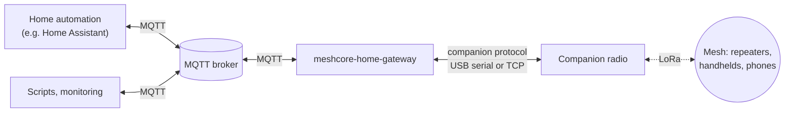
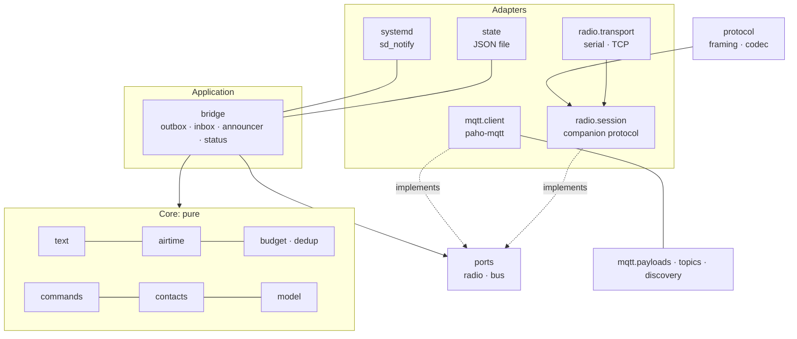
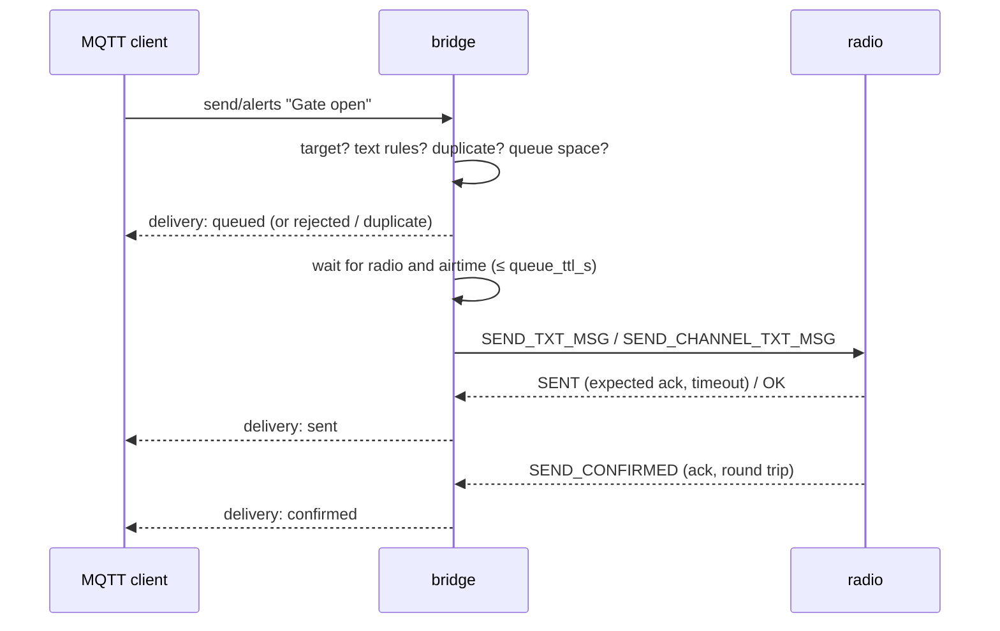

# meshcore-home-gateway: design

| | |
| --- | --- |
| Status | Accepted for 0.1; the observer (§13) accepted 2026-10-23 |
| Date | 2026-10-18, extended 2026-10-23 |
| Decisions | [`docs/decisions/`](decisions/README.md) |

## 1 Summary

meshcore-home-gateway connects one MeshCore companion radio to an MQTT broker. Automations publish a
text to a topic and the gateway sends it over the mesh; messages the radio receives appear as MQTT
events; direct messages from allowlisted contacts that start with a configured word become command
events. The gateway budgets airtime, suppresses duplicates, reports the delivery state of every
message, and announces itself to Home Assistant through MQTT discovery. It is small, has one runtime
dependency from the Linux distribution, and installs on Proxmox VE into its own unprivileged
container.

The documents call the whole program the gateway. *The bridge* is its application module
(`bridge.py`, §5.1) between the radio session and the bus; where this document says "the bridge"
for the whole program, it is the older word for the same thing.

## 2 Context and scope

[MeshCore](https://github.com/meshcore-dev/MeshCore) is a LoRa mesh firmware. A *companion radio*
is a node that a client (phone app, script) controls through a binary protocol over BLE, USB serial
or TCP. Repeaters relay packets; contacts exchange end-to-end encrypted direct messages; channels
are group messages encrypted with a shared secret.

A home automation system can use the mesh as an independent reporting path: alerts reach handhelds
when the internet or the mobile network is down, and people can send simple commands back. The
bridge is the piece in between.



In scope: text messages to and from configured contacts and channels, delivery state, commands,
status, Home Assistant discovery, deployment on Proxmox VE and on any systemd-based Linux. Since
[ADR 0014](decisions/0014-the-gateway-as-the-households-mesh-observer.md) the gateway is also the
household's **mesh observer**: it harvests what the radio reports (positions, heard nodes, the
radio's own statistics), manages the radio's contacts, pulls telemetry and positions from the
household's own companions, keeps a local history, and offers all of it as provider-neutral
documents for Home Assistant and later front ends (§13).

## 3 Goals and non-goals

**Goals**

| ID | Goal |
| --- | --- |
| G1 | Send text to a configured target (channel or contact) by publishing to an MQTT topic. |
| G2 | Publish every received message; publish authorised commands as separate events. |
| G3 | Report the delivery state of each outgoing message (queued, sent, confirmed, failed …). |
| G4 | Protect the shared channel: airtime budget, duplicate suppression, bounded retries. |
| G5 | Home Assistant integration without custom code, through MQTT discovery. |
| G6 | Minimal supply chain: Python standard library plus the distribution's `paho-mqtt`. |
| G7 | Installation on Proxmox VE in one step, configured through dialogs. |
| G8 | Observable: availability, radio link, battery, airtime use, logs, watchdog. |
| G9 | Observer: contacts with their own Home Assistant devices, heard nodes, positions and telemetry of the household's companions, the radio's measured duty cycle; nothing about the household leaks to the mesh ([ADR 0014](decisions/0014-the-gateway-as-the-households-mesh-observer.md)). |
| G10 | One set of provider-neutral documents for every front end, with a local history ([ADR 0015](decisions/0015-provider-neutral-documents-on-the-bus.md), [ADR 0016](decisions/0016-history-in-a-local-sqlite-database.md)). |
| G11 | In the household's language: English, German, Dutch, Polish, French ([ADR 0019](decisions/0019-internationalisation-with-gettext.md)). |

**Non-goals**

* Repeater and room-server administration, requests to nodes that are not the household's
  contacts, firmware updates, changing the radio's frequency or modulation
  ([ADR 0014](decisions/0014-the-gateway-as-the-households-mesh-observer.md)).
* BLE as a transport (possible later as another adapter).
* Several radios in one process: run one instance per radio (topics are per node).
* Guaranteed delivery. Radio is best effort; the bridge reports what happened.

## 4 Requirements and constraints

### 4.1 Functional requirements

| ID | Requirement |
| --- | --- |
| F1 | A UTF-8 text published to `<base>/<node>/send/<alias>` is sent to the target `<alias>`. Unknown aliases are rejected with a delivery event. |
| F2 | Texts are cleaned (control characters, spaces), optionally transliterated to ASCII, and limited to the byte limit of the target type; too long texts are truncated (marked `...`) or rejected. |
| F3 | Direct messages are retried until acknowledged, up to `max_attempts`; after `flood_after` unacknowledged attempts the stored path is reset so the next attempt floods. |
| F4 | Messages wait in a bounded queue for the radio and for airtime, alerts first; after `queue_ttl_s` they expire. A stop keeps them for the next start ([ADR 0028](decisions/0028-outgoing-queue-kept-across-restarts.md)). |
| F5 | The same text to the same target within `dedup_window_s` is sent once. |
| F6 | Every received message is published on `received`, with sender, channel, signal and the command verdict. |
| F7 | A received message is a command only under the rules of §7.3; accepted commands are published on `command` with the word as `event_type`. |
| F8 | Availability (`online`/`offline`, retained, with last will) and a retained state document are published. |
| F9 | Home Assistant discovery publishes one device with connectivity, battery, airtime, queue, message, delivery and command entities and one notify entity per target; the device shows the radio's model, firmware and key. |
| F10 | The CLI checks a configuration, probes a radio (contacts, channels), sends and listens via MQTT, and renders a configuration from installer answers. |

### 4.2 Quality requirements

| ID | Requirement | Measure |
| --- | --- | --- |
| Q1 | Security | Commands only from allowlisted full public keys, never from channels; replay and clock checks; no execution in the bridge (§7). |
| Q2 | Reliability | Reconnects to radio and broker without restart; systemd restarts the process on crash or hang (watchdog). |
| Q3 | Resource use | Idle CPU near zero, resident memory below 50 MB, container disk below 1 GB. |
| Q4 | Maintainability | Branch coverage ≥ 90 %, `mypy --strict`, `ruff`; one module, one responsibility. |
| Q5 | Supply chain | Runtime: standard library and Debian's `python3-paho-mqtt`; tools hash-pinned with a 14-day cooldown; actions pinned to commit SHAs; release files reproducible and attested. |
| Q6 | Privacy | Message texts are logged only at debug level. What is kept of the household and of other people, where and how long: [privacy.md](privacy.md); settings keep less of other people's. |

### 4.3 Constraints

* **Protocol limits** (MeshCore v1.18.0, details and sources in [`protocol.md`](protocol.md)): frames
  carry at most 176 bytes; a text is at most 160 bytes (10 cipher blocks); the radio queues at most
  16 frames for a disconnected client and tracks at most 8 expected acknowledgements.
* **Regulation.** In the EU sub-band 869.40–869.65 MHz, short-range devices may transmit with up to
  500 mW e.r.p. at a duty cycle of at most 10 % (ERC Recommendation 70-03, Annex 1). Other bands and
  regions have other limits; the airtime budget is configurable and defaults far below.
* **Platform.** Linux with Python ≥ 3.11 and `paho-mqtt` ≥ 2.0. The reference target is Debian 13
  (Python 3.13, `python3-paho-mqtt` 2.1.0).

## 5 Architecture

### 5.1 Ports and adapters

The core holds the rules and calculations and does no I/O. The application layer orchestrates. The
adapters talk to the radio, the broker, the file system and systemd
([ADR 0007](decisions/0007-hexagonal-architecture-with-an-asyncio-core.md)). The application asks
the radio and the bus through the ports (`ports`): the radio port with its events and errors, the
transport, the bus and its requests. The adapters implement them, and
`tests/test_architecture.py` checks that no application module names an adapter (ARC-003): a
second radio adapter changes none of them.



| Package / module | Responsibility |
| --- | --- |
| `core.text` | Clean, transliterate and limit outgoing text. |
| `core.airtime` | LoRa time on air; on-air size of MeshCore text and telemetry packets, the airtime a telemetry request causes. |
| `core.budget` | Airtime token bucket (with a debt for airtime already spent); event rate limit; duplicate suppression. |
| `core.lpp` | CayenneLPP decoder for telemetry answers; the position in them and the names of their readings. |
| `core.telemetry` | The telemetry schedule: whom to ask next, by which route and when, within two airtime lanes; each companion's state (§6.11). |
| `core.contacts` | Resolve 6-byte key prefixes to full keys; detect ambiguity. |
| `core.commands` | Decide whether a message is an authorised command. |
| `core.mesh` | The observer's view of the mesh: contacts with when they were heard and where they are, nodes heard but not added; the radio's measured airtime over an hour. |
| `core.model` | Data classes shared by all layers. |
| `protocol.framing` | Frame encoder and incremental decoder. |
| `protocol.codec` | Command encoders and response decoders. |
| `protocol.packet` | On-air packets from the radio's packet log, and the adverts in them. |
| `views` | Providers: the documents of the MQTT API, built from the core's state (pure). |
| `ports` | What the application asks of the radio and the bus and what they give it: the radio port, its events and errors, the transport, the bus and its requests (ARC-003). |
| `radio.transport` | Serial port (termios) and TCP byte streams. |
| `radio.session` | Connection handshake, request/response, pushes, message sync, time sync. |
| `bridge` | Supervises the radio, hands out its events and runs the tasks of all parts on one event loop (§5.2). |
| `outbox` | The outgoing queue (alerts first, kept across a stop) and its delivery: validation, deduplication, attempts, acknowledgements, retries, a delivery event for each step (§6.2). |
| `inbox` | Received messages: in order, without copies, commands judged (§6.4, §7.3), each published and handed on; a bounded rate per sender and per channel. |
| `announcer` | Announcements to Home Assistant: the discovery document, the controls that add contacts, the contacts' devices; again after a birth message or a cleared device (§6.7). |
| `drafts` | The drafts of Home Assistant's chats: one per chat in memory, published retained; a text or a press from Home Assistant, the press handed to the outbox at once (§6.7). |
| `status` | The state document with its health section, and systemd's status line. |
| `radio_link` | The radio as the parts see it: the session while connected, what the radio said it is, whether another client took the TCP link. |
| `config_checks` | What a configuration implies: the contacts it protects, the warnings that the start logs and `check-config` shows. |
| `config_view` | The configuration as the `config` document shows it: an allowlist of the settings in effect, never a secret, a host or a key. |
| `wiring` | Puts the service together: the adapters, the parts, and who hears of what (the list in its docstring; ARC-009). |
| `observer` | Feeds the mesh view and the history from the radio's reports, messages, telemetry answers and deliveries; publishes the documents. |
| `telemetry_poller` | Asks the companions for telemetry, one at a time, after the messages; takes an answer only for the contact asked (§6.11). |
| `history` | The local history in SQLite. |
| `mqtt.topics`, `mqtt.payloads` | Topic layout and JSON payloads of the public API. |
| `mqtt.discovery` | Home Assistant device discovery document. |
| `mqtt.client` | paho-mqtt adapter: connection, last will, subscriptions, hand-over to the event loop. |
| `config` | TOML loading with strict validation; rendering from installer answers. |
| `state` | The state file, read once and held in memory, its sections written together and atomically (§5.2); ledger of accepted command timestamps. |
| `systemd` | Readiness, watchdog and status notifications. |
| `cli` | Command line: the parser and `main` (`cli/__init__.py`), a module per group of commands (`run`, `config_cmd`, `probe`, `messages`, `contacts`, `codes`, `dashboard`, `status`, `doctor`, `backup`, `retire`, `history`) and what they share (`common`: exit codes, language; `broker`: the commands' MQTT client). |

### 5.2 Concurrency

One asyncio event loop runs everything except paho's network thread. The paho callbacks pass data
to the loop with `loop.call_soon_threadsafe`; nothing else crosses threads, so the application code
needs no locks. The serial port is read with `loop.add_reader` on a non-blocking descriptor.

Long-running tasks on the loop, supervised by a task group:

* **radio supervisor**: connect, run the session, reconnect with exponential back-off (1 s doubling
  to 60 s, with jitter) when the transport fails;
* **outbox worker**: one outgoing message at a time, in order;
* **radio events**: acknowledgements and the receive log at once; received messages go to
* **message handler**, which processes them in order (a command that could be accepted may wait
  for a fresh read of the radio's contact table, §7.3, without delaying acknowledgements);
* **request reader**: turns MQTT send requests into queue entries or rejections;
* **status reporter**: publishes the state document on change and every 60 s, pings the systemd
  watchdog, writes an exclusion from telemetry that could not be stored yet (§6.11) and writes
  the state file (below);
* **telemetry poller** (only with `[telemetry] enabled`, the default): one request to a companion
  at a time (§6.11). Its saved schedule is restored before any task starts;
* **lag probe**: sleeps a second at a time and measures how late it wakes. A host that gives the
  gateway no CPU, or a disk that holds it up, shows there (`health.loop_lag_max_s`, a warning from
  1 s) before it shows as a radio that does not answer. A command whose timeout falls in such a
  stall gets a few more turns of the loop for an answer that has come meanwhile, which the reader
  has not handed on yet (CODE-001).

On stop the telemetry poller is cancelled first, so no request goes out after it, and saves its
schedule; an answer that arrives later is dropped. The outbox worker starts no attempt any more:
one that waits for its acknowledgement gets it for at most 60 s (the unit's `TimeoutStopSec` is
90 s), and the messages still queued, that one too if it needs another attempt, are kept in the
state file for the next start (§6.2). Then the radio supervisor ends and closes the
session. The radio events and the message
handler then finish the messages the radio has already handed over, for at most 2 s (a command
waiting for its table read is rejected, `sender_unverified`); then the other tasks are cancelled.
Messages still waiting in the radio are fetched at the next start.

The state file (`state.json`, `state.py`) is one store for every part that keeps something
across a restart (ARC-004): read once at the start, held in memory, and written whole and
atomically (a temporary file, `fsync`, rename). A part changes its section in memory; the status
reporter writes what changed at its tick (every 30 s under systemd's watchdog, else every
minute) and at the stop, so a
table read that changes the contact devices, the published keys and the components costs one
write. What a crash must not lose is written at once: the newest accepted command time per sender
before the command is published (§6.4), the observer's kept documents and advert checks when they
change (a place a companion stopped sharing must not come back, §6.6), the telemetry schedule
after a flood and at the first-start hour (§6.11) and the radio profile's attempts before its
setters. A crash loses at most the other changes since the last tick, which the next table read
makes again. A file replaced on disk while the service runs is overwritten with every section by
the next write; a backup is restored with the service stopped (§9).

Each radio session runs two tasks of its own: a **reader** that routes frames, and a
**maintenance** task that re-reads the contact table after adverts and contact pushes, drains the
message queue on `MSG_WAITING` and every 5 minutes, and polls the battery every 60 s as a
heartbeat.

Waits with a time limit use `asyncio.timeout`, not `asyncio.wait_for`: on Python 3.11, `wait_for`
can lose a cancellation that arrives just as the awaited event completes, and the task group then
never finishes on shutdown (found by the test matrix).

## 6 Detailed design

Three subsystems have documents of their own; their sections keep their numbers and a summary
here, so references to them hold:

| Section | Document |
| --- | --- |
| 6.6 Observer: documents and history | [design-observer.md](design-observer.md) |
| 6.7 Home Assistant | [design-home-assistant.md](design-home-assistant.md) |
| 6.11 Telemetry | [design-telemetry.md](design-telemetry.md) |
| 6.13 Dashboard (MVP) | [design-home-assistant.md](design-home-assistant.md#613-dashboard-mvp) |

### 6.1 Radio session

The session speaks the protocol subset of [`protocol.md`](protocol.md). The companion protocol is
strictly request/response for commands, with unsolicited *push* frames in between. The session
therefore sends one command at a time (an `asyncio.Lock`), routes push frames to handlers, and
hands the waiting command only frames with the response codes it expects; anything else (stale
frames after a reconnect, noise) is logged and dropped. Every command has a 5 s timeout; a timeout
or transport error closes the session and the supervisor reconnects.

* **Opening.** The serial port runs raw at 115200 baud, exclusively (`TIOCEXCL`), with DTR asserted
  and RTS cleared like the official Python clients: nRF52 radios only send while DTR is set, and
  RTS can reset ESP32 boards. 1200 baud is refused (it reboots nRF52 radios into the bootloader).
* **Resynchronisation.** The radio's serial frame parser has no timeout and keeps its state
  across reconnects, so over USB the session first writes 256 zero bytes and discards everything
  that arrives in the next 0.5 s. Over TCP it does not: each connection resets the WiFi parser,
  and zeros would misalign its 3-byte header reads (protocol.md, section 1).

```mermaid
sequenceDiagram
    participant B as bridge
    participant R as radio
    B->>R: APP_START (client name)
    R-->>B: SELF_INFO (public key, radio settings, name)
    B->>R: DEVICE_QUERY (protocol version 3)
    R-->>B: DEVICE_INFO (firmware, limits, model)
    B->>R: GET_AUTOADD_CONFIG, GET_TUNING_PARAMS
    R-->>B: AUTOADD_CONFIG, TUNING_PARAMS (or ERR on older firmware)
    opt always
        B->>R: GET_DEVICE_TIME
        R-->>B: CURR_TIME
        opt set_clock, radio clock behind, host clock plausible
            B->>R: SET_DEVICE_TIME (now)
            R-->>B: OK
        end
    end
    B->>R: GET_CONTACTS, GET_CHANNEL (each index)
    R-->>B: contacts, channel names
    B->>R: GET_BATT_AND_STORAGE, GET_STATS (core, radio, packets)
    R-->>B: BATT_AND_STORAGE, STATS (or ERR on older firmware)
    loop until NO_MORE_MESSAGES
        B->>R: SYNC_NEXT_MESSAGE
        R-->>B: CONTACT_MSG_RECV_V3 / CHANNEL_MSG_RECV_V3
    end
    opt set_clock, radio clock 1 min to 1 h ahead, a restart sets it back, nothing delivered
        B->>R: REBOOT
        Note over B,R: the session ends; the next connect sets the clock forward
    end
    Note over B,R: connected: pushes MSG_WAITING, SEND_CONFIRMED, LOG_RX_DATA,<br/>ADVERT, NEW_ADVERT, PATH_UPDATED,<br/>CONTACT_DELETED, CONTACTS_FULL
```

* **Clock.** The session reads the radio clock at connect and with every heartbeat; the `state`
  document shows how far it is ahead of the host's (`radio_clock_offset_s`, also an entity). With
  `set_clock` (the default) it keeps the radio clock on the host's. Behind by more than 2 s, it
  sets it forward, at connect and at every heartbeat. The firmware moves its clock forward only,
  so a wrong host clock written to it would stay ([protocol.md](protocol.md#5-semantics)): the
  host's time is written only when it is plausible, not before the gateway's release, at most ten
  years after it, and at most `set_clock_max_days` (30) ahead of a radio clock that was set (one
  before the release never was); otherwise a warning says why ([SEC-002](audit/2026-11-security-architecture-review/03-security-findings.md#sec-002-set_clock-moves-the-radios-clock-forward-irreversibly-from-a-wrong-host-clock)).
  `set_clock_max_days = 0` lifts both bounds. Ahead by more than a minute and at most an hour,
  the session restarts the radio: at start the firmware sets its clock to its newest contact time
  plus a second, also back, and the next connect sets it forward. It does so only when that time
  is behind the host's, after taking the radio's messages, when no message is queued or being
  delivered, and at most once a day (the bridge's `may_restart`); the check runs at connect and
  at every heartbeat. Further ahead, a warning says so: nodes and repeaters ignore the radio's
  adverts and logins until real time passes the times it sent before, which is fine for minutes
  but not for days. Command age checks do not use the radio's clock: they compare the sender's
  timestamp with the host's clock (§7.3). The unit starts after `time-sync.target` where a
  service provides it.
* **Messages.** On `MSG_WAITING`, after connecting, and every 5 minutes as a safety net, the session
  drains the radio's queue with `SYNC_NEXT_MESSAGE` until `NO_MORE_MESSAGES`. Messages queued
  before the bridge requested protocol version 3 arrive in the legacy layout; both are decoded.
* **Contacts and channels** are read at connect time; contacts are re-read after advert, path and
  contact-table pushes, so key resolution (§7.3) sees new and changed contacts. A `NEW_ADVERT`
  (a node the radio did not add) changes nothing in the table and reads it only on firmware 1.11
  and older, which announce a contact they have just added that way too (the radio without
  auto-add settings): a flood of strangers' adverts does not keep the radio listing its table.
  Every key the radio names goes to the bridge, with whether the radio holds or held that
  contact: from a push before the next frame is handled, from a table read record by record
  before the read returns (§7.3). Channel slots without a name are not configured and never used
  (the radio would send with an all-zero key).
* **Managed profile** ([ADR 0020](decisions/0020-managed-radio-profile-for-the-observer.md)).
  After the auto-add and tuning settings are read and before the contact table is read, the
  session hands itself to the profile (`radio/profile.py`): a three-way reconcile of desired
  (configuration), last applied (state file, per radio key, for the current radio and the two
  saved before it, CODE-003) and live (the radio) in
  `core/profile.py` names what to write; one setter per command, then the settings are read back.
  After the table read, protected contacts are added or made favourites. A bug there is logged and
  the connection goes on. When the profile only observes, the session warns if the radio adds
  contacts on its own (§7.2).
* **Messages fetched at connect** are marked: they may have arrived while no session listened to
  the radio's pushes (§7.3).
* **Liveness.** A battery query every 60 s doubles as a heartbeat; with it the session reads the
  radio's statistics (noise floor, its own measured time on air, packet counters, uptime), unless
  the firmware does not have them.
* **What the radio reports** goes to the bridge as events beside the messages: every contact table
  it reads, every advert the radio checked (a contact's key, or the full record of a node it did
  not add, with its position) and the heartbeat's readings. The full contact records keep the
  path, flags and the position of the contact's last advert that carried one (protocol.md,
  section 3).
* **Telemetry.** `request_telemetry` sends `SEND_TELEMETRY_REQ` and returns the route and the
  estimated timeout from `SENT`; the answer is a push, awaited by the poller outside the command
  lock (§6.11). Its condition (`unless`, a message waiting in the outbox) is checked once the
  command holds the lock, so a message that came meanwhile goes first and nothing is written.
  The session numbers every frame it reads, so an answer read before a request's `SENT` belongs
  to the request before. `PATH_UPDATED` and `TELEMETRY_RESPONSE` go to the event queue.
* **Path reset.** `RESET_PATH` makes the radio forget the stored path without a push: the session
  patches its cached record the same way and reports the reset, so the outbox budgets the floods
  that follow and the contact's document says at once that no path is known.
* **Single client.** The radio must not serve another client (phone app) at the same time: both
  would drain the same message queue.

### 6.2 Outbound path



1. **Request.** The alias comes from the topic. A retained publish made while the bridge is
   connected arrives without the retain flag (MQTT 3.1.1) and is sent once; the copy the broker
   keeps arrives flagged at every later connection (reconnect or restart) and is rejected
   (`reason: retained`), so it is not sent again. Payloads over 1 KiB or not valid UTF-8 are
   rejected.
2. **Target.** Only configured aliases exist
   ([ADR 0008](decisions/0008-outbound-safety-targets-airtime-budget-deduplication.md)). A contact
   target is bound to a full public key; at send time its 6-byte prefix must match exactly one
   contact in the radio's table as last read, read again first when the radio has reported a
   contact change since, and that contact must have the configured key, otherwise the delivery
   fails (`ambiguous_target`, `unknown_contact`). The radio encrypts for the first contact with
   the prefix, so a look-alike it has just added would get the message; a change whose push was
   lost (over TCP) remains unseen until the next read. A channel target must be a named channel
   slot on the radio (`channel_not_configured`).
3. **Text.** `core.text` applies the policy. Limits: 160 bytes for a direct message, 150 with
   `confirm_nonce`, whose random suffix the message gets once it is queued; for a channel
   message the firmware prepends `"<radio name>: "`, so the limit shrinks by that prefix. Before
   the radio has connected once, the name is unknown: a channel text is checked against the
   shortest prefix and limited again when it is sent; one that may not be truncated then fails
   (`too_long`), as after a rename of the radio.
4. **Duplicates.** Same alias and same final text within `dedup_window_s` → `duplicate`. A
   request rejected because the queue is full does not count, so its retry is accepted.
5. **Queue.** Bounded (`queue_size`); a full queue rejects. Each entry carries its arrival time and
   a time to live of `queue_ttl_s`. The messages to `[messages] alert_targets` leave before the
   others (IMP-032); each kind leaves in arrival order. At a stop the queue goes to the state
   file (`outbox`, with each message's time waited, radio timestamp and attempts sent); the next
   start queues those with time left again and publishes `queued` again with their `id`, ends
   the others as they would have ended, and counts their texts for the duplicate check
   ([ADR 0028](decisions/0028-outgoing-queue-kept-across-restarts.md)). A message that never left within that time is `expired`:
   `no_radio` (radio disconnected), `queue_ttl` (waited behind other messages) or
   `airtime_budget`. A message that left at least once and runs out of time is `failed` with
   `no_acknowledgement`. No attempt starts after the time to live, but the acknowledgement wait of
   the last one runs to its end (step 7), so a late acknowledgement still confirms the message and
   the final event can come up to 60 s after `queue_ttl_s`.
6. **Airtime.** Before each transmission the bridge estimates the packet's time on air (§6.3) and
   waits until the budget allows it; if the wait would exceed the remaining time to live, the
   message expires. A packet longer than `burst_s` could never be sent: it fails at once
   (`exceeds_airtime_burst`), and the bridge warns at connect if the radio's settings make long
   messages that slow.
7. **Send and confirm.** Channel messages are final at `sent`. Direct messages wait for the
   acknowledgement: 1.2 times the radio's estimate from `SENT`, bounded to 5..60 s, like the
   MeshCore Python client. Without an acknowledgement the bridge retries with the **same
   timestamp** and the next attempt number (0..3; the acknowledgement code depends on both); after
   `flood_after` unanswered attempts it first resets the stored path, so the next attempt floods.
   Late acknowledgements of earlier attempts still count. After `max_attempts` the state is
   `failed`. A `confirmed` event says whether its round trip was shorter than the stored path
   allows (`suspect`, §7.2); with `confirm_nonce` every attempt carries the same suffix, which
   step 4 left out. A recipient whose acknowledgement got lost receives the retry as a second
   message; the firmware does not deduplicate it. An attempt interrupted by a radio error
   (disconnect, timeout) is repeated with the same number once the radio is back, within the time
   to live. If the
   radio had already sent it, the repeat is the identical packet, and nodes that saw the first copy
   drop it ([`protocol.md`](protocol.md#5-semantics)): a channel message arrives once; a direct
   message's repeat earns no acknowledgement, so the bridge waits out its timeout and the next
   attempt may show up at the recipient as a second message. The radio's own refusals (ERR,
   `disabled`) end the delivery as `failed` with the error name.

Messages leave one at a time, alerts first, each kind in arrival order. A message waiting for an
acknowledgement delays the next one; this keeps the protocol simple and the channel calm (the radio
tracks at most 8 acknowledgements anyway). Between two attempts of a message an alert that waits
goes first: the message keeps its timestamp and attempt count and continues after it, as it does
after a restart that kept it.

### 6.3 Airtime estimate and budget

Time on air follows the Semtech SX126x datasheet formula; the radio's own settings come from
`SELF_INFO` (frequency, bandwidth, spreading factor, coding rate). The packet size is modelled from
the MeshCore packet format ([`protocol.md`](protocol.md#6-on-air-sizes)): header, path length and
path, then for a direct message the destination and source hashes, a 2-byte MAC and the AES-128
ciphertext of timestamp, flags and text, padded to 16-byte blocks; for a channel message the
channel hash, the MAC and the ciphertext of timestamp, flags, name prefix and text.

Modulation details from the firmware: preamble 32 symbols up to SF 8 and 16 above, CRC on,
explicit header, low data rate optimisation from 16 ms symbol time. The estimate counts 4
transport-code bytes on every flood and, for a flooded direct message, the path packet the radio
sends back after the acknowledgement, sized for a recipient 4 path bytes away (4 hops with
one-byte hashes). Up to that distance it errs on the high side; over more hops the path packet
is larger than counted ([`protocol.md`](protocol.md#6-on-air-sizes)). The implementation
reproduces published reference values and RadioLib's own calculation (`tests/test_airtime.py`).

The budget is a token bucket over seconds of airtime
([ADR 0008](decisions/0008-outbound-safety-targets-airtime-budget-deduplication.md)): it holds at
most `burst_s` (default 10 s) and refills at `budget_s_per_hour` (default 36 s, 1 % of an hour).
Over any interval *T* the airtime the bridge counts for its own transmissions is bounded by
`burst_s + budget × T / 3600`, plus at most one long message per restart: the bucket's level is
written to the state file at once after each transmission and at the stop, and a start takes it
back, refilled for the time stopped, but at least what a direct message of 160 bytes needs at the
radio's settings when it was last connected, so that the first alert after a restart goes out at
once (ARC-005). The count is exact except for a flooded attempt to a recipient more than 4 path
bytes away, whose returned path packet is longer than estimated (protocol.md §6).
Each attempt of a direct message counts. The radio's other transmissions (acknowledgements it
sends, adverts, path returns) are not counted; the default leaves 9 percentage points of the 10 %
EU duty cycle for them. Telemetry has two budgets of its own, which never take from this one
(§6.11).

### 6.4 Inbound path

1. A message frame is decoded into `InboundMessage` (kind, text, sender prefix or channel index,
   sender timestamp, SNR, hop count, text type).
2. Exact repeats (same sender or channel, timestamp and text within an hour) are dropped: that is
   how a sender's retries arrive.
3. The sender prefix is resolved against the contact table as last read; for a possible command
   (a direct message whose first word is a command word) §7.3 decides whether the table has to be
   read again first.
4. `core.commands` decides: not a command, accepted, or rejected with a reason.
5. The bridge publishes the message on `received` (with the verdict), and an accepted command on
   `command`. The newest accepted timestamp per sender goes to the state file before the event is
   published, so a crash cannot turn into a replay; if the file cannot be written, the command is
   rejected (`state_unwritable`) and the service carries on. A command refused because the broker
   is unreachable (`broker_unavailable`) stores its timestamp too: its sender was verified.
6. Channels listed in `ignore_channels` are not published (busy public channels).

### 6.5 MQTT interface

The full API with payload examples is in [`mqtt-api.md`](mqtt-api.md); the table below lists the
main topics only (the contact requests, the radio profile's topics and the discovery topics are
there).

| Topic below `<base>/<node>/` | Direction | Retained | Content |
| --- | --- | --- | --- |
| `availability` | out | yes | `online` / `offline`, last will `offline` |
| `state` | out | yes | JSON: radio link, battery, airtime, queue, radio and device info |
| `send/<alias>` | in | must not be | UTF-8 text to send |
| `delivery` | out | no | JSON with `event_type` = delivery state |
| `received` | out | no | JSON with `event_type` = `contact` or `channel` |
| `command` | out | no | JSON with `event_type` = command word |
| `rx` | out | no | JSON per received packet: SNR, RSSI, raw bytes (optional) |
| `stats`, `contacts`, `contacts/<key>`, `nodes`, `history`, `pending` | out | yes | JSON documents of the observer (§6.6) |
| `config` | out | yes | JSON: the settings in effect, by an allowlist (module `config_view`), at the start and at each radio connect |
| `contact`, `node` | out | no | JSON: a contact added or removed, the result of a contact request (also excluded from telemetry or included again); a node heard for the first time |
| `contacts/<key>/telemetry` | in | must not be | `on`, `off` or JSON: include a companion in telemetry, or exclude it (§6.11) |
| `telemetry` | out | no | JSON: a companion answers again, or stopped answering (§6.11) |
| `homeassistant/draft/<kind>/<chat>` | out | yes | JSON `{"text": …}`: the draft of a chat in Home Assistant (§6.7) |
| `homeassistant/draft/<kind>/<chat>/request` | in | must not be | JSON: a text for the draft, or `{"send": true}` (§6.7) |

* QoS 1 throughout, except command events. MQTT 3.1.1 with a clean session (or, with
  `[mqtt] protocol = "5"`, MQTT 5 without a session expiry interval, which ends the session with
  the connection; ARC-014): requests published
  while the bridge is
  offline are lost, which is the safer choice for alerts that would otherwise arrive late. Events
  the bridge publishes while the broker is down are queued in memory (up to 1000, more are
  dropped and counted in the log) and sent after the reconnect; retained documents are not
  queued, because the reconnect publishes availability and state again. Commands are refused
  while the broker is unreachable (`broker_unavailable`): delivered after the reconnect, they
  would trigger automations at an arbitrary later time. A broker that vanishes silently (power
  loss, network) is noticed only after one to two `keepalive_s`; command events go out with QoS 0,
  so one sent in that time is lost instead of being resent after the reconnect. The sender then
  gets no answer and can send the command again.
* With MQTT 5 the adapter adds what the protocol carries and the core never sees
  ([mqtt-api.md](mqtt-api.md#mqtt-5)): user properties with the gateway, its version and the
  time on every message, an expiry on the events (`queue_ttl_s`, for `command` `max_age_s`),
  and the correlation data of a send request on its delivery events, which the outbox keeps by
  the request's `id` until the final one. It follows no response topic: the gateway writes
  only its own topics.
* On reconnect the bridge republishes availability, discovery and state; when Home Assistant
  announces itself on `homeassistant.status_topic` (default `homeassistant/status`), discovery and
  state (availability is retained, so Home Assistant receives it with its subscription).
* The adapter subscribes to the gateway's retained topics as well (`availability`, `state` and the
  documents; module `mqtt.retained`). Its own payloads come back and are dropped (MQTT 3.1.1 has no
  option to leave them out); what another client writes there is undone, at once and then at most
  every 10 seconds per topic, with a warning (§7.2). The copies the broker sends for the new
  subscription at a connect are not compared: the connect publishes every document after it
  (they carry the retain flag, live messages do not: [platform notes](platform-notes.md#mosquitto)).

### 6.6 Observer: documents and history

The bridge hands the observer everything the radio reports (contact tables, checked adverts,
statistics, the packet log), every received message and every final delivery
([ADR 0014](decisions/0014-the-gateway-as-the-households-mesh-observer.md)). The observer keeps the
core's view of the mesh, writes the history
([ADR 0016](decisions/0016-history-in-a-local-sqlite-database.md)) and publishes the providers'
documents ([ADR 0015](decisions/0015-provider-neutral-documents-on-the-bus.md)): `stats`,
`contacts` and `contacts/<key>`, `nodes`, `history`, `pending` (the outbox's messages on their
way), `config` (the settings in effect, which the bridge hands it at the start and at each radio
connect), and the events `contact`, `node` and `telemetry`.

The detail is in [design-observer.md](design-observer.md#66-observer-documents-and-history).

### 6.7 Home Assistant

The bridge publishes one device-based discovery document for itself
([ADR 0010](decisions/0010-home-assistant-through-mqtt-device-discovery.md)) and one for each
contact ([ADR 0017](decisions/0017-contacts-on-the-radio-each-with-its-own-device.md)); entities
and example automations are in [`home-assistant.md`](home-assistant.md).

The detail is in [design-home-assistant.md](design-home-assistant.md#67-home-assistant).

### 6.8 Configuration

One TOML file, `/etc/meshcore-home-gateway/config.toml`, owner `root`, group
`meshcore-home-gateway`, mode 0640 (it holds the broker password). Unknown keys are errors. Every
setting is in [`configuration.md`](configuration.md). The installer writes the file through
`meshcore-home-gateway config render`, which validates with the same code as the service and
creates a missing directory with mode 0755 whatever the umask, so that the service user reaches
the file.

### 6.9 Command line

| Command | Purpose |
| --- | --- |
| `meshcore-home-gateway run` | Run the bridge (systemd service). |
| `meshcore-home-gateway check-config` | Validate the configuration (and load the TLS files) and print a summary. |
| `meshcore-home-gateway probe --serial DEV` / `--tcp HOST[:PORT]` | Connect to a radio directly (service stopped) and print device info, contacts and channels; `--list` gives tab-separated lists for the installer, `--json` everything. IPv6 addresses go in brackets: `[ADDRESS]:PORT`. |
| `meshcore-home-gateway send [--wait S] ALIAS TEXT` | Publish a send request through the broker (only to a configured alias); with `--wait`, wait for the delivery result and exit 0 only on `sent` (channels) or a `confirmed` that is not `suspect`. |
| `meshcore-home-gateway listen [--topic T] [--count N]` | Print events from the broker as JSON lines (`received`, `command`, `delivery`, `state`, `contact`, `node`, `telemetry`). |
| `meshcore-home-gateway contacts list [--json]` | The radio's contacts and the heard nodes, from the retained documents (tab-separated: kind, key, type, `protected`/`removable`/`look_alike`, heard, name). |
| `meshcore-home-gateway contacts add [--wait S] CONTACT` | Add a contact: a full key, a heard node as `KEY12…KEY8` (a name may follow, as Home Assistant's select lists it), a contact link or card; prints the full key to compare. Exit 0 on `added` (with `--wait 0`: once the broker took the request), 1 on `refused`, `failed`, no result in `--wait` (default 30 s) or the gateway offline, 2 when the text is no key, link or card, or a label names no single node. |
| `meshcore-home-gateway contacts remove [--wait S] KEY` | Remove a contact (full key or `KEY12…KEY8`); exit codes as for `add`, 0 on `removed`. |
| `meshcore-home-gateway contacts link` | Print the gateway's contact link (for a QR code). |
| `meshcore-home-gateway commands enrol KEY` | Give a command sender (a full key of `[commands] senders`) a new code secret in `[commands] codes_file` (160 random bits; the file keeps its mode and group, a new one gets 0640 and the configuration's group) and print it as an `otpauth://` line for an authenticator app on standard output; standard error says the secret to type in and to restart the service. Exit 1 without `codes_file`, for a key that is not a sender or a file it cannot read or write, 2 for text that is no full key. |
| `meshcore-home-gateway commands revoke KEY` | Remove the code secret of a key that is no longer in `[commands] senders` from `[commands] codes_file`; the file keeps its mode and group, and stays when it holds no secret any more. Exit 1 without `codes_file`, for a key that is still a sender (without its secret it would command without a code), a key without a secret, or a file it cannot read or write; 2 for text that is no full key. |
| `meshcore-home-gateway contacts telemetry [--wait S] [--forget] CONTACT {on,off}` | Ask a companion for telemetry again (`on`) or exclude it (`off`; a full key also before it is on the radio, `KEY12…KEY8` from the index); `--forget` with `off` also deletes its readings and positions from telemetry from the history. Exit 0 on `excluded` or `included` without a reason, 1 on `refused`, `failed`, any reason, no result in time or the gateway offline, 2 on a usage error. |
| `meshcore-home-gateway dashboard [--state-dir DIR]` | Print a Home Assistant dashboard for this gateway as YAML, its texts in `[homeassistant] language`; the map lists the contacts with a position in the service's state (read only, default `$STATE_DIRECTORY` or `/var/lib/meshcore-home-gateway`), and standard error says how many. Exit 1 when `[homeassistant] discovery` is off. |
| `meshcore-home-gateway status [--json]` | What the running gateway reports of itself, from its retained documents: availability, radio, battery, the radio's clock, a contested TCP link, airtime, queue, telemetry, the health section and the contacts; `--json` gives `availability`, `state` and `contacts` as published. Exit 0 while the gateway is online and its health section is not degraded, 1 otherwise and when the broker cannot be reached. |
| `meshcore-home-gateway doctor [--state-dir DIR]` | One line per check, `ok`, `warning` or `problem`: the configuration and its warnings, a radio over TCP, TLS, the broker login and whether the broker takes clients without a user name, the gateway online, its radio, a radio clock more than 60 s off, a contested link, untested firmware, the health section, then on this host the free space for the state, automatic security updates and a restart that updates wait for. Exit 1 when a check finds a problem. |
| `meshcore-home-gateway backup FILE [--with-secrets] [--state-dir DIR]` | Write the configuration, `state.json`, `telemetry-excluded.json`, a copy of `history.sqlite3` made with SQLite's online backup and `MANIFEST.json` (version, time, paths, files, whether the password is in it) into a tar.gz that only its owner can read, while the service runs; never over an existing file. The broker password's line becomes a comment unless `--with-secrets`, which also takes the files `password_file` and `codes_file` name. Exit 1 when a file cannot be read or the archive written. |
| `meshcore-home-gateway retire [--yes] [--state-dir DIR]` | With the service stopped: remove the gateway, its controls and every contact device (also one whose removal is pending) from Home Assistant, each bound to all components it had first; clear every retained document under the gateway's topics; leave its availability `offline`. Without `--yes`, count what it would do. Exit 1 while the gateway is online or when the broker refuses. |
| `meshcore-home-gateway history export [--table T] [--format F] [--since DATE] [--state-dir DIR]` | Print a table of the history (`messages`, `positions` or `readings`) as JSON lines (`jsonl`) or CSV, oldest first, read only while the service runs. Times in ISO 8601 and UTC; `--since` takes a date or a date and time in ISO 8601 (UTC without a zone). In CSV, control characters become spaces and a text that begins with `=`, `+`, `-` or `@` gets a leading `'`, so that a spreadsheet shows it rather than computes it. Columns that a history not yet migrated lacks stay empty. Since 2.1 `messages` ends with `target`, `delivery_id`, `queued_at` (a time), `suspect` (`true` or `false`) and `reason`, the keys of the `history` document ([mqtt-api.md](mqtt-api.md#history-history)). Exit 1 without a history or with one of a newer version. |
| `meshcore-home-gateway config render` | Write a validated configuration (TLS files loaded) from `key=value` answers (installer). |
| `meshcore-home-gateway config answers` | Print a configuration as answers, the inverse of `render` (installer, reconfigure). |

Exit codes: 0 success, 1 failure, 2 usage error (invalid arguments), 78 configuration error (the
systemd unit does not restart on it).

Texts for people follow the language of the environment ([§6.12](#612-translations)); machine
output, exit codes and `run` never change with it.

### 6.10 Logging and observability

* Logs go to standard error; under systemd (`JOURNAL_STREAM` set) without time stamps, because the
  journal adds them. Level from the configuration.
* Message texts appear only at debug level; info level logs alias, length and state.
* `sd_notify`: `READY=1` after start-up, `STATUS=` with radio state and queue length, `WATCHDOG=1` from
  the event loop at half the watchdog interval, `STOPPING=1` on shutdown.
* The `state` document and the Home Assistant diagnostic entities show the radio link, battery and
  airtime use; the `delivery` event shows every failure.
* The check for positions in adverts (§6.6) logs each check at info level ("contact
  a1b2c3d4e5f6: its advert carries its position", or "no position", with "(the radio's record
  keeps an older one)" when it does), a logged copy that differs from the advert the radio took as
  a warning, and each advert the radio took that the gateway could not check at debug level
  ("contact …: its advert at <time> was not checked (not logged)" or "(no report from the
  radio)"). A heard companion's differing copies and its advert without a log are logged at debug
  level only, when its `NEW_ADVERT` comes ("node …"), and not again at the read that adds it. No
  coordinate is logged.

### 6.11 Telemetry

[ADR 0018](decisions/0018-telemetry-pulled-from-the-households-companions.md): the gateway asks the
household's companions for battery, readings and position with `SEND_TELEMETRY_REQ`; a companion
answers only contacts it allows (denial is silence). On by default (`[telemetry] enabled`); the
household includes its companions (`[telemetry] ask = "household"`, the default since 2.0.0,
SEC-016): a contact is asked only once included, or as a contact target or command sender, and
the first start holds nothing. With `ask = "all"` it excludes every companion that is not its
own instead. Values expire when a companion stops
answering ([ADR 0024](decisions/0024-telemetry-values-in-home-assistant-expire.md)).

The detail is in [design-telemetry.md](design-telemetry.md#611-telemetry).

### 6.12 Translations

The command line, the installer and the names sent to Home Assistant are translatable through
gettext catalogs ([ADR 0019](decisions/0019-internationalisation-with-gettext.md)). 2.0.0 ships
the machinery and English only: `i18n.LANGUAGES` is `{"en": "English"}`. A language comes as a
contribution of its catalog files ([translations.md](translations.md#adding-a-language)).

| Output | Reader | Language from |
| --- | --- | --- |
| `--help`, argparse's errors, `check-config`, `config render`'s errors, the `probe` report, the notes and errors of `send` and `contacts` | operator, installer boxes | the environment |
| everything `run` prints, the log, `sd_notify` | journal, support | always English |
| `probe --list`, `--json`, `listen`, `send --wait`, the results of `contacts add`, `remove` and `telemetry` with a wait, `contacts list`, `contacts link`, `config answers`, `--version` | scripts, the installer | always English |
| entity, device and model names in Home Assistant; the dashboard ([§6.13](#613-dashboard-mvp)) | the household | `[homeassistant] language` |
| the installer's dialogs, buttons and boxes | operator on the host | its first menu, shown once a language besides English is offered |
| the installer's own log lines, `--help`, errors before the menu, `--update`, `--answers` runs | operator, support | always English |

* **Catalogs compiled when loaded** ([ADR 0027](decisions/0027-message-catalogs-compiled-when-loaded.md)).
  `src/meshcore_home_gateway/locale/` holds the template `meshcore-home-gateway.pot` and one PO
  file per language besides English. `i18n.translator(language)` compiles a language's file in
  memory with `catalog.write_mo` when it is first used. `texts.py` (`Text`, `TextError`) and
  `catalog.py` (the PO reader and the MO writer) are pure, so `core/` and `protocol/` raise
  translatable errors without importing `i18n`.
* **Texts that go to logs and to people are `Text`s.** `str()` of a `Text` is always its English
  text (logs, MQTT reasons, `str(exc)`); the command line renders it in its language, nested
  `Text`s too. `ConfigError`, `LinkError` and the errors of `core/` are `TextError`s.
* **The command line's language** is the first of `LANGUAGE`, `LC_ALL`, `LC_MESSAGES` and `LANG`
  that is set and not empty, in Python's order: `LANGUAGE` also counts under `C`, unlike in GNU
  programs ([configuration.md](configuration.md#language-of-the-command-line)). `run` is English,
  decided before the arguments are parsed, so the journal reads the same everywhere. argparse's
  own words are translated through its module attributes, restored after each command.
* **No translation can break a command.** A translation is used only when it formats with the
  given values and names only the fields of its English text; a text argparse %-formats (help and
  description texts, argparse's own words) only when its `%` directives equal the English ones.
  Otherwise the English text. The catalog checks hold the shipped catalogs to the same rules.
* **Home Assistant.** Every name goes through `ha_name` (`msgctxt "home assistant"`); entity IDs,
  unique IDs, event types, options, attribute keys and units stay. The default device name
  `MeshCore radio` is translated whenever the setting equals it. `[homeassistant] language` is
  strict, one of `i18n.LANGUAGES`, default `en`; a change renames the display names at the next
  start, and Home Assistant keeps the entity IDs and the names a user gave
  ([home-assistant.md](home-assistant.md#language-of-the-names)).
* **Whole messages.** One text per line or sentence, with named fields (`{alias}`), plurals
  through `trn`, the program's prefix outside every text; never an f-string. English output stays
  as it was, except two lines of `check-config` (`1 sender`, the language of the names).
* **The installer** keeps its texts in its own catalog (`deploy/proxmox/locale/installer.pot`).
  Each language's catalog gives a plain-text pack (`<language>.messages`), whose SHA-256 the
  script carries in a block that `make translations` writes. The pack is fetched from where the
  script comes from (its release, the checkout next to it, else `main`), read into memory without
  `eval`, and checked against its digest; one that cannot be loaded leaves English dialogs, a log
  line and one English box. With a pack loaded, `LANGUAGE` goes into the container's commands, so
  the program's messages in the boxes match the dialogs. A new installation gets the menu's
  language as `homeassistant.language`; a reconfiguration keeps the configured one; a version
  before 1.1.0a4, which lacks the setting, gets it only from an answers file.
* **Checks are tests** (`make check`): every text of a listed language translated and none fuzzy,
  the same fields, `%` directives and kept tokens as the English text, valid plural headers,
  canonical files, the templates current, byte identity with GNU `msgfmt` (CI installs `gettext`),
  only the modules that show texts import `i18n`, a test-wide catalog that fails a lookup of a
  text the template lacks, and a pseudo-language through the command line, the builders, the
  installer and Home Assistant: machine output, the snapshot and the entity IDs the same in every
  language.

### 6.13 Dashboard (MVP)

`meshcore-home-gateway dashboard` writes one Home Assistant dashboard for the gateway it runs
beside ([home-assistant.md](home-assistant.md#dashboard)). This is the first part of
[ADR 0021](decisions/0021-generated-dashboards-for-desktop-and-mobile.md), which stays the
target: no new entity, topic or setting, only the entities and the cards Home Assistant has.

The detail is in [design-home-assistant.md](design-home-assistant.md#613-dashboard-mvp).

## 7 Security

### 7.1 Assets and trust boundaries

The [threat model](threat-model.md) is the full account: twelve assets, twelve actors, seven
boundaries and what stands in the way of each; this section is its summary.

* **Assets:** the command path into the home; the alert path out of it; the household's positions
  and messages; the radio's key, contact table and settings; airtime; the broker and the gateway's
  login; the container and the host; what users install; the gateway being there; trust in the
  documents.
* **Boundaries:** the air (B1: untrusted, the firmware checks signatures and decrypts) → the radio
  (trusted firmware, holds the keys) → its USB or TCP link (B2) → the gateway → the broker (B3:
  its ACL decides who writes) → Home Assistant (B4) → its users (B5); the gateway's container (B6);
  the project's releases (B7).

### 7.2 Threats and mitigations

| Threat | Mitigation |
| --- | --- |
| Spoofed command over the air | Commands only from direct messages, which the firmware authenticates with the key shared between sender and radio; channel messages never command (anyone with the channel secret can write any name). |
| Look-alike contact with the same 6-byte key prefix | Permissions and targets bind full public keys. The sender must be the only contact with its prefix in the table read after the message arrived, and no other key with that prefix may have been seen on the radio in the last 24 hours, so a look-alike that came and went counts. Commands that waited in the radio before the bridge connected are rejected (§7.3). Recommended radio settings, warned about at connect: manual adding, no contact type added automatically. |
| A node named like a contact or the gateway (anyone chooses a node's name; look-alike letters from other scripts) | Names are compared as a person reads them (NFKC, case folding, Cyrillic and Greek letters that look Latin, invisible format characters left out): such a heard node is `name_taken` in `nodes` and the `node` event and marked in *Add heard node*; a contact named like the gateway's device or a contact added before gets a device named with its key's first 8 digits. Labels start with the key's digits, which a person compares with the node's screen (SEC-007). |
| Replayed command packet | Sender timestamp must be newer than the last accepted one of that sender (persisted; a command refused because the broker was unreachable counts too) and within `max_age_s` of the bridge clock. Exact repeats are dropped for an hour, also those of a rejected command. |
| Command injection into the automation system | Only configured single words become event types; arguments are data. The bridge executes nothing. Automations must treat `args` as untrusted. |
| Abuse of the send topic by any broker client | Broker authentication and topic ACLs; only configured targets exist; airtime budget, queue limit, duplicate suppression; the events of refused requests are rate-limited. paho reads a message whole before the bridge can check its size, so a broker limit on the packet size keeps huge payloads out of the bridge's memory (mqtt-api.md, last section). |
| Retained send request re-sent on every reconnect | A retained request published while the bridge is connected arrives without the flag (MQTT 3.1.1) and is sent once; the copy the broker keeps arrives flagged at every later connection (reconnect or restart) and is rejected (`reason: retained`), not sent. Clear it with an empty retained message on the same topic. |
| Forged events on the bridge's topics by another broker client (a fake `command` event triggers automations as if an allowlisted sender had sent it) | Topic ACLs: only the bridge user may publish below `<base>/<node>/`, except `send/`. Required when commands are configured (mqtt-api.md, last section); the sender check protects only the radio side. The gateway cannot see the ACL; it warns at start and in `check-config` when it logs in without a user name, or without TLS to a broker beyond its host or link, and with commands configured either is a configuration error until `[mqtt] insecure = true` accepts it. `check-config --broker` logs in once more without credentials and warns when the broker takes that client. |
| A forged, cleared or stale retained document by another broker client (a forged position in `contacts/<key>` steers a presence automation; an empty one makes the contact's entities unknown) | Topic ACLs, as above: the documents carry no origin, so their consumers trust them because only the gateway may write them ([ADR 0015](decisions/0015-provider-neutral-documents-on-the-bus.md), amendment). The gateway subscribes to its retained topics and undoes what another client writes there: its own payload again, or an empty one where it has published nothing in this run, at once and then at most every 10 seconds per topic; the log names the topic once a minute, and says when the gateway cannot read its topics (a refused subscription, or its `online` not back within 10 seconds, as Mosquitto's `acl_file` grants every subscription). A forgery stands until then, and while the gateway is offline (§7.4). |
| Another broker client takes the gateway's client id, or floods Home Assistant's status topic with birth messages | The default client id has a random part per start, so it cannot be read off the topics (a broker drops a client when another connects with its id). Announcements after birth messages and discovery clears are never postponed by a later one and come at most every 30 s; more than 5 births a minute are logged with the topic. |
| Unauthenticated TCP companion interface | Prefer USB. Whoever reaches the radio's TCP port controls the radio: the release firmware hands its private key to any client and takes a new one (`ENABLE_PRIVATE_KEY_EXPORT` and `_IMPORT` in its common build flags), and as MeshCore's direct messages have no forward secrecy, the key decrypts every direct message of the radio, also earlier ones recorded from the air; a client can also send any packet, move the radio off the mesh's frequency, reset it, create temporary contacts the contact list never shows, and take messages before the bridge does ([protocol.md](protocol.md) §1). So a TCP radio needs `[radio] tcp_unauthenticated = true`, which the installer asks for with these facts; put the radio in a network that only the bridge's host reaches (a VLAN of its own, a second SSID with client isolation), and leave the two flags out of a firmware built for it. The radio serves one client and closes the link when another one connects: the bridge takes it back after a second, and a link the radio closed while its uptime went on is logged and shown as `radio_link_contested` in `state` for an hour (`core.link`). Nor does the bridge authenticate the radio: a host that takes the radio's address (ARP or DNS spoofing, or while the radio is off) can present an allowlisted key as a contact and forge accepted commands, and it receives the outgoing messages. Over TCP the radio also drops pushes while its send queue is full; the bridge warns when commands are configured with TCP. |
| Credential disclosure | Configuration 0640 `root:meshcore-home-gateway`; the broker password in a file of its own (`password_file`, which the installer writes), so the configuration, `config answers` and the installer's reconfiguration carry only its path; the installer passes answers through a temporary file in the container and deletes it; secrets are never logged. |
| Compromised dependency | Runtime code from the distribution only; development tools hash-pinned with a cooldown; actions pinned by SHA; Dependabot with cooldown. |
| Tampered release download | Release files are built by the release workflow from the tagged commit and attested with Sigstore-signed build provenance; `SHA256SUMS` and `gh attestation verify` with the release workflow and the tag check them (ADR 0013); the tag ruleset keeps tags from being moved or deleted, and CI tags only a commit whose checks passed (ADR 0022). |
| Privilege escalation in the service | Dedicated system user, systemd sandboxing, unprivileged container. |
| Telemetry of someone outside the household: a companion that allows everyone and has the gateway as a contact answers | A companion's firmware denies telemetry by default and answers only a requester in its own table; the household excludes every other companion (the switch, the command line, MQTT; a full key also before it is added); the first time telemetry runs on an installation it waits an hour after the radio connects, so the household can do so first; exclusions survive restarts and the contact leaving the table, and an unreadable exclusions file pauses telemetry instead of asking everyone. |
| Presence decided on a position nobody confirmed | A position from telemetry and the readings expire when the companion stops answering ([ADR 0024](decisions/0024-telemetry-values-in-home-assistant-expire.md)); the state says why; `paused` with `no_radio` while the radio is away, and no events then. |
| A household companion shares its position in adverts, which everyone in range can read | The gateway checks each companion's newest advert ([ADR 0025](decisions/0025-positions-in-adverts-checked-from-the-packet-log.md)): *Position in adverts* on its device, the gateway's *Companion position in adverts* and the event `position_in_advert` warn the household. Until the newest advert is checked, the radio's record decides, erring to warn. The gateway reads only what the radio logged and accepted; it sends no command for it and never writes a companion. |
| A forged advert in the packet log (the radio logs every packet before it checks the signature) | A log counts only for an advert the radio pushed and whose timestamp the next table read shows as `last_advert`. While the receive delay is 0, the log that is the frame directly before the push decides, and a forged copy is never there; otherwise all logs of the key with that time must agree, and differing copies decide nothing. A flagged log must hold the position the record took. A forged position is never shown: positions come from the record. |
| A flood of adverts with invented keys (a new key costs microseconds; any board in range) | Memory, documents and history stay bounded: 50 heard nodes, of which those heard again stay longest; the `nodes` document at most every 30 seconds while only heard nodes change; `node` events at most one every 5 seconds on average; the history keeps only the nodes the gateway keeps. A stranger's advert reads no contact table (firmware 1.12 and newer). The airtime the flood takes is the mesh's problem, not the gateway's (§8). |
| A flood of messages from a contact, or on a channel (anyone who knows its key: the *Public* channel's is in the firmware) | What messages produce is rate-limited per sender and per channel: beyond a burst of 10 direct messages one every 2 s, beyond a burst of 20 channel messages one a second, are published and kept in the history; the others are judged as commands (an accepted command always goes out) and counted in the log, at most once a minute. The radio acknowledges each direct message of a contact before the bridge sees it (§7.4). Keep the contact table to the household; `ignore_channels` keeps a busy channel out. |
| A forged acknowledgement: anyone in range who knows or guesses a direct message's text (an alarm's is fixed) computes its code and sends it in the clear; the delivery reads `confirmed` and the retries stop | The firmware's weakness, which only an acknowledgement authenticated with the pair's secret would close (§7.4). `[messages] confirm_nonce` ends direct messages with 8 random hex digits, so the code is as hard to guess as itself; the digits reach the broker only in the final event and the history, so that a reader of the topics with a board in range cannot use them while an acknowledgement counts; a `confirmed` event is `suspect`, and the log warns, when its round trip is shorter than the stored path through repeaters allows (`core.airtime.shortest_acknowledgement_s`); `send --wait` exits 1 on it. The documentation says what `confirmed` proves and recommends an answer from the recipient for alerts ([mqtt-api.md](mqtt-api.md#what-confirmed-proves)). |

### 7.3 Command authorisation in detail

A received message is an accepted command only if: it is a plain-text direct message; its first word
(case-insensitive, ended by any whitespace) is in `commands.words`; its 6-byte sender prefix
resolves to exactly one contact; that contact's full key is in `commands.senders`; its sender
timestamp is newer than the last accepted command of that sender; and, unless `max_age_s` is 0, it
lies within `max_age_s` of the bridge clock in either direction (with 0, at most a day ahead); and,
if the sender has a code secret, its last word is the sender's code (below)
([ADR 0009](decisions/0009-inbound-commands-from-allowlisted-contacts.md)).

The sender check is the hard part: the frame names the sender only by the prefix, and the contact
table can change under the bridge. The radio decrypts a direct message only with a contact it
holds, so a look-alike that sent a message was in the table when the message arrived. Afterwards
it may stay (the prefix is then ambiguous), be overwritten by a newer contact, or, in firmware
1.18, clear its own slot with two adverts, without any removal push. What the radio does report,
once and to whichever client is connected, is every advert, path update and overwrite, each with
the full key ([`protocol.md`](protocol.md#5-semantics)); every table read lists the keys too.

The bridge therefore keeps a memory: each key that shares the 6-byte prefix of an allowed sender and
that the radio named as its contact (table read, advert, path or overwrite push), with the time it
was last seen. A node the radio reported but did not add (`NEW_ADVERT`) cannot have sent a message
the radio decrypted; its key only renews one already remembered, so a look-alike that merely
advertises does not block the sender. (Firmware 1.11 and older also announce a contact they have
just added that way, but cannot drop it without a client, so the fresh table shows it.) A message's
sender must be the only contact with its prefix in the table of the session that fetched the
message, and no other remembered key may share that prefix. Remembered keys only add doubt; they
never become the sender. Only keys with a sender's prefix are kept, so the memory stays small
whatever the radio hears. The checks run in this order:

1. **Cached table.** A rejection by the table the bridge already holds stands, unless the sender
   was unknown (it may have been added since): keys that leave the table are remembered, so
   nothing the radio does turns such a rejection into an acceptance. Senders that are not allowed
   cost nothing.
2. **Fetched at connect.** A command fetched by the first sync of a session, which also takes
   what arrives during the connection setup, may have arrived while no session listened: a
   look-alike may have come and gone unseen. It is rejected (`sender_unverified`); the sender
   sends it again.
3. **Fresh table.** Otherwise the bridge reads the table again, unless a read started after the
   message was fetched: one read serves every message fetched before it, and a read in progress
   is awaited instead of repeated. A failed read rejects the command (`sender_unverified`), also
   when the radio connection ends first.
4. **Verdict** on the fresh table and the memory.

A read costs about 150 bytes per contact, about 4.6 s for 350 contacts over a USB-UART bridge at
115200 baud. The rejection reasons are published, so misconfiguration and attacks are visible.

**Codes** (IMP-002). The sender checks rest on the firmware's decryption and the prefix; whoever
can hand the bridge frames (a host that took the radio's TCP address) or has a look-alike added
defeats them. A sender with a code secret (`[commands] codes_file`) therefore ends each command
with the 6-digit code of an authenticator app: RFC 6238's TOTP with SHA-1 and 30-second steps, as
the apps compute it. After the checks above, the last word must be the code of the bridge
clock's step or of the step before or after (`code_missing`, `code_invalid`), of a step newer
than the sender's last accepted code (`code_reused`); `args` leaves it out. The step is stored
with the timestamp, before the event goes out, so a code serves once, also across a restart.
After 5 wrong codes of a sender within an hour (`code_missing` and `code_invalid`), its commands
are refused without a look at the code (`code_locked`, RFC 4226 section 7.3) until the first of
them is an hour old, and the log warns each time the sender reaches the limit; their times are
in the state file, so a restart does not end it (§7.4). A command that came late (it waited in
the radio through a restart, an update or a re-plug, or in the mesh) ends with the sender's code
of the time it was sent, which the bridge clock no longer accepts. It is refused as
`code_invalid`, but it is no guess and is not counted: its code is the sender's for the step of
its own timestamp, or the step before or after, and that step is older than those the bridge
accepts. A guess that hits such a code gains nothing: the command is refused all the same, and
the code of a past step serves no later command. A step ahead of the bridge's never counts as
late, so the count tells a guesser no code it could use once its time came.
The code authenticates the text, not the frame: it comes from the secret, which neither the
radio, the link nor the mesh carries. The secret is 160 random bits from
`meshcore-home-gateway commands enrol`; the file is read once, at the start, and a missing one
stops the service rather than let commands pass without codes. The secret of a key that is not
in `senders` is ignored, with a warning at the start: removing a lost phone's sender ends its
commands and nothing else, and `commands revoke` then removes its secret. A sender's key
corrected by hand leaves its secret behind the same way, and the corrected key commands without
a code; so while a secret is ignored, the warnings also name each sender without one.

**Answers** (EXT-009). With `[commands] reply`, the bridge answers the sender of a published
command (`ok: <word>`) and, with `all`, of a command it refused after the sender checks passed
(`rejected: <reason>`: replay, age, code, state file, broker). Before them nothing is answered:
an answer to `sender_unknown`, `sender_ambiguous`, `sender_not_allowed` or `sender_unverified`
would tell whoever sent the frame the command words and the state of its key. The answer goes to
the full key the checks resolved, encrypted to that contact, through the outbox like any message
(queue, airtime budget, events), without the duplicate check: the inbox judged each command once,
and the same command sent again deserves its answer again. The checks drop an identical copy of a
command's packet first, so a replay costs at most one answer per rate-limit token of that sender
(§6.4).

### 7.4 Residual risks

* A contact can keep the radio busy with direct messages: the firmware acknowledges each before
  the bridge sees it, and its own transmit limit (the airtime factor) then delays everything
  else the radio sends, the household's alerts included, which the bridge's budget does not see
  (ADR 0008). The bridge bounds only what such messages produce (§7.2); remove a contact that
  floods. The radio's statistics, read once a minute, come too late to extend the
  acknowledgement wait by the radio's queue.
* Whoever controls an allowlisted handheld (or its key) can send commands. Keep the word list
  small and make automations confirm critical actions; a code secret (§7.3) adds the phone
  with the authenticator app as a second factor.
* A look-alike needs a 48-bit prefix collision with an allowlisted key, which takes considerable
  but feasible computing effort: about 2^48 ≈ 2.8 × 10^14 key generations, some 180 years of one
  CPU core, months of one GPU, days for a hundred GPUs (a few thousand to a few tens of thousands
  of euros at 2026 cloud prices; RES-003). If the radio adds it, the real
  sender's commands are rejected (`sender_ambiguous`) for 24 hours after the bridge last saw it.
  A restart of the service ends that early; commands that waited in the radio meanwhile are
  rejected anyway (§7.3, step 2). Without its code secret a look-alike that got past those checks
  cannot command a sender who has one.
* A code is one of a million, and three time steps pass, so a guess wins with at most 3 in a
  million. Whoever has the bridge judge commands of an allowed sender without the secret (a host
  posing as the radio over TCP, at link speed; a stolen handheld, one every few seconds over
  the air) would otherwise find one within a minute, or in about two weeks. Held to 5 wrong
  codes per sender an hour (§7.3), such a guesser wins with about 1 in 2,800 a day, and with
  about 12 % in a year of guessing without a pause. The log warns each time the sender reaches
  the limit again, up to 5 times an hour, and the `received` events show `code_locked`. The
  same limit lets the guesser keep the sender's commands refused for as long as it guesses:
  remove a sender whose codes someone guesses ([configuration.md](configuration.md#commands)).
* A code authenticates the text, not its sender's radio, and it lives up to 90 seconds: whoever
  reads a code before the bridge accepted it (a host posing as the radio over TCP sees the text;
  so does a reader of the `received` event of a command rejected for another reason) can use it
  for another command of that sender in that time. Once the bridge accepted a code, that code and
  all earlier ones are spent.
* A command rejected as `sender_unverified` or `state_unwritable` leaves the sender's last
  timestamp as it was (the sender was not verified, or the file could not be written). A replayed
  copy of its packet is dropped as a repeat for as long as it could pass the age check: an hour,
  or twice `max_age_s` and a minute if that is longer (the sender's clock may be `max_age_s`
  ahead). So only a restart of the service leaves a gap, within `max_age_s`; with
  `max_age_s = 0` a copy that arrives after the hour is accepted at any time.
* Over TCP, pushes can be lost while the radio's send queue is full; a look-alike that enters and
  leaves the table between two table reads can then go unseen. The link is not authenticated
  either: whoever answers on the radio's address is the radio to the bridge, so a host that takes
  that address can forge commands from an allowlisted key. Commands should use USB, or a network
  that only the bridge and the radio can reach.
* A client that reaches the radio's TCP port can read its private key in a moment, and nothing
  on the radio shows it afterwards. The bridge sees only a link that the radio closed while it kept
  running (after 49.7 days its uptime wraps, and a takeover then reads as a restart); a client that
  connects while the bridge is away leaves no trace at all. Treat a key that may have been read as
  lost (deployment.md, *Troubleshooting*): with no forward secrecy, a new key protects only what
  comes after.
* A second client of the radio (another interface of a multi-interface build, or anyone on the
  TCP port) can change the contact table without the bridge seeing it. The bridge must be the
  radio's only client.
* `confirmed` proves that the acknowledgement's code arrived, which anyone who knows the text
  can compute (§7.2). Without `confirm_nonce` a stranger in range can confirm a fixed alert text
  nobody received; with it, the odds are those of guessing 32 bits within the acknowledgement
  wait, also for a reader of the broker, which sees the suffix only in the final event. A stop
  keeps a message that waits with its suffix in the state file, where only the service and root
  read it. `suspect` catches only a forger beside the gateway who answers at once over a path
  through repeaters; one who waits, and anything sent to a neighbour or flooded, passes. The
  history keeps such a message as `confirmed`; the event and the log tell. The fix belongs in the
  firmware: an acknowledgement authenticated with the secret the two radios share, for the
  maintainer to raise with the MeshCore project.
* A client that may write the gateway's topics can show Home Assistant a forged document until
  the gateway restores it: a round trip, up to 10 seconds if it keeps writing, and as long as it
  likes while the gateway is offline, as it can write `online` to `availability` too. Only the
  broker's ACL prevents it (mqtt-api.md, *Securing the broker*). The documents carry no stamp of
  the time the gateway published them, as a forger copies one, and no signature until a consumer
  can check one; Home Assistant's templates cannot.
* Telemetry (§6.11) asks the companions the household included, and the gateway cannot read a
  companion's permissions: with `ask = "all"` a contact that answers everyone ("Allow All") is
  tracked like a household member until it is excluded. There an update nobody looks at within
  the first-start hour asks such a contact, and a heard node added from Home Assistant's select
  is asked within a minute (exclude it first on the command line). An answer is bound to a
  contact by its 6-byte prefix: a look-alike in the table could answer in its place, so no contact
  with a shared prefix is asked and nothing is asked while the radio adds contacts on its own. A
  position comes from the companion's receiver and may be old (some trackers send their last one
  with GPS off); the gateway shows when it received a position and when it last changed, never
  when it was fixed.
  Values count for up to an hour (three of the companion's intervals) after its last answer, and
  coming back takes up to 30 minutes. Any Home Assistant user who may switch entities can include
  an excluded companion again; the broker's ACL decides who may write `contacts/+/telemetry`.
  `[homeassistant] controls = false` makes that switch, the contact requests and *Show hidden
  contacts* unavailable in Home Assistant, which then leaves them out of service calls; every
  Home Assistant user still sees every entity, the map included (home-assistant.md, *Shared
  households*).
* The check for positions in adverts cannot read every advert: a report the radio dropped over
  TCP, a log too long for a frame (non-default repeaters), an advert made while the gateway was
  stopped, a companion added from a key or a link before the gateway heard it. Until the newest
  advert is checked the radio's record decides: a companion that stopped sharing warns again after
  an unchecked advert, until its next checked advert; one that starts sharing while unchecked is
  missed only if its record holds no position, until its next advert: it never had one (0, 0); the
  gateway added it before 1.1.0a3, or after a restart between hearing and adding it; or it was
  added from a key or a link before the gateway heard it. A second advert during the table read
  that the first one started goes unchecked when no log of its own is directly before its push (a
  receive delay above 0 or not known, or a log too long for a frame): the read shows the first,
  and the gateway cannot tell that it is old. Two adverts between two table reads, sharing switched
  off in between, read as sharing when the first one changed the record's position; another
  client of the radio that writes a contact with a newer advert time and another position does
  the same.
  A forged copy without the flag decides only when the real advert's log was too long for a frame
  and the forgery is the adjacent or only copy, or when another client raised the receive delay
  during a session (the gateway reads it at connect): a wrong "no position" until the next advert.
* Excluding a contact does not purge Home Assistant's own history: its recorder keeps the states
  until it purges them, and the long-term statistics of `measurement` sensors until they are
  deleted by hand (home-assistant.md, *Privacy*). The gateway's history of the contact goes with
  `forget`.
* The radio firmware and its key storage are trusted.
* Messages on the radio are only as confidential as MeshCore's encryption; channel secrets of
  public or hashtag channels are known to everyone. With `publish_channels = "all"` strangers'
  texts on such channels reach the bus, the history and Home Assistant's recorder; `"targets"`,
  the default since 2.0.0, keeps only the channels the household chose.
* Every radio in range is a heard node with its key and type on the bus, in the history and in
  Home Assistant's recorder, and with `[contacts] heard_nodes = "full"` also with its owner's
  chosen name and its signal; `"keys"`, the default since 2.0.0, and `"off"` keep less. The
  opt-in `rx` diagnostics publish every packet as received, other people's positions in their
  adverts included: redacting them would make the diagnostics wrong ([privacy.md](privacy.md)).

## 8 Reliability and failure modes

| Failure | Detection | Behaviour | Visible as |
| --- | --- | --- | --- |
| Radio unplugged or rebooted | read error, command timeout | session closed, reconnect with back-off; queue waits; an interrupted attempt is repeated | `state.radio = disconnected`; connectivity entity off |
| Malformed or unexpected answer | decoding | session closed, resynchronised on reconnect | log warning |
| Malformed pushes (a radio out of step, or a client posing as one over TCP) | decoding | each dropped; 20 in a row end the session, which the reconnect resynchronises | a log warning at most once a minute with the count |
| Radio clock wrong | `CURR_TIME` vs host clock, at connect and every heartbeat | with `set_clock`: set forward from a plausible host clock; 1 min to 1 h ahead, a restart of the radio sets it back; further ahead, warn | `radio_clock_offset_s`; log warning; its adverts carry the later time, and nodes that took them ignore the radio's adverts and logins for as long once it is set back |
| Host clock wrong | sender timestamps vs host clock; the release date and the step from the radio's clock | commands outside `max_age_s` rejected; a host clock before the release, more than ten years after it or more than `set_clock_max_days` ahead of the radio's is not written to the radio | command rejections `too_old` / `from_the_future`; log warning `radio clock left ... behind` |
| Broker unreachable | paho disconnect (a silent loss: after one to two `keepalive_s`) | paho reconnects (1..60 s); up to 1000 events queued in memory; commands refused; command events (QoS 0) are never queued | availability `offline` via last will; `received`: `broker_unavailable` after the reconnect |
| Bridge hangs | systemd watchdog | process restarted | journal entry; availability `offline` then `online` |
| Bridge crashes or restarts | systemd | restart after 5 s, each further automatic restart later, up to 5 min (never given up); a stop keeps the queued outgoing messages for the next start, which queues them again (§6.2), a crash loses them; on a stop, received messages the radio has handed over are still published (for up to 2 s, §5.2) | availability; `queued` again for a kept message, no delivery state for a lost one |
| Airtime budget exhausted | token bucket | messages wait, then expire | `delivery: expired`; airtime entity |
| Recipient out of range | no acknowledgement | retries, flood, then give up | `delivery: failed` |
| Automation loop floods requests | duplicates, queue | duplicates suppressed, queue full rejects; the events of refused requests are limited to 20 per second (bursts of 100), so they cannot push other events out of a subscriber's queue on the broker | `delivery: duplicate` / `rejected`; a log warning counts the events left out |
| A flood of adverts from strangers (invented keys, or a busy mesh) | none: each advert is valid | bounded (§7.2): heard nodes heard once make room first; the `nodes` document at most every 30 s; `node` events rate-limited; no table read per advert on firmware 1.12 and newer; the history keeps only the nodes the gateway keeps | *Nodes heard* at 50 with unknown names; the *Add heard node* select offers them |
| A flood of messages from a contact or on a channel | rate limit per sender and per channel | judged as commands, then published and kept in the history up to a burst of 10 per sender (then one every 2 s) and of 20 per channel (then one a second); an accepted command always goes out | fewer `received` events; a log warning counts those left out, at most once a minute |
| State file corrupt | JSON error at start | moved aside, start empty (read once: every part starts empty) | log warning |
| State file not writable | error on write | the command is rejected, the service carries on; the other sections stay in effect in memory and are written once the file can be | `received`: `state_unwritable`; `health.state_file = unwritable`; a log warning once, an info line when written again |
| Command sent while the bridge was not connected or was connecting | fetched at connect | rejected; the sender sends it again | `received`: `sender_unverified`; log warning |
| Companion silent (away, switched off, no permission) | no telemetry answer within the wait | one retry after 30 s, then a back-off: at least every `max(30 min, its interval)` for a day on its stored path, then up to 6 h; never a flood unless heard | log info per state change |
| Telemetry answer from another contact or a look-alike | prefix, table | dropped; with a look-alike in the table nobody with that prefix is asked | log debug or warning |
| Radio adds contacts on its own, or transmitted 180 s in the last hour | settings, statistics | telemetry paused | `state.telemetry = paused`, `telemetry_reason` `auto_add` or `radio_airtime`; log warning |
| Radio without `SEND_TELEMETRY_REQ` | `ERR 1` | telemetry off until it reconnects | `state.telemetry = unsupported` |
| Bug in the telemetry poller | exception | logged; the next step goes on after 60 s; messages are not affected | log error |
| `telemetry-excluded.json` not writable on `off` | error on save | in effect in memory, a warning once; written again at every status tick until stored, then an info line | `contact`: `excluded`, `reason: not_saved`; the command line exits 1 |
| … not writable on `on` | error on save | nothing changes, the contact stays excluded | `contact`: `failed`, `state_unwritable` |
| … cannot be parsed at start | JSON error | left in place, an error once, never written; telemetry paused; `off` in memory only, `on` refused | `state.telemetry_reason = exclusions_unreadable`; `not_saved`, `failed` |
| … cannot be read at start | `OSError` | the service stops, as for the state file | systemd log |
| Invalid entries in it | validation | skipped | log warning |
| A flood of exclusion requests | rate limit | beyond 1 a second (bursts of 30) `rate_limited`; refusal events limited as for other requests | `contact`: `refused`; log |
| 1024 keys excluded | count | `off` for a further key refused; `on` removes keys | `contact`: `refused`, `too_many` |
| An exclusion while the request waits for the radio's lock | the request's last check | withdrawn before the write | log debug |
| An answer of a contact excluded meanwhile | after the table wait, and in the observer | dropped; a silence counts as nothing learned | log debug |
| History broken, off, or of a newer version | open or write error | readings neither stored nor restored; `forget` cannot delete; documents and Home Assistant go on | log warning; `excluded` with `not_forgotten` |
| More than 16 reading keys of one contact | count | the rest only in the document | log info, once per key and run |
| An unpublished CayenneLPP type | decoder | not published | log debug |
| A bug while the states are evaluated | exception | logged at most once a minute; the step goes on | log error |
| Radio away | no session | telemetry paused at once; states turn `away` after `current_s`; no event | `state.telemetry = paused`, `telemetry_reason = no_radio` |
| The clock set back while stopped | negative age | ages unknown: last answers count as more than a day old, no located time, the first-start hour kept whole | – |
| An advert the radio took but did not report (over TCP its push dropped) | `last_advert` grew without a push | not checked: a new position in the record at the next table read counts; else the last check stays, and the value errs to warn | log debug "not checked"; `advert_checked_at` older than `last_advert_at` |
| An advert made while the gateway was stopped | at the first table read, `last_advert` is newer than the stored check | not checked: the first read compares nothing, so the last check stays and the value errs to warn; no event. While the last check carried none, no advert position comes back; while it carried one, the record's position is shown, also a new one from that advert | log debug "not checked" at the first read; `advert_checked_at` older than `last_advert_at` |
| An advert without its log (too long for a frame), or a read that never shows the logged advert | no log with the record's time | not checked: a new position in the record counts; else the last check stays, and the value errs to warn | log debug "not checked" |
| A table read that started before the radio took the advert (its push came during the read) | the push's own log is newer than the record, the record is no newer than at the read before, or no log has the record's time while a newer one is in the window | the read waits for the next one, at most 30 s, which decides | – |
| Logged copies of one advert that differ, or a log against the record | comparison | nothing learned; the last check stays | log warning |
| A receive delay above 0, or firmware that reports no tuning | the tuning read at connect | the frame before the push does not decide; all logs of the key with the advert's time must agree | – |
| Advert checks in the state file invalid or not writable | validation, error on write | invalid entries skipped; the checks are in effect in memory and written once the file can be | log warning |

## 9 Deployment and operations

* **Proxmox VE** ([ADR 0006](decisions/0006-deployment-in-an-unprivileged-proxmox-container.md),
  [`deployment.md`](deployment.md)): `deploy/proxmox/meshcore-home-gateway-lxc.sh` runs on the host
  (Proxmox VE 9, or 8 with a `pve-container` that supports Debian 13), straight from its address
  (`bash -c "$(wget -qO- URL)"`); the host keeps nothing. A default setup asks only for the radio,
  the broker and the targets, an advanced one for everything. After a confirmation it creates an
  unprivileged Debian 13 container with nesting, passes the USB serial device through (`dev0`,
  group `dialout` as seen in the container; refused when another container of the host already
  passes it through), installs `python3` and `python3-paho-mqtt` from Debian and the program
  inside the container (a release's zipapp checked against its `SHA256SUMS` and the digest the
  published installer carries, or the source of `main` built there), validates the answers with
  it, probes the radio to offer its channels and contacts as targets, writes the configuration
  and starts the service. Commands in the container run with a clean environment. The container
  gets Debian's updates from `unattended-upgrades`, and its journal is limited to 100 MB. Once
  the gateway offers a
  language besides English, the first dialog chooses the installer's language and the default of
  `[homeassistant] language`; the language's pack is read into memory and checked against a
  digest the script carries ([§6.12](#612-translations)).
* **Any systemd Linux:** install the two packages, copy the zipapp to
  `/usr/local/lib/meshcore-home-gateway/`, the unit to `/etc/systemd/system/`, write the
  configuration.
* **Service:** `deploy/systemd/meshcore-home-gateway.service`: `Type=notify`, watchdog, restart on
  failure with a growing delay (5 s to 5 min) and no start limit, so a crash loop never ends in
  the `failed` state, memory capped at 192 MB, system user `meshcore-home-gateway` in group
  `dialout`, sandboxing
  (`ProtectSystem=strict`, `NoNewPrivileges`, no capabilities, restricted address families and
  system calls, write-execute memory denied). Device access is not restricted by the unit:
  `PrivateDevices=` would hide the serial port, and unprivileged containers do not enforce
  `DeviceAllow=`; in the container only the passed-through device exists, and only `dialout` may
  open it.
* **Layout in the container:**
  `/usr/local/lib/meshcore-home-gateway/meshcore-home-gateway-<version>.pyz`, the symlink
  `current.pyz` to the active version, `/usr/local/bin/meshcore-home-gateway` pointing to it. The
  zipapp runs with `/usr/bin/python3 -I` (isolated mode: no user site, no environment variables).
* **Update:** `meshcore-home-gateway-lxc.sh --update <id>` downloads the new zipapp (from a
  release, checked against its `SHA256SUMS`) or builds it, under a temporary name next to the old
  one, checks the current configuration with it, then moves it to its versioned name, switches the
  symlink and restarts; a failed check leaves the old version active, also when
  the version string did not change. Rollback switches the symlink back to a version still
  installed; an update with an unchanged version string replaces that version's file, and the unit
  file the update installed stays in place (it is not rolled back; a release's unit names its
  version in a comment). `--reconfigure <id>`
  runs the dialogs again with the current settings as defaults (`meshcore-home-gateway config
  answers`) and keeps the settings it does not ask for, and targets or command senders the radio no
  longer offers; `--answers <file>` installs without dialogs.
* **Backup:** the configuration file, `/var/lib/meshcore-home-gateway/state.json` and
  `telemetry-excluded.json` next to it, and the history (`history.sqlite3`).
* **Releases** ([ADR 0013](decisions/0013-signed-releases-with-github-artifact-attestations.md)):
  semantic versioning from 1.0.0 on; every finished increment is a pre-release of the minor
  version it leads to (`vX.Y.0aN`), a release candidate is what the release check runs with
  ([ADR 0030](decisions/0030-release-checked-by-ci-self-test-and-use.md),
  [development.md](development.md#release)). The pull request writes the version, a check
  refuses one that is not the next, and CI on `main` tags the merge commit
  ([ADR 0022](decisions/0022-releases-tagged-by-ci-on-main.md)). A tag runs
  `.github/workflows/release.yml`. A read-only job runs `make check` and
  `make release` (reproducible zipapp, wheel and sdist, `SHA256SUMS`, notes from the changelog);
  a second job, the only one with write permissions, attests every file with Sigstore-signed build
  provenance and publishes the GitHub release. Users verify a file with `sha256sum --check` and
  `gh attestation verify`.

## 10 Testing strategy

| Level | What | How |
| --- | --- | --- |
| Unit | core, protocol codec, configuration, payloads, discovery | pytest, golden byte vectors from the firmware source, reference values for time on air |
| Property | the parsers of what the radio, the air and the bus send in: frames, messages, logged packets and adverts, sensor answers, keys, links and cards, cut texts, message catalogs, installer answers and configuration files | Hypothesis makes up the input; each parser returns or refuses with its own error, never another, within a second (`tests/test_properties.py`, CODE-009) |
| Component | session and bridge | an in-memory radio that emulates the firmware's responses and pushes |
| Integration | MQTT adapter and bridge end to end | a private `mosquitto` per test on a free port; the system test runs the service as a process (its coverage is measured too) |
| Contract | discovery, payloads, the documented automations, the names in every language and the generated dashboard in Home Assistant | the real MQTT integration of a pinned Home Assistant release, in its own environment (`make ha-test`); a pseudo-language marks every name and text |
| Firmware | the gateway against MeshCore's own companion and repeater firmware | the pinned release built natively on stand-ins, nodes as processes on a simulated LoRa air, the gateway on a pseudo terminal; scenarios of the hardware checklist run the gateway's service against it: messages, commands, codes and replies, an unreachable contact and the radio profile (steps 3–6, 10–14, 55 and 56), steps 29, 30, 33, 34, 35 and 39 and parts of steps 41 and 43 (the check for positions in adverts), and a test pins down the firmware's part of step 31 (`make firmware-test`, [which parts](testing.md#where-each-step-is-checked), [ADR 0026](decisions/0026-gateway-tested-against-the-real-firmware-built-natively.md)) |
| Service manager | the zipapp and the systemd unit as installed | on CI's runner, thrown away after the job: the service under systemd as its user, with an emulated radio and a private broker; readiness, the unit's sandbox, `doctor`, a broker restart, the watchdog (`make unit-run`) |
| Installer | Proxmox host script | runs with stub commands for `pct`, `pveam`, `pvesm`, `pvesh`, `pveversion`, `dpkg-query` and `whiptail`, which answer in the formats of Proxmox VE 9 and parse options like the real whiptail; a manual check drives the real whiptail |
| Static | style, types, shell, workflows, unit file, translations | ruff, mypy --strict, shellcheck, zizmor, systemd-analyze (verify, exposure score); the catalog checks of `tools/i18n.py` as tests, the compiler against GNU `msgfmt` |
| Installation | every real installation | the installer's self-test: `doctor` in the container after an installation, a reconfiguration and an update, until it passes ([deployment.md](deployment.md#install)) |
| Release | the release candidate on the maintainer's installation | its self-test and the maintainer's use of Home Assistant ([testing.md](testing.md#release-check), [ADR 0030](decisions/0030-release-checked-by-ci-self-test-and-use.md)); the hardware checklist describes the behaviour on real radios and is no longer run before a release |

`make check` runs everything except the contract and firmware tests and the run under systemd,
which have their own targets and CI jobs; `make matrix` runs the tests with every supported Python
version, like the CI matrix, and fails if one is missing.

## 11 Alternatives considered

| Decision | Record |
| --- | --- |
| Standalone bridge instead of a Home Assistant integration | [0002](decisions/0002-standalone-bridge-instead-of-home-assistant-integration.md) |
| MQTT as the bus | [0003](decisions/0003-mqtt-as-the-message-bus.md) |
| Own implementation of the protocol subset | [0004](decisions/0004-own-implementation-of-the-companion-protocol-subset.md) |
| Runtime dependencies from the distribution | [0005](decisions/0005-runtime-dependencies-from-the-distribution.md) |
| Unprivileged Proxmox container, host script with dialogs | [0006](decisions/0006-deployment-in-an-unprivileged-proxmox-container.md) |
| Ports and adapters, one event loop | [0007](decisions/0007-hexagonal-architecture-with-an-asyncio-core.md) |
| Outbound safety: targets, airtime budget, deduplication | [0008](decisions/0008-outbound-safety-targets-airtime-budget-deduplication.md) |
| Inbound commands from allowlisted contacts | [0009](decisions/0009-inbound-commands-from-allowlisted-contacts.md) |
| Home Assistant through MQTT device discovery | [0010](decisions/0010-home-assistant-through-mqtt-device-discovery.md) |
| Neutral, English-language project under MIT | [0011](decisions/0011-neutral-english-language-project-under-mit.md) |
| Project name | [0012](decisions/0012-project-name-meshcore-home-gateway.md) |
| Signed releases with artifact attestations | [0013](decisions/0013-signed-releases-with-github-artifact-attestations.md) |
| The gateway as the household's mesh observer | [0014](decisions/0014-the-gateway-as-the-households-mesh-observer.md) |
| Provider-neutral documents on the bus | [0015](decisions/0015-provider-neutral-documents-on-the-bus.md) |
| History in a local SQLite database | [0016](decisions/0016-history-in-a-local-sqlite-database.md) |
| Contacts on the radio, each with its own device | [0017](decisions/0017-contacts-on-the-radio-each-with-its-own-device.md) |
| Telemetry pulled from the household's companions | [0018](decisions/0018-telemetry-pulled-from-the-households-companions.md) |
| Telemetry values in Home Assistant expire | [0024](decisions/0024-telemetry-values-in-home-assistant-expire.md) |
| Positions in adverts checked from the packet log | [0025](decisions/0025-positions-in-adverts-checked-from-the-packet-log.md) |
| Internationalisation with gettext | [0019](decisions/0019-internationalisation-with-gettext.md) |
| Message catalogs compiled when they are loaded | [0027](decisions/0027-message-catalogs-compiled-when-loaded.md) |
| Managed radio profile for the observer | [0020](decisions/0020-managed-radio-profile-for-the-observer.md) |
| Generated dashboards for desktop and mobile | [0021](decisions/0021-generated-dashboards-for-desktop-and-mobile.md) |
| The gateway tested against the real firmware, built natively | [0026](decisions/0026-gateway-tested-against-the-real-firmware-built-natively.md) |
| Releases tagged by CI on `main` | [0022](decisions/0022-releases-tagged-by-ci-on-main.md) |
| Public interfaces kept by a policy and a snapshot | [0023](decisions/0023-public-interfaces-kept-by-a-snapshot.md) |
| The outgoing queue kept across restarts, alerts first | [0028](decisions/0028-outgoing-queue-kept-across-restarts.md) |
| What a contact of the radio is trusted with | [0029](decisions/0029-what-a-contact-is-trusted-with.md) |
| A release checked by CI, the installer's self-test and the maintainer's use | [0030](decisions/0030-release-checked-by-ci-self-test-and-use.md) |


### 11.1 Choices without a record of their own

Decided in the design and the code; each paragraph says why, so that a change starts from the
reasons (security review 2026-11, ARC-017).

* **Telemetry is on by default, with a first-start hour.** It reversed ADR 0018's "off by default
  for now" in 1.1.0a2: telemetry is the reason most households run the gateway. An update to it
  has no moment of opt-in, so the first start asks nobody for an hour and says whom it will ask
  (§6.11). Who is asked is the household's choice since `[telemetry] ask = "household"`, the
  default since 2.0.0 ([ADR 0029](decisions/0029-what-a-contact-is-trusted-with.md)); the
  first-start hour remains for `ask = "all"`.
* **The contact table is read again after adverts, paths and table changes.** A full read is the
  only list of the table the protocol offers, and the look-alike memory of §7.3 relies on it; a
  read costs about 150 bytes per contact (4.6 s for 350 over USB). Adverts of nodes the radio did
  not add read nothing (§6.1), so strangers cannot keep the radio listing; incremental reads wait
  until reads show up as a load (IMP-003).
* **One JSON state file for every section.** The sections are small, belong together for a backup
  and a restore, and change at different paces: one store holds them in memory, writes the file
  whole and atomically once per change set, and at once what a crash must not lose (the command
  ledger, the kept documents, the schedule after a flood).
* **Command events go out with QoS 0.** An event delivered after a broker outage would trigger an
  automation at an arbitrary later time; a lost one costs the sender a repetition, which it sees
  as no answer (§6.5). MQTT 5's expiry does not change it: it counts from the broker, not from
  the gateway.
* **Clean sessions; requests are not persisted.** A request published while the gateway is away
  is lost rather than sent late: an alert that arrives an hour later misleads (§6.5). The
  gateway's own queue keeps what it accepted ([ADR 0028](decisions/0028-outgoing-queue-kept-across-restarts.md)).
* **Fixed bounds shape what the gateway keeps.** 50 contact devices by default (Home Assistant
  slows with thousands of entities), 50 heard nodes (strangers cost memory and documents, SEC-010),
  1024 keys in each set of telemetry marks, documents below the ceilings of
  [ADR 0015](decisions/0015-provider-neutral-documents-on-the-bus.md). Each bound has its reason
  beside its constant; raising one is a decision.
* **The gateway writes the radio's clock.** A radio without a clock starts at the newest time its
  contacts gave it, and its adverts carry that time; the host's clock is the better source, so
  `[radio] set_clock` keeps the radio on it within plausible bounds, and restarts the radio for a
  clock up to an hour ahead, which the firmware sets back no other way (SEC-002, §6.1).
* **Text from the mesh is published as it came.** Texts and names are data for automations and
  people, never commands or markup; cleaning them on the way in would change what was received
  and hide what an attacker sent. Consumers escape them where they display them
  ([development.md](development.md#text-from-the-mesh-and-the-bus)); `[messages] clean_received`
  is the opt-in for consumers that cannot (SEC-017).

## 12 Open questions and future work

* BLE transport as a further adapter, for radios without USB data or WiFi.
* An acknowledgement proves knowledge of the text, not receipt
  ([protocol.md](protocol.md#5-semantics)); proving receipt needs a change of the firmware
  (SEC-001).
* Whether radio clocks drift: one that runs fast is set back by a restart of the radio at most
  once a day (§6.1). The *Radio clock offset* of real installations over days shows whether that
  is enough, or whether the firmware should take a bounded step back.
* Proposals for MeshCore, drafted and not yet sent: [upstream/](upstream/README.md).
* What the security and architecture review of 2026-11 deferred, each with the condition that
  brings it back, is in its
  [triage log](audit/2026-11-security-architecture-review/13-triage-log.md).

## 13 Roadmap: the mesh observer

The observer ([ADR 0014](decisions/0014-the-gateway-as-the-households-mesh-observer.md)) is built
in slices, each a release-ready step with its own tests, Home Assistant first:

| Slice | Content | Records |
| --- | --- | --- |
| 1 | Read what the radio already sends: positions in contact records and adverts, nodes heard, contact flags, the radio's settings, statistics and duty-cycle factor | – |
| 2 | Documents and history: radio statistics, contact index and one document per contact, heard nodes, recent messages, contact and node events; SQLite history | 0015, 0016 |
| 3 | Home Assistant: one device per contact with its entities, created and removed with the contact; every companion a recipient; statistics and contact sensors on the gateway's device | 0017 |
| 4 | Managed radio profile: the observer reveals nothing, adds contacts only on request, keeps the regional duty cycle; installer dialog | 0020 |
| 5 | Contact management: the gateway, the MQTT requests, the command line and the Home Assistant controls (add a heard node, add by key or link, remove; the gateway's QR code) | 0017 |
| 6 | Telemetry and positions of the household's companions, with traces on the map. **6a**: the requests, the schedule and its lanes, positions in the documents and trackers, off by default; **6b**: readings, the answer's time and state, expiry, events, exclusion of a contact, on by default with a first-start hour; **6c**: the check for positions in adverts, traces on Home Assistant's map | 0018, 0024, 0025 |
| 7 | Translations of the command line, the installer and the Home Assistant names. **The machinery** (this release), English only so far; more languages come by contribution, German first ([translations.md](translations.md#adding-a-language)). The first language is the machinery's proof: after it, review whether the installer's language packs (fetched, pinned, size-limited) are worth keeping, or whether the installer stays English and only the program and Home Assistant are translated | 0019, 0027 |
| 8 | Generated dashboards for desktop and mobile. **MVP** (this release): four views on the existing entities, English, `meshcore-home-gateway dashboard`; deferred: [§6.13](#613-dashboard-mvp) | 0021 |

Later: a terminal dashboard and a web dashboard on the same documents, Home Assistant as a
control surface for selected radio settings, the household's own repeaters.
