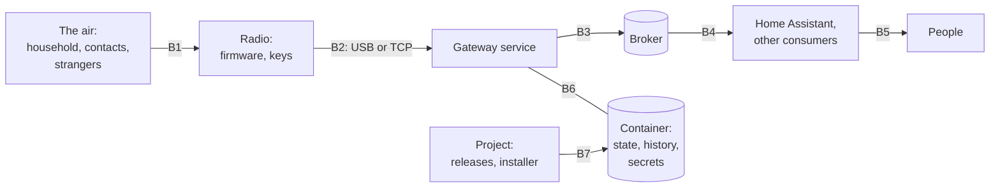

# Threat model

What the gateway protects, from whom, and where it trusts what. [Design §7](design.md#7-security) is
the summary: the mitigations in a table, how commands are authorised and the risks that remain.
This document is the model behind them. It was first written after the security review of 2026-11
([issue #34](https://github.com/dkuenzel/meshcore-home-gateway/issues/34)), whose model it adopts
with the state after the fixes.

Keep it current: every decision record names the boundaries it touches
([template](decisions/template.md)), and a change that moves a boundary, adds an entry point or
weakens a control updates the boundary's section here in the same pull request.

## Assets

| | Asset | Why it matters | Where it lives |
| --- | --- | --- | --- |
| A1 | The command path into the home | An accepted `command` event runs whatever automation the household attached: locks, alarms, heating | the `command` topic, Home Assistant's automations |
| A2 | The alert path out of the home | Alerts must arrive when the internet is down; a false `confirmed` is worse than a reported failure | the outbox, `delivery` events, the air |
| A3 | Positions of the household's people | Presence automations act on them; they are personal data and they persist | retained `contacts/<key>`, Home Assistant's recorder, the history, `state.json` |
| A4 | Message texts, and who writes to whom | The household's own messages, and the neighbourhood's on public channels | `received`, `history`, the history database |
| A5 | The radio's identity, its private key | Whoever holds it is the gateway to every contact and reads every direct message to it | the radio's flash |
| A6 | The radio's contact table and settings | They decide what the radio decrypts, whom it answers, whether it shows a position, how much it sends | the radio's flash |
| A7 | Airtime | The operator answers for the radio's transmissions; the channel is shared | the budgets, the radio's airtime factor |
| A8 | The broker and the gateway's login | The broker is the home's bus | `mqtt-password`, the broker |
| A9 | The container and the Proxmox host | A foothold in the home network | the container, the host the installer runs on |
| A10 | What users install | A release reaches a machine that controls a transmitter and a home | releases, the installer, the workflows |
| A11 | The gateway being there | Alerts and presence stop with it | the service, its state, the watchdog |
| A12 | Trust in the documents | Automations act on `contacts/<key>`, `command` and `telemetry` without further checks ([ADR 0015](decisions/0015-provider-neutral-documents-on-the-bus.md)) | the broker's retained topics |

## Actors

| | Actor | What they can do | What stands in the way |
| --- | --- | --- | --- |
| T1 | A stranger in radio range | Send any packet: adverts under any name and any key of their own, channel messages, acknowledgements and paths in the clear; read what is in the clear; jam | The firmware decrypts direct messages only from contacts; floods are bounded (B1); acknowledgements prove little ([what `confirmed` proves](mqtt-api.md#what-confirmed-proves)) |
| T2 | A stranger with a 6-byte key prefix collision | Pose as an allowed sender's prefix, after about 2⁴⁸ key generations ([residual risks](#residual-risks)) | The look-alike memory ([design §7.3](design.md#73-command-authorisation-in-detail)); codes ([configuration](configuration.md#commands)) |
| T3 | A contact of the radio outside the household | Direct messages the radio decrypts, telemetry answers, adverts | Commands need the allowlist; telemetry asks only the household with `ask = "household"` ([ADR 0029](decisions/0029-what-a-contact-is-trusted-with.md)); rate limits per sender |
| T4 | Whoever holds an allowed sender's handheld or key | Send accepted commands | Codes, a second factor on a phone; a small word list; automations that confirm |
| T5 | A host on the radio's network (TCP) | Be the radio, or a second client of it: read and write everything, export the private key | USB is the default; TCP needs `tcp_unauthenticated = true`; a contested link is reported; codes ([design §7.4](design.md#74-residual-risks)) |
| T6 | A broker client other than the gateway | Publish and read what the broker's ACL allows: forge events and documents, send messages, manage contacts | The ACL ([securing the broker](mqtt-api.md#securing-the-broker)); warnings and refusals for a broker without login or TLS; forged documents restored |
| T7 | A Home Assistant user who is not an administrator | Every entity of the gateway: send, add and remove contacts, switch telemetry, see positions and messages | `[homeassistant] controls = false`, `hidden_targets` ([Home Assistant](home-assistant.md)) |
| T8 | Home Assistant's administrator or host | All of T7, automations, the recorder | Not an attacker of the gateway; a victim of what reaches Home Assistant |
| T9 | A process in the container as the service user | The state directory, the radio's device, the login in memory | The systemd sandbox; the password as a credential root alone may read ([deployment](deployment.md#4-operations)) |
| T10 | Root in the container, the Proxmox host | Everything | Not an attacker of the gateway |
| T11 | The supply chain | Ship code to every installation with the next update | Hash-pinned tools, pinned actions, attested and reproducible releases, immutable releases, a protected tag ([SECURITY.md](../SECURITY.md)) |
| T12 | The operator, by mistake | A wrong clock, ACL or backup, a copied configuration | Checks that refuse or warn: `check-config`, `doctor`, the clock bounds, the confirmations of the installer |

## Trust boundaries



### B1: the air and the radio's firmware

**What crosses:** every packet in range. **Trusted:** the firmware's checks: adverts are signed and
must be newer than the stored one; direct messages decrypt only with a contact's shared secret;
channel messages with the channel's secret (the *Public* one is in every firmware). **Not
trusted:** names (anyone chooses one), acknowledgements (a 4-byte code in the clear), the packet
log (logged before any check), channel senders (the name is text).

**Controls:** commands come only from direct messages of allowlisted full keys
([ADR 0009](decisions/0009-inbound-commands-from-allowlisted-contacts.md)), with codes as a second
factor; names are compared as people read them and a taken name is marked; floods of adverts,
messages and malformed frames are bounded per sender and channel; a forged acknowledgement is made
unguessable by `confirm_nonce` and caught by `suspect` where the path allows; positions in adverts
are checked from the packet log only under the radio's own rules
([ADR 0025](decisions/0025-positions-in-adverts-checked-from-the-packet-log.md)); the gateway's own
adverts never carry a position.

**Remains:** jamming; a contact that keeps the radio busy (the radio acknowledges before the
gateway sees the message); acknowledgements the firmware does not authenticate.

### B2: the radio and the gateway

**What crosses:** the companion protocol's frames, unauthenticated and unsigned. **Trusted:** the
radio is the gateway's only source of truth about the mesh. **Not trusted:** the content of
frames (the decoder is strict and total) and, over TCP, that the other end is the radio.

**Controls:** USB by default; TCP only with `tcp_unauthenticated = true`, a warning everywhere it
is set up and the contested link reported (`radio_link_contested`); the clock is written only
within plausible bounds; codes authenticate commands whatever frames arrive.

**Remains:** over TCP a host on the radio's network can export the private key and act as the
radio; a second client of the radio can change its table unseen ([design §7.4](design.md#74-residual-risks)).

### B3: the gateway and the broker

**What crosses:** requests in, events and documents out. **Trusted:** the broker's ACL decides who
may write the gateway's topics; the gateway has no notion of a sender on the bus. **Not trusted:**
the content of requests (sizes, targets and keys are checked) and anything another client writes
on the gateway's own topics.

**Controls:** a login and TLS are expected (warnings, the anonymous probe of
`check-config --broker` and `doctor`, commands refused over an open broker without
`insecure = true`); forged retained documents are restored; a random client id per start; only
configured targets and known contacts receive; rate limits, a bounded queue, the airtime budget.
MQTT 5's user properties name the publisher but prove nothing ([mqtt-api](mqtt-api.md#mqtt-5)).

**Remains:** a client the ACL allows to write `command` triggers automations; a forged document
shows until it is restored, and while the gateway is offline as long as the forger likes. With
`[homie] enabled`, a second connection publishes the Homie device and takes texts on
`homie/<device>/<key>/send/set` as on `contacts/<key>/send` ([mqtt-api](mqtt-api.md#homie-homiehomie_device));
what another client writes on the device's topics is not restored, so only the ACL keeps its
values true.

### B4: the broker and Home Assistant

**What crosses:** discovery documents (templates the gateway wrote) and documents (data the mesh
wrote). **Trusted:** the templates. **Not trusted:** names and texts from the mesh, which are
data: never markup, never templates ([text from the mesh](development.md#text-from-the-mesh-and-the-bus)).

**Controls:** cards escape mesh text; device names of the same name carry key digits; labels show
key digits.

### B5: Home Assistant and its users

**What crosses:** every entity to every user. **Trusted:** Home Assistant's users are the
household. **Not trusted:** that every user should act on the radio.

**Controls:** controls that can be switched off, targets that can be hidden; the guide explains
Home Assistant's user model ([shared households](home-assistant.md#shared-households)).

### B6: the service, the container and the host

**What crosses:** the device node, the state directory, the configuration and secrets. **Trusted:**
root of the container and the host. **Not trusted:** the service itself, which runs as its own
user in a tight systemd sandbox.

**Controls:** the state directory 0700; the configuration 0640; the broker password and the code
secrets in files of their own, also as systemd credentials; backups without secrets unless asked;
automatic security updates in the container ([deployment](deployment.md#4-operations)).

### B7: the project and its users

**What crosses:** releases, the installer, the documentation. **Trusted:** the maintainer's
account and GitHub. **Not trusted:** a download that is not the attested one.

**Controls:** releases built twice and attested; immutable releases and a protected tag; the
installer pins the digests of what it fetches; code owners and a reviewer's checklist; the agent's
inputs named ([SECURITY.md](../SECURITY.md), [development.md](development.md)).

**Remains:** one maintainer reviews the agent's pull requests; required reviews and a second
identity are the maintainer's to set up.

## What attackers would want

Each leaf names what stands in the way now.

```text
Run an automation in the home (A1)
├─ a command from a direct message
│  ├─ hold an allowed sender's key (T4) ............... codes; confirming automations
│  ├─ a look-alike the household added (T2) ........... look-alike memory; codes
│  ├─ replay a recorded command ....................... timestamp ledger; repeat memory; codes serve once
│  └─ be the radio over TCP (T5) ...................... USB; codes
├─ publish a `command` event (T6) ..................... the ACL; no commands over an open broker
└─ a forged position for a presence automation (T6) ... the ACL; restored documents

Make the household believe an alert arrived (A2)
├─ forge the acknowledgement (T1) ..................... confirm_nonce; suspect; an answer as proof
├─ be the radio over TCP (T5) ......................... USB
└─ publish a `delivery` event (T6) .................... the ACL

Learn where someone is (A3)
├─ read the broker or Home Assistant (T6, T7) ......... the ACL, TLS; controls and recorder settings
├─ read the state or the history (T9) ................. the sandbox, 0700
├─ positions in the companion's adverts (T1) .......... the advert check warns
└─ ask the companion yourself (T1, T3) ................ the companion's own settings

Take over the radio (A5, A6)
├─ its TCP port (T5) .................................. USB; tcp_unauthenticated; contested link
└─ make it add a contact over the air (T1) ............ the managed profile adds contacts by hand

Deny alerts or presence (A2, A3, A11)
├─ jam (T1) ........................................... none
├─ flood adverts or messages (T1, T3) ................. bounds per node, sender and channel
├─ keep the radio busy with direct messages (T3) ...... remove the contact; see below
├─ spend airtime on answers to replays (T1) ........... reply off by default; repeat memory; rate limits; budget
├─ take the client id, clear documents (T6) ........... random id; the ACL; restored documents
└─ push the radio's clock ahead (T12) ................. clock bounds; the offset in `state`
```

## Residual risks

The full list is [design §7.4](design.md#74-residual-risks). The ones this model weighs most:

* **A contact can keep the radio busy.** The radio acknowledges every direct message before the
  gateway sees it, and its own transmit limit then delays everything else it sends, alerts
  included. The gateway bounds what such messages produce, not what the radio spends (SEC-013);
  remove a contact that floods.
* **A 6-byte prefix collision costs money, not genius.** About 2⁴⁸ ≈ 2.8 × 10¹⁴ Ed25519 key
  generations: some 180 years of one CPU core, months of one GPU, days for a hundred GPUs; a few
  thousand to a few tens of thousands of euros at 2026 cloud prices. A look-alike still has to be
  added by the household, and blocks rather than commands a sender with a code secret.
* **Acknowledgements are the firmware's weakness.** Only an acknowledgement authenticated with the
  secret the radios share would make `confirmed` a proof; that is for the MeshCore project.
* **The broker's ACL is the only guard of the bus.** The gateway warns about an open broker and
  restores its documents; it cannot tell a forged event from its own.

## Assumptions

1. The radio's firmware is trusted; its interfaces (TCP, the key export, the clock) are the
   gateway's concern because the gateway recommends and automates them.
2. The operator secures the broker; the gateway checks and warns, and refuses commands over an
   open one unless told.
3. Only the gateway writes its topics; it restores what others write, and nothing it publishes
   proves its origin.
4. Home Assistant's users are the household; its controls can be switched off.
5. The host's clock is right; the radio's clock is written only within bounds.
6. The mesh is mostly benign; what it can produce is bounded per node, sender and channel.
7. The texts automations send need not be secret, but should not be predictable where
   `confirmed` matters (`confirm_nonce`).

Where the data goes and for how long: [privacy.md](privacy.md).
